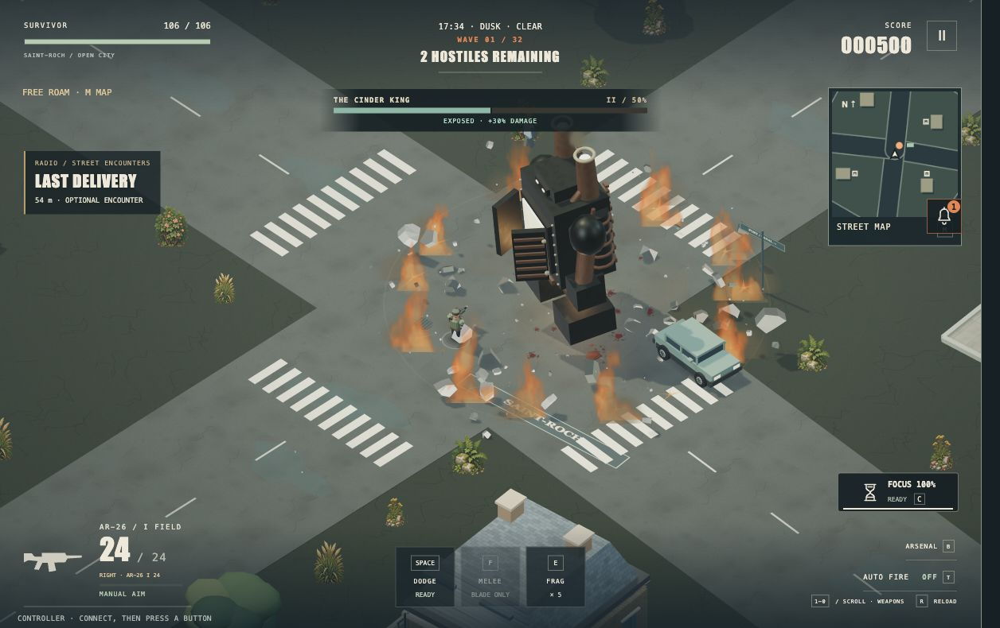
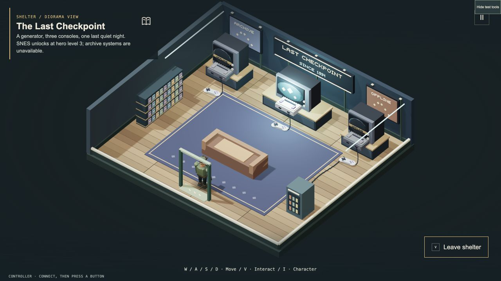
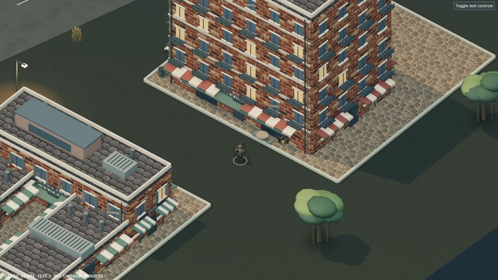
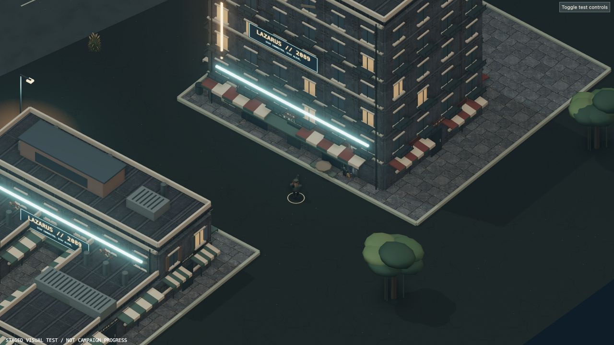
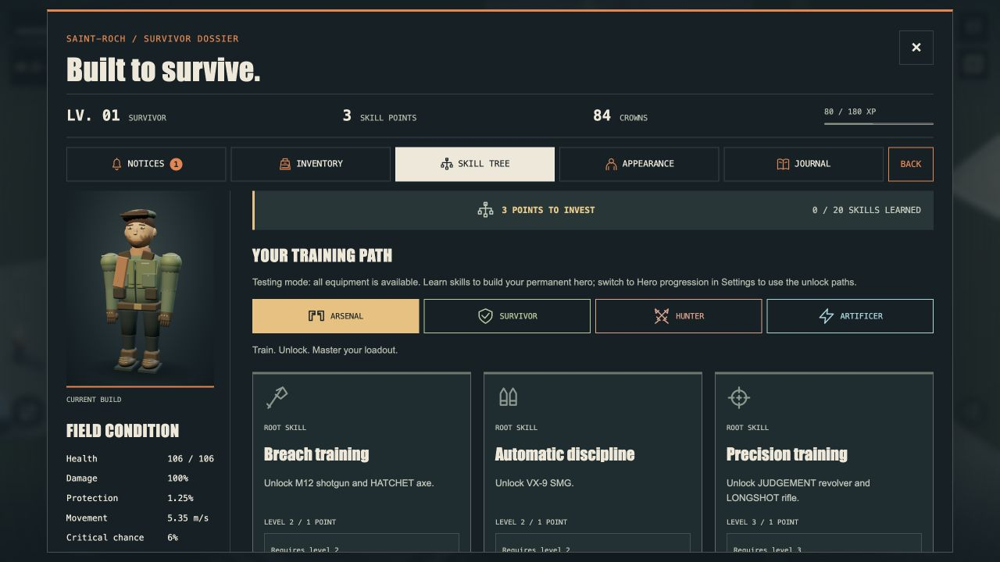
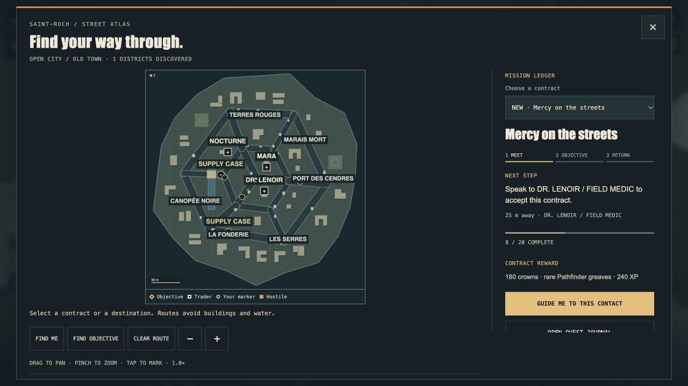
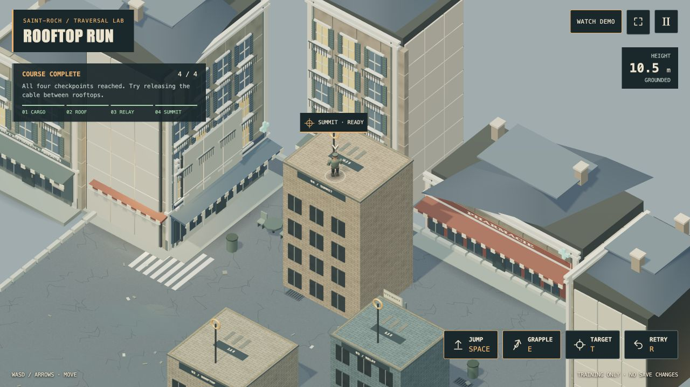
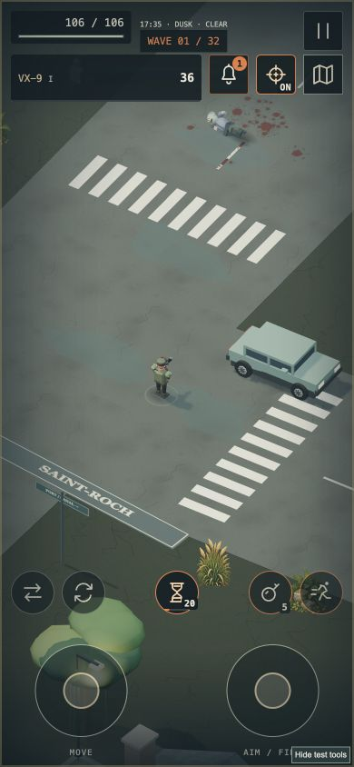
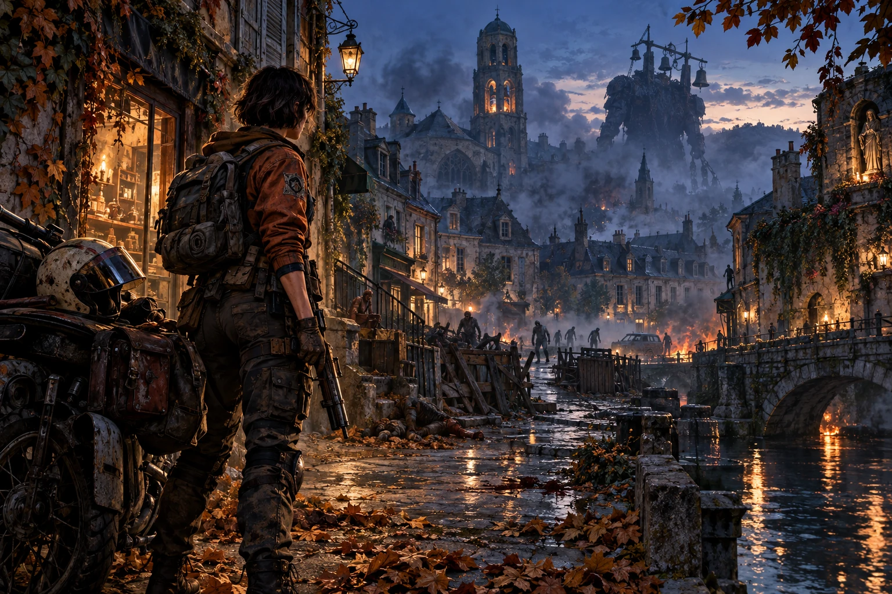
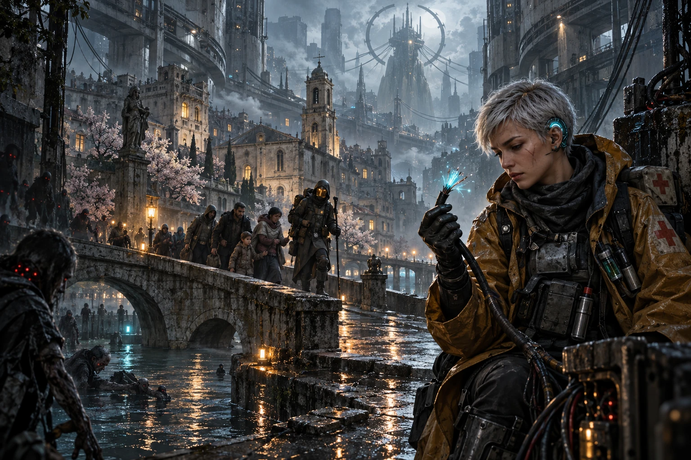

<div align="center">

# ZOMBIE BAGARRE

**QUARANTINE · 2.5D SURVIVAL ACTION**

*A little town. A lot of trouble.*

[](https://iamknow0ne.github.io/zombibagarre/)

[](https://github.com/iamknow0ne/zombibagarre/actions/workflows/pages.yml)
[](docs/RELEASE-4.49.6.md)

[](package.json)
[](#controls)

**[Screenshots](#screenshots) · [The game](#the-game) · [Worlds & artwork](#worlds--artwork) · [Run locally](#run-locally)**

No installation. No account. Single player. Share the Play link with your friends.

</div>



<p align="center"><sub>The Cinder King, phase II. Actual v4.36 game rendering, staged in the development encounter workshop.</sub></p>

Explore a ruined town on foot or behind the wheel. Pair two guns, master a blade, slow time and build a survivor who gets stronger between expeditions. Survive **32 waves**, defeat the Wardens and reach extraction.

## Maintenance roofs · 4.49

Find **Rooftop access → Maintenance roof** on the city map, follow the street route and grapple up. The roof, parapets and ventilation unit have matching solid collision. Enemies can attack the supporting building; its collapse removes the roof and anchor. [Actual captures, validation and limits](docs/RELEASE-4.49.1.md).

## Survivor and infected visual pass · 4.48

Refined survivor clothing and proportions, articulated footwork and six rebuilt enemy silhouettes. The live cast remains stylized procedural art; the more detailed Rook model is still a separate development study. **553 regression tests pass**, with rendered rifle/melee checks and Mac hardware startup. [Actual captures, changes and limits](docs/RELEASE-4.48.md). The [4.48.1 patch](docs/RELEASE-4.48.1.md) fixes corpse geometry cleanup and jump/landing foot angles; all 559 regression tests pass. The [4.48.2 patch](docs/RELEASE-4.48.2.md) fixes platform-edge landings and reduces temporary allocations in building visibility rendering; 563 regression tests pass.

## A game inside the game

**The Last Checkpoint** is a hidden retro refuge in Open City. Follow the rumour
in the street atlas, walk up to the central CRT and play the first real SNES
cartridge. Unlock it at hero level 3, or use Testing mode.

[](https://iamknow0ne.github.io/zombibagarre/)

**[Try Night Shift directly](https://iamknow0ne.github.io/zombibagarre/retro/play.html)** ·
**[Download the SNES ROM](https://iamknow0ne.github.io/zombibagarre/retro/zombie-bagarre.sfc)** ·
[ROM source and build instructions](demakes/snes/README.md)

A first playable homebrew: one city block, escalating zombie waves, two guns,
grenades and a dash. Future consoles are dormant exhibits. Physical SNES hardware
is not yet validated. [Milestone details and QA](docs/RELEASE-4.47.md).

## Screenshots

<table>
<tr>
<td width="50%"><a href="docs/screenshots/sharp-diorama-429.png"></a><br><b>Saint-Roch, up close</b><br><sub>Sharp Pixel Diorama materials and layered street dressing.</sub></td>
<td width="50%"><a href="docs/screenshots/blackout-diorama-429.png"></a><br><b>Blackout / 2089</b><br><sub>A switchable cyberpunk world treatment.</sub></td>
</tr>
<tr>
<td><a href="docs/screenshots/readme-skill-tree-4.36.jpg"></a><br><b>Build your survivor</b><br><sub>Twenty skills, four branches and permanent character progression.</sub></td>
<td><a href="docs/screenshots/readme-city-atlas-4.36.jpg"></a><br><b>Find your next lead</b><br><sub>Procedural city plans, traders, contracts and walking routes.</sub></td>
</tr>
</table>

<sub>All images above are captured from the running game. The two city close-ups use staged art-inspection scenes. Click any gallery image for the full-size capture.</sub>


## Take the high road

**New in 4.46:** Travel from Saint-Roch to **Old Mill Road**, recover guarded medicine and return to Lenoir. Damaged buildings, loot, ammunition and city waves persist across visits during the same expedition. Find the footpath in the map directory; travel on foot. [Release details and limits](docs/RELEASE-4.46.md).

**Controls in 4.45:** Remap action keys in **Settings → Keyboard & mouse**, with conflict warnings and reset controls. Settings now have focused submenus and compact phone navigation. Custom keys follow your save and appear in HUD hints. [Release details](docs/RELEASE-4.45.md). The [4.45.1 patch](docs/RELEASE-4.45.1.md) corrects perspective aiming after camera turns and releases temporary avatar-fade materials.

**[Play Rooftop Training →](https://iamknow0ne.github.io/zombibagarre/traversal.html)** · [Controls and scope](docs/TRAVERSAL.md)

Jump onto cargo, grapple between roofs, release the cable in mid-air and reach a 10.5 m summit. **Watch Demo** shows the route using the actual movement physics. Training is separate from expeditions and never changes your character save.

[](https://iamknow0ne.github.io/zombibagarre/traversal.html)

## The game

| Explore | Fight | Grow |
| :--- | :--- | :--- |
| **Open City** with four seeded street-network families, varied building shapes, parks, canals and bridges. | **13 weapons:** eight firearms and five melee families. Pair any two guns or commit to a melee stance. | **Permanent survivors** with levels, stats, armour, cosmetic customization and a 20-skill tree. |
| **Eight biomes** in the separate campaign: French quarter, docks, gardens, factories, jungle, mountains, badlands and marsh. | **Focus bullet time**, shooting dives, critical hits, elemental synergies and four throwable types. | **32 upgrade families**, four rarity tiers and four weapon evolution stages per expedition. |
| **Eight vehicle types**, street encounters, shops, contracts, hidden guardians and relic weapons. | **Eight boss encounters** with distinct attacks, second phases, giants and a paired fight. | **Fresh expeditions:** keep your character and discovered gear; rebuild your run with new choices. |

Buildings take bullet scars, lose windows and walls, then collapse into material-specific debris. Fire spreads, rain quenches exposed flames, water reacts to impacts, and snow changes traction. A day/night cycle changes the streets and unlocks night-only contracts.

**Choose your progression:** the title screen defaults to **Testing / All equipment** so you can try the arsenal immediately. Select **Hero / Earn your arsenal** for weapon and dual-wield unlock paths. Both modes retain character progression in the current browser.

<details>
<summary><b>See the arsenal and evolution path</b></summary>

| Firearms | Melee | Throwables |
| :--- | :--- | :--- |
| AR-26 · assault carbine | RONIN · katana | FRAG · fragmentation |
| M12 · breach shotgun | GEMINI · twin swords | WILDFIRE · fire bottle |
| VX-9 · compact SMG | HATCHET · execution axe | WHITEOUT · frost canister |
| JUDGEMENT · heavy revolver | PILGRIM · war spear | BLACKOUT · shock charge |
| LONGSHOT · piercing rifle | GRAVEMAKER · demolition hammer | |
| CINDER · flamethrower | | |
| THUMPER · grenade launcher | | |
| VOLTA · arc projector | | |

**Field → Modified → Elite → Signature.** Deal damage to earn mastery, change the weapon's appearance and unlock stronger effects. Two guns have independent magazines; melee replaces both firearms. Throwables share one supply pool.

[Weapon design](docs/ARSENAL-4.22.md) · [Skill progression](docs/PROGRESSION-4.23.md) · [Focus mechanics](docs/BULLET-TIME-4.35.md)

</details>

## Controls

| Action | Keyboard & mouse | Default PlayStation layout |
| :--- | :--- | :--- |
| Move / aim | WASD or ZQSD / mouse | Left stick / right stick |
| Fire | Hold left mouse button | R3 right hand / L2 left hand¹ |
| Dodge / throw | Space / E | Cross / L1 |
| Focus bullet time | C | Circle |
| Reload / interact | R / V | Square / Triangle |
| Select weapons | B opens Arsenal; mouse wheel cycles right hand | D-pad Left / Right: tap to cycle, hold for a weapon wheel |
| Auto fire | T | L3 |
| Map / pause | M / Escape | Create or touchpad click / Options |

¹ Prefer conventional triggers? Choose the **L2 / R2 firing preset** in Settings. Controller bindings, stick response, driving style and vibration are configurable. [Controller setup, Steam Deck guidance and fullscreen](docs/CONTROLS-4.32.md) · [Weapon haptics and DualSense extras](docs/HAPTICS-4.34.md)

<table>
<tr>
<td width="32%" align="center"><a href="docs/screenshots/focus-mobile-4.35.png"></a></td>
<td valign="middle">
<h3>Made for thumbs, too.</h3>
<p>Move with the left stick; aim and fire with the right. Compact icon buttons keep dodge, ordnance, reload, weapon swapping and Focus within reach.</p>
<p>Drag the map, pinch to zoom and tap to mark. Character notices surface unspent skill points, equipment updates and ready rewards.</p>
<p>Settings include touch size, opacity, floating or fixed sticks and aim assist. Driving uses easy point-to-drive handling on touch.</p>
<p><a href="docs/MOBILE-4.33.md">Mobile controls &amp; notices →</a></p>
<sub>Phone-size browser capture from the touch QA scene.</sub>
</td>
</tr>
</table>

## Worlds & artwork

<table>
<tr>
<td width="50%"><a href="public/art/quarantine-key-art-v1.webp"></a><br><b>QUARANTINE / Saint-Roch</b><br><sub>Shuttered streets, broken bells and one more night to survive.</sub></td>
<td width="50%"><a href="public/art/blackout-key-art-v1.webp"></a><br><b>BLACKOUT / 2089</b><br><sub>The same fight beneath corporate signs and electric light.</sub></td>
</tr>
</table>

<sub>Original AI-generated world illustrations shown in the in-game World Dossier; these are artwork, not gameplay screenshots.</sub>

Meet **Rook, Saint, Torque and Vesper**, explore the factions, and read the Wardens' stories and tactics in the **World Dossier** from the title or pause menu. Classic and sharp Pixel Diorama styles, optional Retro pixels, shader treatments and independent detail settings let you tune the look.

[World art & lore](docs/art/WORLD-DOSSIER.md) · [Survivor & Warden portraits](docs/art/PORTRAITS-4.36.md) · [City sprite and texture atlases](docs/art/CITY-ASSETS.md)

## Previous field report · 4.40.0

**More room to fight on mobile.** Compact character tabs, reachable attribute spending, smaller upgrade panels and quieter combat notices. Full alerts remain in **Pause → Recent field messages**. The boss strip keeps the information without a second large box covering your survivor.

**Reliability fixes.** Matching-pair reloads keep the correct weapon state, ammo supplies refill holstered pairs, malformed profile/settings records recover safely, controller menus skip locked options, and unfinished street encounters keep working after wave 32 until you extract. [Audit, regression checks and remaining limits](docs/AUDIT-4.40.md).

**Beyond Saint-Roch?** A proposed path from enterable buildings and neighbouring cities to a hidden hangar, a launch into orbit and a first explorable moon. This is a future design proposal, not a shipped feature. [Read the expansion plan](docs/BEYOND-THE-QUARANTINE.md).

### Previous camera and visibility update · 4.39

**Keep your survivor in sight.** Rooftop Training now shares the city’s building visibility effect. A wider, softly feathered opening follows the full body behind walls and around corners; the roof beneath your feet stays solid. [Visibility fixes and checks](docs/VISIBILITY-4.39.1.md).

**Get closer to the fight.** TPS/FPS now have precision aiming, a steadier shoulder camera, cover-aware camera retraction and adjustable field of view, sensitivity, shoulder and motion. First-person weapons stay visible near cover. Braced aiming, blended turns and seven-pose melee strokes improve movement and recovery.

**Your level of gore.** A new **0–10 slider** controls blood spray, wall and ground stains, persistence and fragments. **4 matches the original intensity**; 0 removes blood and dismemberment. Rendering budgets remain capped at every level, and combat damage is unchanged.

[Camera controls, verification and limitations](docs/PERSPECTIVE-4.39.md) · [Try Rooftop Training](https://iamknow0ne.github.io/zombibagarre/traversal.html) · [Previous performance and artwork report](docs/RELEASE-4.36.md)

## Weight, impact and stability · 4.42

Grenades rebound off walls, fire bottles ignite the facade they hit, and water catches and quenches thrown ordnance. Vehicle entry/exit respects walls and water. The chase camera stays above the street, and the crowded HUD keeps active effects clear of navigation.

Rendering updates transfer only active enemy, rubble and weather data. **530 regression tests pass**, with browser effects checks and a bounded collapse stress run. [Changes, measurements and QA limits](docs/RELEASE-4.45.md) · [Continuing work](docs/NEXT-PASS.md).

## macOS test app and portable saves

**[Download the Apple Silicon macOS test edition →](https://github.com/iamknow0ne/zombibagarre/releases/tag/v4.49.6)** · macOS 13+

**Your survivor can travel with you.** Settings → Your save now exports and restores character progression, equipment, base camp and settings. Restore previews the incoming character and keeps a recovery copy. Storage problems are visible rather than silently discarding progress.

The Apple Silicon macOS app runs offline with GPU acceleration, native menus and backup-file dialogs. This is an ad-hoc signed, unnotarized test edition; a downloaded app may be blocked by Gatekeeper. [Mac installation and local-build guide](docs/MACOS.md) · [Release details and QA](docs/RELEASE-4.49.6.md).

## Install on Steam Deck

**[Download the offline Linux test edition →](https://github.com/iamknow0ne/zombibagarre/releases/tag/v4.40.1)**

**Startup investigation:** a Deck LCD launch failure was reported in both Desktop and Gaming Mode. v4.40.1 includes startup recovery changes and saved error logs; confirmation on the affected device is still needed. [Troubleshooting and logs](docs/STEAM-DECK.md#saves-updates--troubleshooting).

Extract the archive in Desktop Mode, run **Install Zombie Bagarre.sh**, then add **Zombie Bagarre** through Steam’s **Add a Non-Steam Game** menu. Return to Gaming Mode and play without a browser or internet connection. Native Linux; no Proton required.

The LCD preset starts at native resolution with a 60 FPS cap, independent LT/RT firing, configurable graphics profiles, suspend handling and a controller-accessible Quit button. Hardware performance and rumble still need testing on the actual Deck. [Installation, controls and tuning guide](docs/STEAM-DECK.md).

## Run locally

Use **Node.js 22** (the version used by CI) and npm.

```sh
git clone https://github.com/iamknow0ne/zombibagarre.git
cd zombibagarre
npm ci
npm run dev
```

Open the local URL printed by Vite, normally [localhost:3000](http://127.0.0.1:3000/). A modern browser with WebGL is required.

```sh
npm test                              # Automated regression suite
npm run test:campaign                 # Full campaign, all difficulties
npm run test:campaign -- standard city # Open-city completion simulation
npm run build                        # Production site in dist/
npm run preview                      # Serve the production build locally
```

Development-only workshops such as `/dev/visual-qa.html`, `/dev/boss-qa.html` and `/dev/touch-qa.html` exercise the actual game without writing player progress. They are excluded from the published build.

<details>
<summary><b>Project structure & publishing</b></summary>

| Location | Responsibility |
| :--- | :--- |
| `src/main.js` | Menus, HUD and application flow |
| `src/rebuild/Simulation.js` | Combat and gameplay simulation |
| `src/rebuild/City.js`, `Map.js` | Seeded city and biome plans |
| `src/rebuild/World.js`, `Effects.js` | World rendering, destruction and effects |
| `src/rebuild/Atlas.js` | Street map and navigation |
| `src/rebuild/Input.js`, `Audio.js` | Controls and synthesized audio |
| `public/art/` | Delivered illustrations, materials and sprites |
| `tests/`, `docs/` | Regression coverage, design notes and QA evidence |

[GitHub Actions](.github/workflows/pages.yml) runs a clean install, tests and build on every push to `main`, then deploys `dist/` to GitHub Pages. Pull requests run the same checks without deploying. Pages must use **GitHub Actions** as its source. Relative asset URLs support the `/zombibagarre/` project path.

The former implementation is retained in `src/legacy-main.js` and `legacy-3d.html`; the main page uses the rebuilt game.

</details>

<details>
<summary><b>Current scope & compatibility</b></summary>

- Single-player, finite generated worlds. No multiplayer, cloud saves or mid-expedition save/resume. Progress is stored locally per browser/origin or desktop app; portable backups transfer permanent progress between them.
- Diorama is the primary camera. FPS/TPS remain experimental. Jumping and grappling are playable in **Rooftop Training**; city combat and enemy navigation remain on the ground.
- Destruction uses bounded debris physics and staged structural damage. It is not a structural-engineering or fluid solver.
- Touch and controller flows have browser QA and regression coverage. Physical-phone, Steam Deck and direct DualSense USB/Bluetooth validation remain separate hardware checks. Optional WebHID trigger effects require a compatible browser; standard play does not require WebHID.
- Gore, combat labels, quest guidance, motion and graphics detail are configurable in Settings.

</details>

[Platform & demake roadmap](docs/PLATFORM-ROADMAP.md) · [Detailed development history](docs/DEVELOPMENT-HISTORY.md) · [Boss design](docs/BOSS-DESIGN.md) · [Living-world rules](docs/LIVING-WORLD-4.31.md) · [Report a bug](https://github.com/iamknow0ne/zombibagarre/issues)

---

<div align="center">

**The streets are gone. The fight isn't.**

### [Enter the quarantine →](https://iamknow0ne.github.io/zombibagarre/)

</div>
