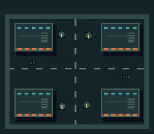

# Zombie Bagarre: Night Shift — SNES prototype

An original, playable 256 KiB LoROM cartridge built with **PVSnesLib 4.6.0**. This is the first small demake: survive waves in a dusk city block, switch between pistol and shotgun, hold your aim while strafing, dash through the horde and use emergency grenades. New waves restore one health pip and one grenade.



## Play

Open `public/retro/zombie-bagarre.sfc` in a compatible SNES emulator, or use the game's Retro Room. This cartridge contains its own original game code and graphics; no commercial game dump or BIOS file is an input.

| SNES control | Action |
| --- | --- |
| Start | Begin, pause/resume, restart after death |
| D-pad | Move and face a direction |
| Y or B (hold) | Fire; gentle aim assist toward enemies ahead |
| L (hold) | Keep your aim direction while moving |
| R | Switch pistol / shotgun |
| A | Grenade burst; limited supply |
| X | Directional dash; short invulnerability and cooldown |

## Rebuild

Requirements: Python 3.9+, GNU Make; Apple Silicon macOS or x86_64 Linux. From the repository root:

```sh
python3 scripts/snes-build.py
```

The script downloads the official 4.6.0 compiler archive into an OS temporary cache, verifies its SHA-256, creates the original tile/palette/BRR assets, builds a clean cartridge, then copies the cartridge and a checksum manifest to `public/retro/`. Set `SNES_SDK_CACHE` to retain the SDK in another directory. No toolchain binary is committed to the project.

The compiler archive hashes are pinned in the build script and verified against GitHub release asset metadata. On macOS the script uses the Command Line Tools copy of Make, avoiding an unrelated Xcode license prompt.

For an already installed SDK:

```sh
python3 demakes/snes/generate_assets.py
PVSNESLIB_HOME=/path/to/pvsneslib make -C demakes/snes
```

This writes `demakes/snes/zombie-bagarre.sfc`; the automated builder also publishes it to the web assets.

## Current scope and limits

- One original city block; fixed collision geometry and four spawn routes.
- 14 enemy slots, 12 projectile slots, 8 hit/explosion slots; fixed-size pools.
- 230 deduplicated background tiles; 19 original survivor/zombie/effect frames.
- Original synthetic BRR gunshot, no commercial sample material.
- No save file, quests, vehicle driving, inventory or boss encounter yet.
- Cartridge structure/build checks are separate from emulator interaction QA. Real SNES hardware has **not** been tested.
- This is a dedicated SNES game, not the JavaScript game in an emulator or an automatic port.

## Credits and resource provenance

The SNES gameplay source, pixel patterns and sound generator were created for Zombie Bagarre. `generate_assets.py` uses only the Python standard library; source patterns are the editable master assets. The small preview images are generated from the same indexed pixels written to the ROM.

PVSnesLib by Alekmaul and contributors provides startup, PPU/input and audio support. See [PVSNESLIB-LICENSE.txt](PVSNESLIB-LICENSE.txt) for the bundled library notice. The exact notice in the 4.6.0 archive is retained rather than replacing it with a repository metadata license label. Tools and runtime components retain their upstream licenses; the compiler is obtained from the original release.

Primary resources: [PVSnesLib 4.6.0](https://github.com/alekmaul/pvsneslib/releases/tag/4.6.0), [sprite API](https://alekmaul.github.io/pvsneslib/sprite_8h.html), [background API](https://alekmaul.github.io/pvsneslib/background_8h.html), [sound API](https://alekmaul.github.io/pvsneslib/sound_8h.html).
