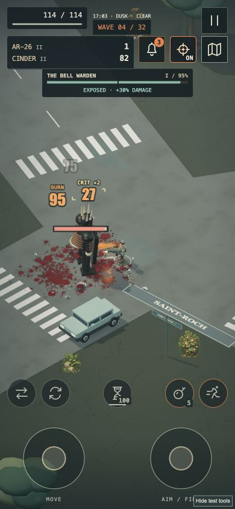

# Reliability and mobile audit · 4.40.0

13 October 2026. This pass reviews the current web game and its integration boundaries. It does not certify every device or declare the game bug-free. Native platform work is deferred; the existing Steam Deck download is still a separate release.

## Fixed defects

| Finding | Reproduction / impact | Fix |
| --- | --- | --- |
| A holstered twin reload finished on the wrong gun | Empty and reload a matching off-hand carbine, then equip a shotgun. The old reload emitted a shotgun completion and could grant reload healing. | Suspend the matching pair's off-hand state in its own reserve; clear the shared active slot; only advance it for an active matching pair. Restoring the pair resumes its own reload. |
| Supplies missed holstered twin magazines | Collect ammo while the matching pair is unequipped, then restore it. The stored off-hand remained empty or reloading. | Refill stored twin magazines and cancel their stale reloads and durations. |
| Malformed skill records prevented startup | A saved object instead of an array in `skills` could throw when normalization called `includes`. Strings could accidentally grant skills. | Require a real array; filter known skill IDs and owned equipment/relic identifiers; reject inherited object-property names. |
| Valid JSON could still break Rooftop Training | Saved settings containing `null` passed JSON parsing, then failed during property access. | Shared object-only storage reader for both entry points; invalid or inaccessible data falls back without writing over the original during recovery. |
| Controller selects entered disabled options | Menu navigation assigned the next option index directly, including locked weapons. | Skip disabled, hidden and disabled-group options; preserve the selection when no valid next choice exists. |
| Street contracts froze after the final wave | Remaining street encounters could not activate or advance while the survivor explored in the extraction state. | Continue street encounters before extraction; pause still freezes them and rewards remain single-use. |
| Small-phone status overlap | At 320px, the clock and wave block intruded on the health panel. | Move the portrait status block slightly right. |

New regressions are in `tests/audit-regressions.test.js`, including all 13 weapon families through switching, firing, reload, supplies and pause/resume.

## Mobile changes

- Compact icon tabs with accessible names and descriptions; preserve at least 44px targets.
- Remove the large character portrait from Skills, Journal, Notices and Trade on phones. Keep it where choosing an outfit needs the preview.
- Put Core Attributes before the skill branches and open it for a fresh level-one hero. Preserve the disclosure choice while allocating points.
- Tighten dialog headers, upgrade cards, setting rows and spacing. Body copy stays readable instead of scaling the whole interface down.
- Show one smaller progression notice above the survivor on mobile.
- Remove the redundant central boss-introduction box on touch layouts while keeping the dedicated boss strip and attack labels.
- Shorten combat alerts to their headline. Full messages remain available in **Pause → Recent field messages**; keep six deduplicated entries per expedition.
- Position alerts below the boss strip, including safe-area offsets, rather than clipping longer text.

The design keeps the existing charcoal, bone and amber field-kit style. Smaller panels and progressively disclosed information leave combat visible; joystick and action targets remain large. Tradeoff: icon-only character tabs require learning the symbols, so their accessible names and desktop hover titles remain present. On very short screens, dialogs intentionally scroll rather than shrinking controls below usable sizes.

The screenshot is from the local scripted touch workshop, with invulnerability enabled. It demonstrates layout, not phone hardware performance or combat difficulty.

## Verification

The baseline suite passed **308 tests** before fixes. The final suite passes **316 / 316 tests**, including eight added regressions. The production build succeeds, with the existing Three.js chunk-size advisory. `git diff --check` passes.

Deterministic campaign simulations on the starting revision completed all 32 waves:

| Route | Result | Simulated seconds | Kills | Final health |
| --- | --- | ---: | ---: | ---: |
| Biome campaign / Relaxed | Victory | 1225.8 | 1556 | 130 |
| Biome campaign / Standard | Victory | 1316.5 | 1594 | 259 |
| Biome campaign / Nightmare | Victory | 1263.8 | 1580 | 100 |
| Open City / Standard | Victory | 1052.7 | 1608 | 208 |

These are seeded bot routes using `scripts/campaign-check.mjs`; they establish a completion path, not that every build is equally strong or that human difficulty is balanced. The new extraction regression specifically exercises the post-wave contract fix, which the direct extraction bot route does not cover.

After the final gameplay changes, the Standard Open City simulation was repeated: victory at wave 32, 1052.7 simulated seconds, 1608 kills and 208 health. Its outcome remained unchanged.

Browser checks use the actual UI and `dev/touch-qa.html`: portrait, small-phone and landscape layouts; skill allocation; journal navigation; map tracking and return; upgrade selection and weapon evolution; pause and full message history; dodge with the stick held; cancelled touches. The scripted dodge travelled 5.30 world units while maintaining the held movement direction. Action buttons measured 48×48px, with auto-fire 44×44px in the portrait layout.

## Audit coverage and remaining limits

Production entry points are `src/main.js` and `src/traversal.js`, built by Vite. Review focused on save normalization, simulation transitions, reload ownership, progression/quest completion, controller menu navigation and touch rendering. Existing automated suites cover weapons, melee, throwables, effects, bosses, destruction, weather, generated cities, collision/navigation, vehicles, RPG rewards, saves, progression, Focus and traversal. Historical 2D/3D implementations outside those production entry points are not a second supported game and were not rewritten.

The codebase is functional but not yet an ideal foundation for a much larger world:

1. **Shared UI ownership:** the main HUD, controller UI and touch UI write some of the same elements. Consolidate their presentation before adding more modes; a naive markup cache can leave the wrong input layout visible.
2. **Large, dense modules:** Simulation, World and the main event loop couple many mechanics. Extract state transitions and typed event contracts gradually, behind regression coverage. Avoid a wholesale rewrite during a reliability patch.
3. **Storage resilience:** recovery now prevents the reproduced crashes. Export/import, save migrations and a visible storage-failure warning are still needed before introducing persistent multi-region worlds.
4. **Performance evidence:** effect caps and scheduling have regression coverage; this pass does not establish new sustained-FPS or thermal numbers. The production build retains a Three.js chunk-size advisory. Measure on target hardware before claiming a speedup or raising detail budgets.
5. **Hardware validation:** real iPhone/Android multi-touch, safe-area behaviour, Steam Deck suspend, DualSense trigger feel and long sessions still require physical-device testing. Browser-sized views and scripted inputs are not substitutes.
6. **Feature boundaries:** TPS/FPS remain experimental, and verticality is still the separate Rooftop Training course. Enterable interiors, country travel and planets are future work, not silently advertised as shipped.

UI self-review: no new palette, gradients, decorative cards or ornamental motion; existing controls and information hierarchy determine the layout. Estimated generic-styling risk is low (1/5); product specificity is strong (4/5). These are qualitative design checks, not objective quality scores.

## Next work

Read [Beyond the quarantine](BEYOND-THE-QUARANTINE.md) for the proposed interior → country road → hidden hangar → orbit → first moon progression. Begin with one useful interior and a reliable travel/save boundary, then build the reveal as a small complete chapter.
