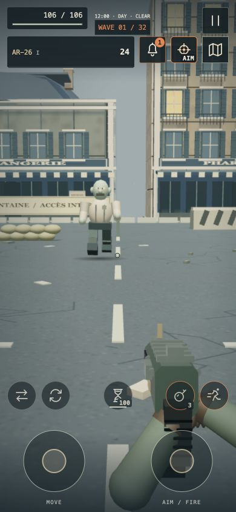
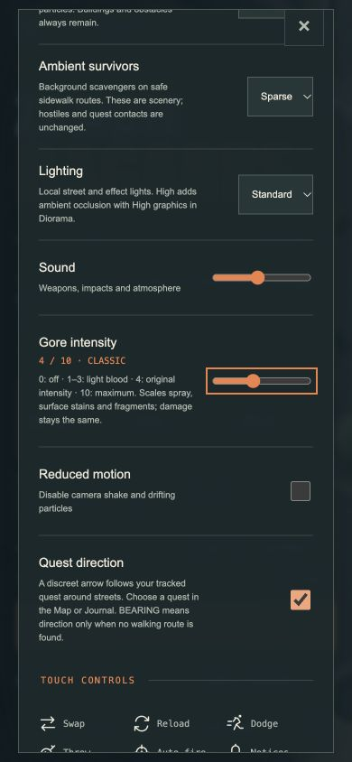

# Perspective combat & gore · 4.39

TPS and FPS remain experimental alternatives to the main Diorama camera. This update improves their controls and presentation while keeping the same combat simulation, weapon progression and saves.

## Try it

Open **Settings → Camera view** and choose Third person or First person.

| Action | Mouse / keyboard | Controller | Phone |
|---|---|---|---|
| Look | Click the game to capture the mouse; Esc releases it. Right-drag works when capture is unavailable. | Right stick | Right aim stick, which also attacks |
| Precision aim | Hold right mouse, or toggle X | D-pad Down by default; remappable as **Precision aim · TPS / FPS** | Target icon: HIP / AIM |
| Fire | Left mouse | Existing independent right/left weapon bindings | Right aim stick |
| Camera comfort | Settings: field of view, sensitivity, motion and shoulder | Same settings, accessible through controller menu navigation | Same settings |

Precision aiming narrows the view, reduces look sensitivity, lowers walking speed to 78% and reduces firearm spread to 55%. Marksman weapons get stronger magnification. This is a braced aiming view, not a simulated optical scope. Melee and driving do not use it. The usual auto-fire shortcut also toggles precision aim in perspective views; Diorama retains auto fire.

The chase camera queries nearby scenery through the existing spatial index, then checks a swept volume against live buildings, props and vehicles, retracts immediately at cover and eases back out. The avatar fades only when the camera is too close. Left/right shoulder selection is independent of the weapon loadout. FPS arms and weapons use a separate depth pass and pull back near a wall; bullets still collide with real cover.

## Animation changes

- Continuous direction blending for forward, backward and strafing transitions, without delaying movement input.
- Turning inertia in the torso and a braced aiming stance with shorter strides and reduced weapon sway.
- Seven interpolated melee poses: guard, weight shift, wind-up, contact, follow-through, recovery and settling. Damage/contact timing is preserved.
- First-person look sway and walking motion, adjustable down to zero; Reduced motion suppresses both.
- Existing weapon-specific recoil, four shot variations, reloads and two-arm grip solving remain active. FPS stocks no longer obscure the receiver; the marksman rear lens now has a rim and glass finish.

## Gore slider

**Settings → Gore intensity** applies immediately and is saved locally.

| Level | Presentation |
|---|---|
| 0 | No blood, stains, fragments or visible dismemberment |
| 1–3 | Increasing light blood; intact limbs |
| 4 | Original spray, stain size and persistence |
| 5–7 | Denser spray, larger stains and more tissue fragments |
| 8–10 | Exaggerated gore, with maximum spray at 2.5× the original |

Blood still projects onto walls and other hit surfaces, dries, follows attached objects, and disappears in water. At level 10 there are at most 180 active droplets, 222 stains and 56 detached fragments, in addition to the existing global effect cap. Lowering the slider clears old gore immediately; new hits use the chosen level. Damage, wound mechanics, rewards and simulation randomness are unchanged. Old enabled/disabled saves migrate to 4/0.

## Validation

- Full automated suite: **306 passing**. Seventeen focused camera/input tests also passed after the final nearby-obstacle optimization; production build passed.
- Browser: FPS headshot registered damage and a wall impact; precision magnification moved from 70° to 47.6° for the marksman. Gore 10 produced wall/ground stains and detached fragments; switching to 0 cleared all three effect categories immediately.
- Main-game UI at 390×844: readable 0–10 slider, live numeric label and keyboard adjustment; TPS and FPS target buttons toggled HIP/AIM without adding another action row. FPS forearms scale to portrait width; shoulder armour is excluded only from the camera overlay.
- Controller binding migration and remapping covered by automated tests. Physical DualSense and Steam Deck handling are not newly hardware-verified by this pass.

Local workshops: `dev/perspective-qa.html` for shooting, cover, walking, reloads and gore; `/?perspectiveQA=1` for the real game UI in a smaller fixed-quality district without save writes. These development helpers are not shipped in the production build.

The published downloadable desktop edition remains **4.37.0**. This update is delivered on GitHub Pages and in source; it does not replace that earlier archive. Rooftop Training remains separate from ground-based city combat.

## Phone-size browser captures

Actual game rendering and settings at 390×844, captured during local QA.

<table><tr><td width="50%"></td><td width="50%"></td></tr></table>
