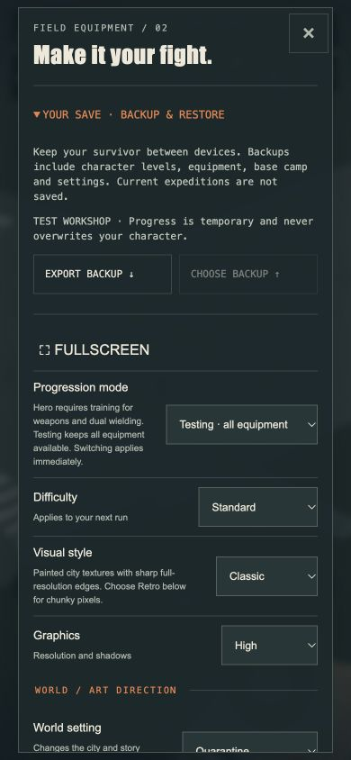
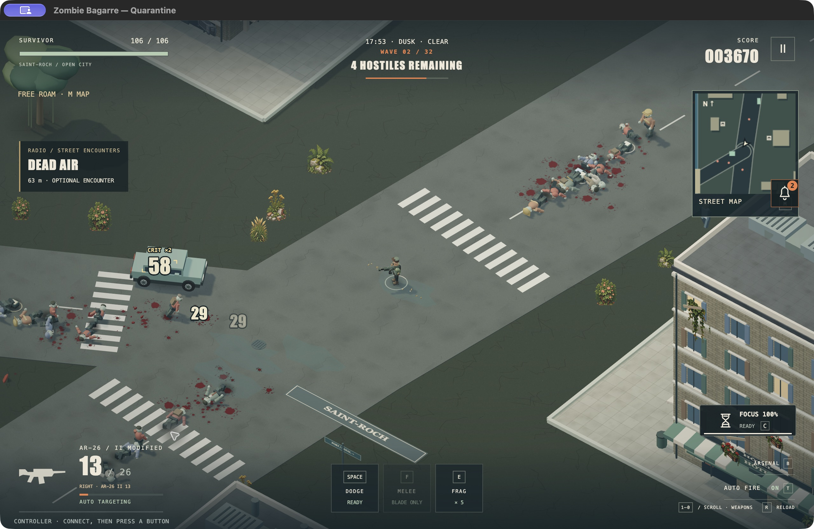

# 4.41 · Keep your survivor

14 October 2026. This release focuses on reliable saves, input presentation and a macOS test app. Steam Deck hardware troubleshooting is deferred.

## Save and restore

**Settings → Your save** exports character progression, equipment, base camp and settings as a portable JSON file. On the title screen, choose a backup, compare the character summary and restore it. A recovery copy preserves the previous save. Active expeditions are not resumed or merged.

The game now writes one complete save record instead of three independent records. Legacy progress migrates without deleting the original keys. Failed writes display a warning and leave the current session available to export. Corrupt, unsupported and externally changed records are protected from silent overwrite. Restoring prevents outgoing page events from replacing the imported character. Invalid calibration and oversized restored data are rejected or normalized before they can break a later launch.

## Interface and startup

Touch and controller presentation no longer compete to rebuild shared HUD elements. Unchanged markup is reused, and the hidden phone minimap is not redrawn. This removes avoidable work; it is not a measured hardware FPS claim.

Startup compiles scene materials before exposing controls and installing development fixtures. The previous asynchronous polling could wait on materials that a test action had already disposed. The title menu is inert while loading.

Phone checks cover 390×844 portrait, 844×390 landscape and 320×568 compact layouts. The scripted directional dodge travelled 5.30 world units while the stick remained held. Compact dodge targets measured 48×48 pixels. These are browser tests, not physical-phone validation.

The panel uses the existing charcoal, bone and amber palette, monospace labels and restrained borders. Settings scroll on short screens rather than shrinking controls. No new decorative motion or overlay is added to combat.

## macOS

[Download the Apple Silicon test edition](https://github.com/iamknow0ne/zombibagarre/releases/tag/v4.41.0).

See [the Mac installation and build guide](MACOS.md). The app packages the offline game and uses hardware-accelerated WebGL. It is not a separate Metal engine. The first release targets Apple Silicon and is a test build, not notarized public distribution.

## Scope

FPS/TPS remain experimental. Jumping and grappling remain in Rooftop Training. Interiors, country travel and space exploration are future work. Real phone multitouch, controller haptics and sustained hardware performance remain separate verification tasks.

## Verification

The automated suite passes **348/348 tests**. Campaign simulations reached wave-32 victory on Relaxed, Standard and Nightmare. Browser QA checked startup, a virtual-controller combat run, touch layout transitions, phone-sized settings, backup export/import and storage-failure recovery. Scripted controls and bot victories establish reproducible paths, not physical-controller feel or human difficulty balance.

The packaged Apple Silicon app passed a local offline startup smoke check with GPU acceleration reported enabled and no software-renderer override. Native UI testing also exercised combat through the first upgrade, the macOS Save dialog, backup-file selection, the restore comparison and a successful reload of the imported survivor. Distribution status is tracked in [the release checklist](RELEASE-TODO.md).

The final local Mac archive is `Zombie-Bagarre-4.41.0-macOS-arm64.zip` (macOS 13 or newer, Apple Silicon). Its SHA-256 is `3a8763e6dc5e9795671323883dc15bb078951c22693d34daa5ca5c27360da86d`. The exact packaged app passed the final hardware-accelerated startup check after all source changes. Native combat reached wave 2, including an evolved weapon, upgrade selection, dodge, grenade and pause; the native Quit menu exited cleanly.

The [macOS release workflow](https://github.com/iamknow0ne/zombibagarre/actions/runs/38545228402) also passed all 348 tests, packaging, signatures, archive checks and startup using its normal graphics backend. The hosted runner exposed an Apple Paravirtual Metal device; this is additional startup evidence, not a physical-Mac performance benchmark. The downloadable archive remains the locally tested package identified above.
