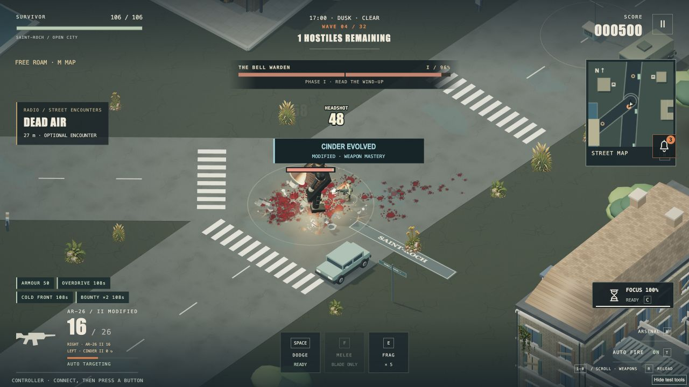
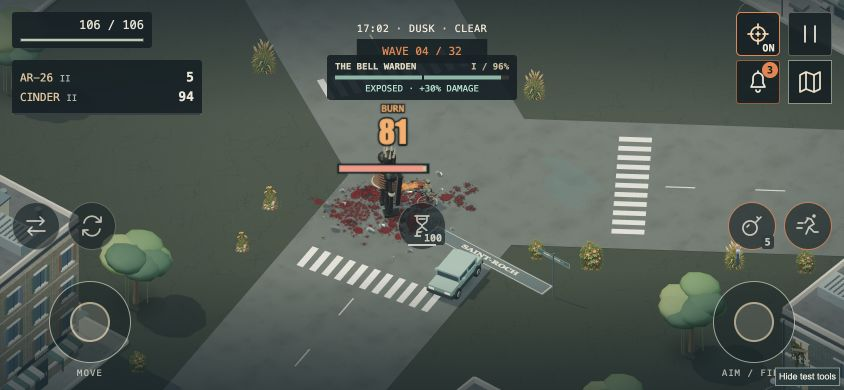

# 4.42 · Weight, impact and stability

14 October 2026. First milestone of the continuing gameplay pass. Apple signing and Steam Deck troubleshooting remain deferred.

## What changes

Grenades and elemental canisters now follow a swept, height-aware path. Walls intercept them; canisters rebound and settle before their fuse expires. Low cover can still be cleared. Fire bottles shatter at first contact, including building facades, and ignite the surface they actually hit. The visible projectile and explosion use the simulation position. Elevated bursts do not incorrectly splash water beneath a roof.

Entering and leaving vehicles now checks the route as well as the destination. The player cannot use a car to teleport through a wall or step out into water. Changing campaign districts clears the old vehicle before prop IDs are reused.

The third-person chase camera stays above street level when looking sharply upward, including while driving. First-person weapon rendering restores the renderer state if an overlay draw fails.

## Performance work

- Enemy, rubble, scenery and ripple batches transfer only their active instance transforms.
- Rain and snow update only visible precipitation buffers; per-drop temporary arrays are removed.
- Foliage draws only visible sprites, preserving the existing density, placement and destruction rules.
- Debris queries use the existing spatial index while preserving exact first-contact order and moving-vehicle handling.
- Rubble teardown explicitly releases instance resources.

Regression tests exercise Three.js's actual upload code with in-memory buffers. A 12-enemy batch transfers **768 bytes instead of 32,768**; a three-chunk rubble batch transfers **192 instead of 65,536**. Shrinking, emptying and regrowing batches retain correct transforms. These byte counts are not FPS estimates.

A fixed-seed CPU microbenchmark (`node scripts/effects-performance-check.mjs`) compares 420 moving-fragment queries against 186 obstacles. Its initial median was 0.538 ms indexed versus 1.115 ms with the old scan, with identical hits. This measures one CPU subtask on this development Mac.

Initial 1280×720 browser probes showed unchanged draw calls and a small reduction in submitted foliage triangles. Combat frame times varied between runs; the evidence is insufficient for a general FPS claim. Stress fixtures now include tall-building collapse, rain, snow and 6,000-frame resource checkpoints. Target-phone and Steam Deck performance remain unmeasured.

## Verification and delivery

- **364/364 automated tests passed**, including new throwable, vehicle, camera and GPU-buffer regressions. Production build passed.
- Automated campaign routes reached victory on relaxed, standard and nightmare, plus Open City standard. These are completion regressions using strong loadouts, not human balance approval.
- Browser checks confirmed wall rebounds, low-cover clearance, facade ignition, water explosions and extinguished fire bottles. The upward-facing chase camera stayed above the street.
- A 6,000-frame collapse fixture covered 100 simulated seconds, peaking at 420 effects and 250 structure pieces. Texture counts settled at 31; geometry counts settled at 308 in the last checkpoints. This is a bounded stress check, not a multi-hour leak guarantee. Rain/high and snow/low probes also completed. [Recorded measurements](qa/performance-4.42.json).
- A fresh Hero progression browser run reached the first boss victory and wave 5, then used earned skill points to unlock and equip the SMG. A complete human-played campaign remains pending.
- Desktop and 390×844 / 844×390 crowded HUD fixtures were inspected. Active effects moved above the weapon panel to stop overlapping destination text. The scripted touch dodge retained its held movement stick and travelled 5.75 m. Physical phone multitouch remains unverified.
- The exact Mac package booted with its normal hardware backend on an Apple Silicon M4 Max. A disposable-profile gameplay check covered combat, a wave upgrade, dodge, grenade use, Focus, weapon evolution and tracked map guidance. No personal save was changed.

**[macOS test download](https://github.com/iamknow0ne/zombibagarre/releases/tag/v4.42.0)** · Apple Silicon · macOS 13+ · ad-hoc signed, not notarized. Apple ID / Developer ID work is deferred.

Archive: `Zombie-Bagarre-4.42.0-macOS-arm64.zip` (133,441,009 bytes).

SHA-256: `0deef8e390683a5bf6b4b87532ca7fd9ca123286ee52d1103b27502f0b4feedd`

These two images use invulnerable development fixtures to inspect crowded layouts; they are actual rendering, not normal-run completion evidence.

## Still in progress

See [the continuing work list](NEXT-PASS.md). Physical phone/controller feel, a complete human-played campaign, main-world traversal, interiors and region/space travel are not claimed complete by this milestone. Existing automated campaign routes remain regression checks, not human difficulty-balance evidence.
