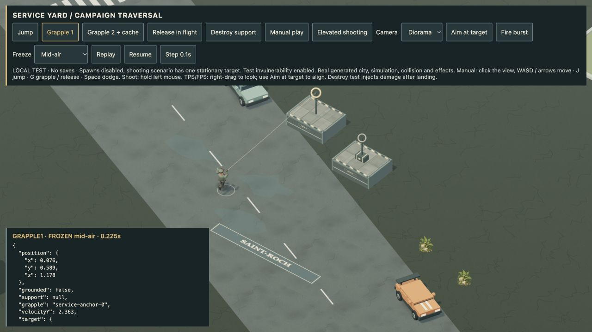
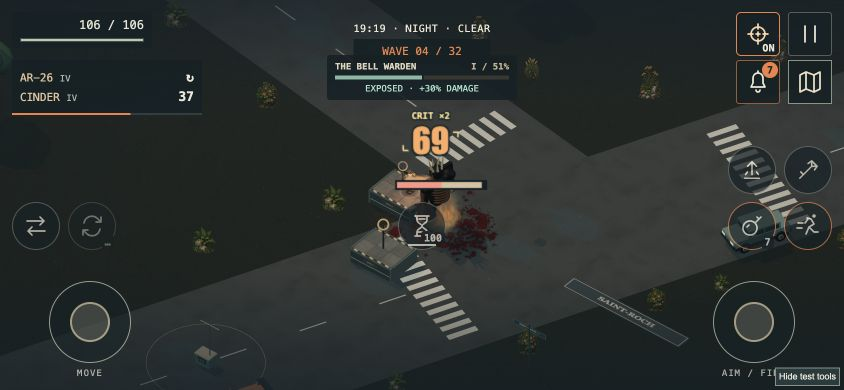

# 4.43 · Street-level verticality

14 October 2026. Main-city traversal milestone. Apple signing and Steam Deck work remain deferred.

## Play the city route

Open City now reserves a small generated route of low service platforms, visible grapple anchors and a supply cache. **J jumps; G attaches or releases the cable.** Jump and grapple are separate configurable controller actions and compact touch icons. Existing custom controller bindings are preserved. If a generated city has no clear dry site, it retains jump movement without forcing platforms through scenery.

The cache awards two grenades, score and expedition currency once. Platforms have matching visible and physical dimensions, panel seams, steel trim and warning markings. Jumping preserves weapon animation; grappling uses a cable and dedicated hand pose. Destroying a support releases the player into a swept fall. Nearby melee enemies wind up and damage occupied service supports, so waiting above a melee wave is not permanently safe.

This is an initial low-platform route, not arbitrary rooftop traversal. The separate rooftop trainer still offers the taller demonstration course.

## Combat and controls

- Projectile origins, target bodies, thrown ordnance, melee, electric chains, blasts, fire, contact attacks and boss hazard bands account for elevation. Low shockwaves can be jumped; taller attacks still threaten airborne players.
- Touch/controller aim assist retains target height and follows a live target after stick release. Automatic weapon poses no longer flatten between elevated shots.
- Quest guidance and damage feedback follow the hero's height. Ground pickups, merchants, cars and extraction require returning to the street.
- Jump/grapple input is consumed once across catch-up physics steps and retained on display frames without a physics tick. Browser QA caught and fixed the previous attach-then-release failure on slow frames.
- Grapple attachment cancels a pending melee strike, and new expeditions clear old anchor/cache state.
- Native mouse capture failures are guarded; cancelled or outside releases clear firing and map dragging instead of leaving actions stuck.
- Collision records reuse storage while tracking moved vehicles, destroyed props and replaced lists. No universal FPS improvement is claimed.

## Validation

- **435/435 automated tests passed**; production build passed. New regressions cover height separation, fall/landing, destroyed supports, cache rewards, controller migration, touch targeting, fixed-step input and platform geometry.
- The relaxed, standard and nightmare campaign bots reached victory, as did Open City standard. These strong-loadout completion checks do not replace human balance testing.
- Rendered fixtures verified the two-anchor route, cache collection, cable release and safe descent after destruction. TPS and FPS camera rays hit a street-level target from a platform; the target lost health after actual simulated bursts.
- Scripted touch input kept the movement stick held during a 1.38 m jump and during grapple attachment; grenade count stayed unchanged. Layouts were inspected at 320×568, 390×844 and 844×390. These are browser pointer tests, not physical-phone certification.
- The exact Apple Silicon package passed normal hardware startup with GPU acceleration enabled, offline world/shaders and the desktop bridge. The previous paused Mac build was preserved in its own folder.

These screenshots use invulnerable local QA scenes; they show actual rendering, not normal expedition completion.

## Mac test download

[Download 4.43 for Apple Silicon](https://github.com/iamknow0ne/zombibagarre/releases/tag/v4.43.0) · macOS 13+ · ad-hoc signed, not notarized.

Archive: `Zombie-Bagarre-4.43.0-macOS-arm64.zip` · 133,446,413 bytes.

SHA-256: `33a5a0843d88928b29a027e0ee8c5f525e00b37f60e629c027873c5aaeda548f`.

The final refreshed package passed its hardware boot test. Extended manual gameplay in that exact refreshed package remains pending; an actively used older test window was not interrupted. [Machine-readable QA summary](qa/traversal-4.43.json).

## Remaining work

A complete human-played 32-wave run, physical controller/phone checks, precise arbitrary-roof collision, elevated enemy access, broader TPS/FPS polish, interiors and region/space travel remain open. See [the continuing work list](NEXT-PASS.md). Apple Developer ID signing/notarization is deferred; the Mac edition remains ad-hoc signed and unnotarized.
