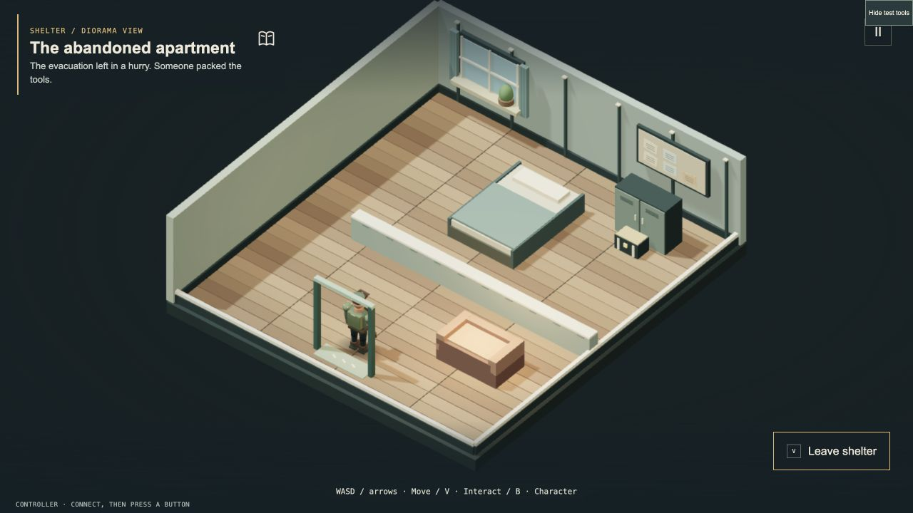
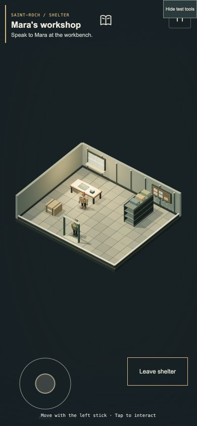

# 4.44 · A door off the street

14 October 2026. First enterable shelters and an apartment recovery contract. Apple Developer ID/signing and Steam Deck troubleshooting remain deferred.

## Visit Mara

In **Open City**, approach Mara’s workshop and interact: **V**, your bound controller interaction button, or the touch prompt. Enter, walk to the workbench and talk to her. Accept **Tools of the trade**, recover her precision-tool case from the marked apartment, then return for **90 crowns, 120 XP and a common Bastion helm**. The case and reward can each be collected once per expedition.

Rooms preserve the outdoor world exactly while you walk and trade. They use a weaponless survivor, furniture collisions and a cutaway diorama view. Leaving restores the outdoor camera. A destroyed host provides a roadside contact or rubble recovery point; exits validate current obstacles, water and hazards before returning the player.

The indoor phone HUD keeps only movement, one contextual action, the journal and Pause. Combat information no longer covers the room. Controller interaction uses the existing configurable binding. Intentional pointer release and repeated dossier shortcuts now preserve the correct menu return context.

Screenshots show isolated local QA scenes with fixture placement and disabled outdoor spawns.

## Validation

- **462/462 automated tests passed** and production build passed.
- The exact Apple Silicon archive passed offline hardware startup: world, shaders, menu and desktop bridge initialized, GPU enabled. Extended manual play in that archive remains pending.
- New coverage includes 100 city seeds, blocked/unsafe entry and exits, destroyed-host recovery, furniture movement, frozen exterior, remote-trade rejection, one-time quest rewards, restart, high-refresh input and nested-menu regressions.
- Renderer ownership/disposal tests exercised 50 alternating room visits. Static architecture is batched; the same WebGL renderer is reused. This is not a physical-device GPU-memory soak or a universal FPS claim.
- Browser checks exercised actual entry, Trade acceptance, case collection, reward claim, exits, pause/resume and portrait/landscape layouts. Placement buttons moved the test hero to locations; this was not a full ordinary expedition.
- Standard Open City campaign bot reached **wave 32 victory**, 1,623 kills, 980.8 simulated seconds. This strong-loadout test does not replace human balance testing.

## Mac test edition

[Download the 4.44 Apple Silicon test edition](https://github.com/iamknow0ne/zombibagarre/releases/tag/v4.44.0) · macOS 13+.

Archive: `Zombie-Bagarre-4.44.0-macOS-arm64.zip`.

SHA-256: `8a33668877689d4d77a8652483a9f0ea2f918a8eafc0f1c31e38c2559b9bbc5f`.

Ad-hoc signed, **not notarized**. Downloaded copies may be blocked by Gatekeeper. Apple account setup is deferred. This is the GPU-accelerated desktop edition of the game, not a separate Metal-engine rewrite. Existing running Mac versions are preserved in their own folders.

## Boundaries and next work

This release adds two authored rooms, not arbitrary enterable buildings. Indoor combat and indoor TPS/FPS are deferred. Hero progression persists; crowns, contracts and room visits reset with a new expedition. Reloading starts outside in a fresh expedition. Physical controller/phone checks, a full human expedition and extended manual gameplay in the final Mac archive remain open.

Next: broader perspective visibility/aiming validation, then region travel and explicit save boundaries before the hidden hangar/space chapter. [Implementation notes](INTERIOR-INTEGRATION.md) · [Continuing checklist](NEXT-PASS.md).
