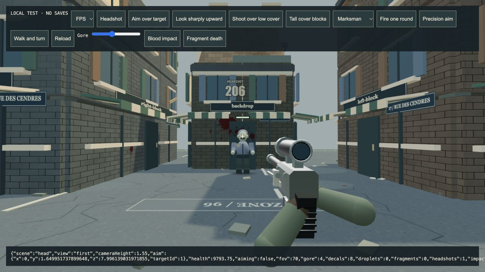

# 4.45.1 — Perspective aiming corrections

14 October 2026. A small gameplay correction following the keyboard/settings
release. The new character asset is a separate development study, not a shipped
visual upgrade.

## Changes

- TPS shots resolve from the current shoulder-camera position after a look
  input, rather than the previous frame's position. A quick turn could otherwise
  miss an enemy centered in the crosshair. FPS aiming also follows changes in
  player elevation before the next render.
- Initial look input is preserved when a perspective camera initializes.
  Camera collision still retracts immediately, while zoom, sway and outward
  easing do not advance during input sampling or pause.
- After leaving close cover, avatar fading restores the original materials and
  disposes temporary copies. Shared materials remain untouched.
- The keyboard editor and nine settings submenus from 4.45 remain available.

## Validation

488 automated tests passed. New regressions cover quick-turn targeting,
elevated FPS/TPS origins, intervening cover, initial look input and 50 repeated
fade/restore cycles. The full suite caught a first-frame touch-turn regression
during development; this was corrected and the suite rerun successfully.

The additional camera synchronization measured about 0.013 ms per aim call in
the agent's bounded Node CPU check with 995 obstacles. This is not an FPS or
physical-device performance claim.

Production build passed with the existing bundle-size warning. The unfinished
Rook asset and preview are absent from `dist`.

Browser fixture checks confirmed a headshot in both FPS and TPS (target health
10000 → 9793.75), while a tall wall produced an impact and left target health
at 10000. No browser console errors were reported in that test tab.

The separate Apple Silicon macOS package passed its isolated hardware startup
smoke: offline world, shaders, menu and desktop bridge initialized with GPU
enabled. Archive SHA-256:
`194f0a1967cfbb43b3713233bab8392463ecb9434eb653361e80002c2e04e9be`.
This does not replace a full native expedition. The app remains ad-hoc signed
and unnotarized. Physical controller/phone validation, Apple signing/notarization
and Steam Deck remain deferred.

## Character asset checkpoint

The repository now contains a reproducible, CC0-based anatomical mesh/rig
prototype and standalone development viewer. It has real skinning and two
deformation studies, but still needs facial likeness, painted textures,
garment cleanup, production animation, optimization and gameplay integration.
It is excluded from the production bundle. See the
[asset production notes](../assets/source/rook/README.md).
