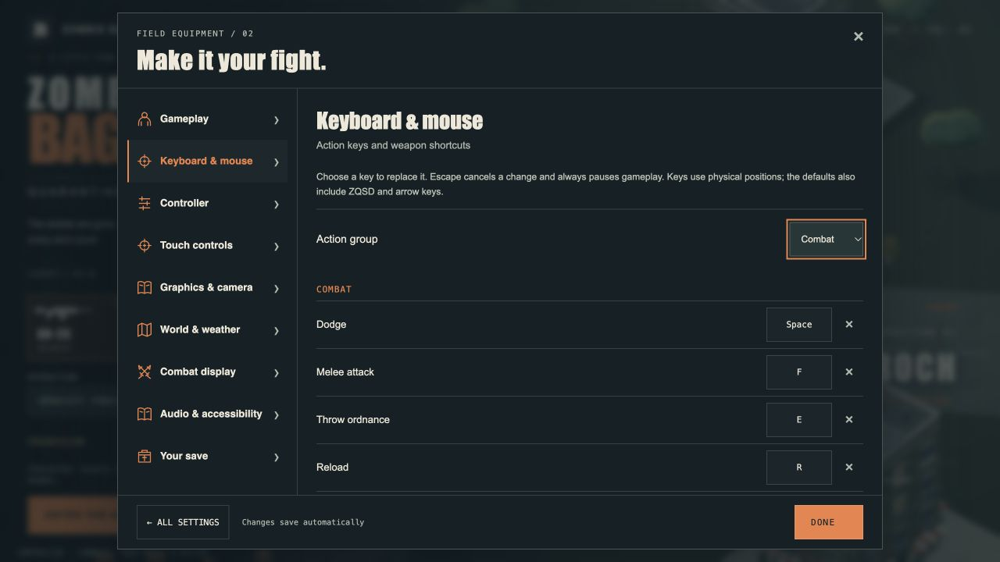
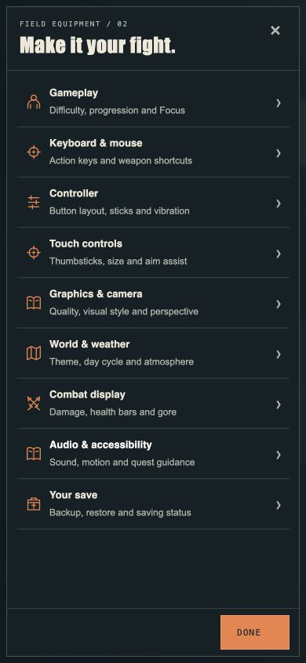

# 4.45 — Your keys, your settings

14 October 2026. This release adds configurable keyboard actions and replaces the long settings sheet with focused submenus. It does not ship the planned new character models.

## Controls

Open **Settings → Keyboard & mouse**. Choose an action group, select its current key and press a replacement. Conflicts require a choice before a key moves away from another action. Escape cancels; it always remains a pause/back fallback. Clear a binding with its × button or restore keyboard defaults with confirmation.

Movement, dodge, melee, ordnance, reload, interaction, Focus, precision aim, map, arsenal, character/journal, weapon shortcuts, per-hand cycling and driving controls are configurable. Optional keyboard bindings can fire both weapons or either hand independently. The original WASD/ZQSD/arrow alternatives remain until that action is changed. Replacing an action replaces its existing alternative keys. Keys refer to physical positions; their labels follow KeyboardEvent.code.

Mappings save with the existing character/settings backup system. HUD and contextual hints use the current mappings. Rooftop training reads the same settings and now uses Jump/Grapple rather than unrelated combat shortcuts. Controller and touch bindings are independent. Mouse buttons, mouse wheel behavior and menu navigation are fixed in this release.

## Settings navigation

Nine categories: Gameplay; Keyboard & mouse; Controller; Touch controls; Graphics & camera; World & weather; Combat display; Audio & accessibility; Your save. Desktop retains a sidebar. Phones open a category list with one submenu at a time. Back returns to categories before closing the dialog; controller Back cancels rebinding before leaving the page. Done and Close remain available. The saving warning opens Your save directly. Native graphics options stay in Graphics & camera.

The design retains the game's charcoal/bone/orange palette, Impact headings, readable sans-serif labels and monospace keys. Compact rows use the existing 4/8/12/16/24 spacing rhythm, square edges, visible focus and 44px primary control targets. No new decorative animation. Review assessment: AI-slop score 1/10; distinctiveness 7/10. Tradeoffs: long controller/camera instructions still require scrolling, and keyboard alternatives cannot be individually added in this first editor.

## Verification

- 483 automated tests passed, including input isolation, custom movement/driving, independent hand firing, default restoration and conflicts, hint updates, canonical save reload and backup restore, and ephemeral QA storage safety.
- Production build passed. The existing Three.js bundle size warning remains.
- Browser checks: assignment, conflict cancel/reassign, default-reset cancellation and focus restoration; remapped Map N opens the atlas while the former M does not; settings sections retain all their inputs; no unclassified inputs remain.
- Virtual controller: select a submenu, Back to categories, Back to title. This exercises the real input/menu paths, but is not physical-controller hardware certification.
- Responsive checks: 1280×720, 390×844, 320×568 and 844×390. Fixed a legacy touch Close-button overflow. Checked long driving key labels, category navigation and persistent footer controls. This is browser viewport QA, not physical multitouch validation.
- Current browser test tab reported no console errors.

## macOS test edition

A separate Apple Silicon package is built under `release/4.45.0`, preserving earlier running apps. It remains ad-hoc signed and unnotarized; Apple ID/signing and Steam Deck work are deferred. The packaged app passed the hardware startup smoke test: offline world, shaders, menu and desktop bridge initialized with GPU enabled. This does not replace a full native playthrough.

Archive SHA-256: `b1301b3ddcdea4da68278d55f8af9ea1372d07d8528bb4016b0870d29f52a845`.
