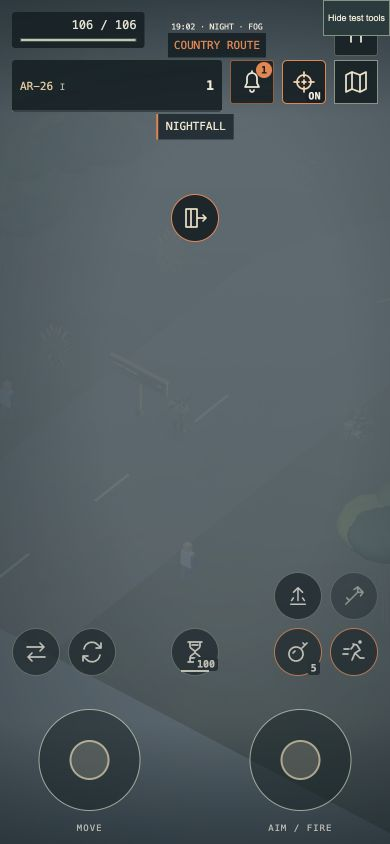

# 4.46 — Old Mill Road

14 October 2026. The first connected region is playable through the existing
Open City game, rather than a separate scene or demo.

## Play the route

Visit **Dr. Lenoir / Field Medic** and accept **Medicine from the old mill**.
The tracked objective leads to the city's **Old Mill Road** footpath. You can
also mark it under **Map → Places & services → Regional footpaths**. Park and
leave your vehicle, clear nearby threats, then use **Interact** or the contextual
travel icon. Keyboard hints follow custom bindings; the same action uses the
controller binding and mobile icon.

The seeded woodland road contains live flammable trees, destructible cover,
three small buildings and a guarded medicine stop. Defeat its four guards,
search the marked medical crate, return through the Saint-Roch sign and claim
**180 crowns + 220 XP** at the clinic. Payment is once per expedition.

Cities, loot and regional progress remain in memory **for this expedition**.
Closing/reloading the game or starting another expedition discards them. Existing
permanent character, equipment and settings saves keep their normal behavior.
This is stated in the guide, pause menu and travel notification.

## Preservation and reliability

Travel keeps the same hero and global ledger: no healing, ammunition refill,
cooldown reset or reward replay. Inactive region combat, pickups, fire and city
spawning freeze. Active weather and the expedition clock continue. Return restores
damaged/destroyed props, moved vehicles, rubble, quests and interior loot flags.

Destination preparation finishes before the active state switches. Unsafe or
unavailable arrivals and failed graphics construction cancel the move. Partial
renderer construction now releases owned resources, overlays and canvas listeners
without disposing the still-running source scene. Input and queued fixed steps
are cleared across the transition.

The atlas paints connected road surfaces together, removing visible segment-end
rings at bends. Regional signs, supply markers and the directory work with the
existing map guidance. The new medical crate opens and empties after collection.

## Verification

- **530/530 tests passed**, plus production build. The existing large-bundle
  warning remains; no measured FPS gain is claimed.
- Four automated full 32-wave runs reached victory: biome campaign on relaxed,
  standard and nightmare; Open City on standard. These are scripted combat runs,
  not a completed ordinary human playthrough.
- Regional tests cover 50 roundtrips, unchanged hero resources, duplicate local
  prop IDs, frozen city timers, district advancement, failure rollback, safe
  arrivals, projectile threats, fresh expeditions and once-only delivery claims.
- Real Simulation navigation walked to selected city gates across ten topology
  seeds. Country generation checks cover 100 seeds and a clear road corridor.
- Renderer tests restore live Three.js scene graphs, damage stages, wrecks,
  vehicle transforms and rubble without replaying effects or consuming RNG.
  Regional decorations allocate nothing new over 500 ordinary updates. Injected
  early/late construction failures verify cleanup and retention of the old owners.
- Browser QA used `/dev/region-qa.html`, which embeds the actual main game with
  an ephemeral save. Fixture placement moves the hero and suppresses nearby city
  spawning; it is not evidence of a normal playthrough. Real autofire defeated
  the guards; the guarded collection first rejected, then succeeded. Returning
  retained **106 HP, 5 rounds, wave 1 / 12 pending enemies**, and a previously
  damaged building at **1883.75 HP**. Clinic payment changed **72 → 252 crowns**
  and **40 → 260 total XP**, with the claim control becoming disabled.
- Final browser checks covered desktop and 390×844 / 844×390 touch-layout views,
  map controls and travel through the contextual mobile button. The final clean
  QA tab reported no captured console errors or warnings.

[Portrait atlas](screenshots/region-map-portrait-4.46.png) ·
[Landscape controls](screenshots/region-hud-landscape-4.46.png) ·
[Delivery completed](screenshots/region-delivery-4.46.png) ·
[Returned city](screenshots/region-city-return-4.46.png)

## macOS test package

Apple Silicon archive: `Zombie-Bagarre-4.46.0-macOS-arm64.zip`
(133,471,922 bytes).

SHA-256: `7281af7404464b4c3986a872c85ca71a1c27fb5a6955e0d1a087d03473cdc962`.

Strict nested ad-hoc signature checks and isolated hardware startup passed on
this Mac: packaged offline world, shaders, menu and desktop bridge initialized
with the default graphics backend and GPU enabled. This is **not** a full native
expedition or sustained GPU-memory soak. The app remains unnotarized; Apple
Developer ID signing/notarization are deferred.

## Remaining boundaries

- Regional travel is on foot; vehicle transport, suspend/resume, hangar,
  spacecraft, orbit and planets are not implemented.
- Facade damage is reconstructed from saved stages; exact historical bullet
  holes and pane choices, old gore decals and transient particles are not retained.
- Physical controller/phone acceptance, prolonged hardware memory testing and a
  complete ordinary 32-wave expedition remain open. Steam Deck/other ports remain
  deferred.
- Rook's textured study remains a development asset. Portrait likeness, tailored
  clothing, authored combat animation, LODs and gameplay integration are unfinished.

## Publication checkpoint

Runtime commit `766aeb7f3216ef00bca0273a5b828d7a89e679af` is pushed to main.
Pages workflow `38587969482` completed successfully; the public page reports
4.46.0. [Release and Mac download](https://github.com/iamknow0ne/zombibagarre/releases/tag/v4.46.0)
are published. GitHub reports the uploaded archive at 133,471,922 bytes with
SHA-256 `7281af7404464b4c3986a872c85ca71a1c27fb5a6955e0d1a087d03473cdc962`,
matching the exact locally tested ZIP.
