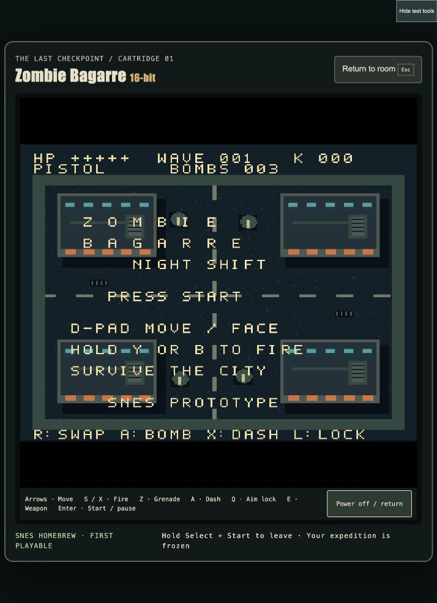

# 4.47 — The Last Checkpoint / SNES first playable

An optional retro gaming refuge now appears in Open City. Find **Rumour / a room
full of old games** in the street atlas, enter the building, and approach the
central console. At hero level 3 the SNES cartridge is available; testing mode
makes it available immediately. The other two consoles are dormant archive
exhibits, clearly marked unavailable.

The TV opens **Zombie Bagarre: Night Shift**, an actual original 256 KiB SNES
LoROM, running locally through a pinned SNES emulator. The first cartridge has
one dusk city block, increasing waves, pistol/shotgun, grenades, directional
dash, aim lock, health, kills, pause, death and restart. Its indexed pixel art
and BRR gunshot are generated from editable source patterns. It is a first
arcade prototype, not the complete SNES campaign.

## Play and return

- Modern game: use the atlas refuge marker, then the normal Interact action.
- Cartridge: arrows move; S/X fire; Z grenade; A dash; Q aim lock; E changes gun;
  Enter starts or pauses. SNES button names are displayed inside the ROM.
- Controller: D-pad, Y/B fire, A grenade, X dash, L aim lock, R weapon, Start.
- Touch controls appear at compact widths and can be toggled explicitly.
- Escape, Power off / return, or holding Select + Start leaves the cartridge.

The modern game's simulation, renderer, input and audio are suspended during
cartridge play. Returning keeps the same room position, health, ammunition,
wave and expedition time. No cartridge score grants modern hero XP. Hero level
unlocks use the existing saved XP; the room's visit state remains expedition-only.

## Validation

- 545 automated tests pass (544 regression tests plus the bundled dependency integrity check); production build passes.
- Actual browser emulator boot, sustained Start/movement/fire/swap/grenade input,
  kills, death/retry and in-room power-off were exercised. A 24-second scripted input sweep reached wave 2 / 8 kills, then paused.
- The room's level-1 lock and level-3 unlock were checked in the real UI using
  explicit development fixtures; this is not a normal adventure playthrough.
- Portrait 390×844 and landscape layouts inspected; no physical phone or
  controller hardware claim. A hidden virtual-pad issue found during this check
  was corrected with a visible Touch controls toggle. Shoulder buttons were also moved inside the short landscape player; all eight visible SNES buttons fit its 818×235 content area.
- Two clean local ROM builds produce identical SHA-256:
  `942ec81621ba72fe845a3e51933ef47a5c2ca6e4b220706a54dc33158c64b784`.
- Automated standard Open City expedition reached victory at wave 32.
- Local/CI checks cover room routes, locked/dormant consoles, safe exits,
  destruction recovery, stale sessions, native frame policy and ROM integrity.

Physical SNES hardware and flash cartridges remain untested. SNES bosses,
additional stages, music, saved cartridge progression and the remaining demakes
are future slices. This release does not complete the broader modern-game art,
traversal or space chapter roadmap.

## Distribution and provenance

ROM: `public/retro/zombie-bagarre.sfc`; source/build instructions:
[SNES project](../demakes/snes/README.md). Pinned SDK builder:
`scripts/snes-build.py`. A path-filtered CI workflow rebuilds and compares the ROM.
CI run `38596857384` passed on macOS and Linux. The canonical macOS build must
match the published bytes; each host also requires two identical clean builds.
The Linux linker swaps equal-sized sections, so cross-host byte identity is not
claimed and Linux output is retained only as a diagnostic artifact. See the
SNES project's rebuild notes. Runtime assets are unchanged by these CI fixes.

The emulator is loaded only on console use, bundled for offline use, and has no
native IPC access. Third-party licenses and source snapshots travel in
`public/retro/emulator`. Snes9x carries non-commercial terms; this free prototype
bundle needs a component/license review before any paid distribution.

UI direction: one CRT object, coal/bone/brass with phosphor accents, compact
controls and restrained motion. Internal design review: slop score 1/10,
distinctiveness 8/10. The cartridge artwork is intentionally modest first-pass
SNES pixel art, not a claim that final art direction is complete.

## macOS package check

The versioned Apple Silicon app passed isolated hardware startup with GPU enabled
and no character-save changes. It is ad-hoc signed, not Developer ID signed or
notarized. Emulator play has been exercised in the browser; the packaged Mac
cartridge roundtrip and physical controller feel still need a dedicated check.

Final Mac archive: 141,684,749 bytes; SHA-256
`00e5651bc2070277fb189f78bf2f31fa797a5c4bc5e4e84f59a1305e087165be`.
The exact archive's packaged app passed hardware startup on 14 October 2026.
