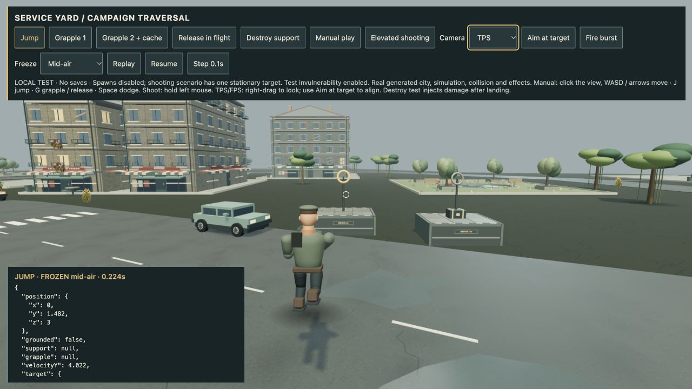

# 4.48.1 — Character cleanup and foot-pose corrections

This patch fixes two regressions reproduced while auditing the 4.48 character
pass. It does not introduce another character model or claim final art parity.

## Corpse geometry ownership

When an enemy finished falling, static batching replaced its articulated meshes
but did not dispose their geometry. The new enemy builder now explicitly marks
its geometry as owned by the actor. Settling releases replaced geometry; final
removal releases any hidden limbs and the resulting batches exactly once.

Before: 0 of 17–23 original geometries released per tested settled enemy.
After: all original geometries released exactly once. The affected vertex/index
arrays total about 478–540 KB per tested enemy; this is source storage, not an
estimate of GPU memory or an FPS claim.

The actual WebGL fixture rendered six archetypes, settled and removed them for
30 cycles (180 enemies). Geometry count returned to its baseline **1** after
every removal, with a peak of **113**. [Captured renderer report](qa/corpse-resources-4.48.1.json).
The fixture is `/dev/corpse-qa.html`; it uses the production enemy builder,
`World.batchStatic` and resource-disposal path. This is a focused resource check,
not a full-game long-session memory soak.

## Final foot orientation

Jump/grapple knee overrides retained ankle angles from the previous walking
phase. Landing compression, recoil and blade finishers also changed the torso
after ankle correction. A final quaternion-based alignment now resolves the
complete torso/thigh/knee orientation, including weapon and traversal layers.

Tests reproduced roughly 1–96° of airborne sole tilt depending on prior stride,
and about 43° during the tested landing. The corrected pose consistently uses
14.3° toe-down in the air and level soles on the ground. Weapon wrist positions,
grip errors, movement/collision bodies and attack timing are preserved. Intentional
whole-body Focus dives remain afterward. This fixes orientation; it does not
claim world-space foot locking or solve every hip/ground contact issue.

## Validation

- **559 automated tests pass**; production build passes with the existing large
  chunk warning.
- Regression tests cover all survivor outfits, jumping, grappling, landing,
  strafing, backpedalling, hits, firearm recoil and paired-blade finishers.
- Enemy coverage uses the real settled-corpse path, hidden body parts, exact
  posed bounds, material ownership, instance transforms and three complete
  variant waves without cache growth.
- Browser checks cover the corrected jump/grapple/landing pose and the rendered
  30-cycle corpse lifecycle. No physical phone/controller or FPS gain is claimed.
- The exact Apple Silicon package passed isolated hardware startup with GPU
  enabled. It remains ad-hoc signed and unnotarized. Archive SHA-256:
  `fc6276d0b38542c7f5e0c9ad011ce41e1afb9b1468ad1ebd5e513aac0de9d868`.

The development fixture retains the project's coal/bone/rust utility styling:
one rendered scene, one 44px action, visible diagnostic results, no decorative
motion. Internal review: slop 1/10; distinctiveness 6/10. Optional future fixture
improvements are an in-scene cycle counter, a compact resource trend and a
freeze-on-settle inspection control; these are not player-facing features.
