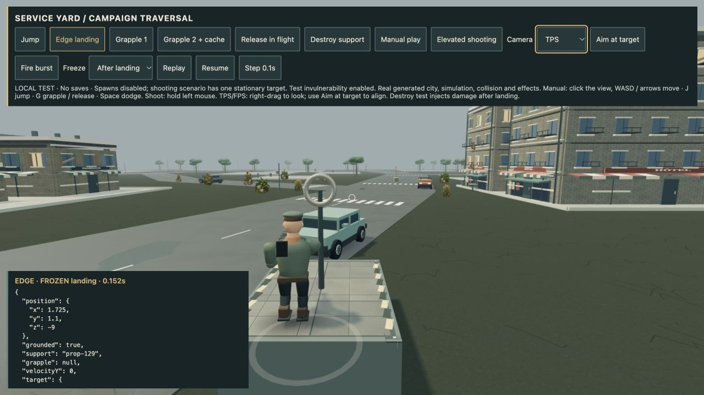
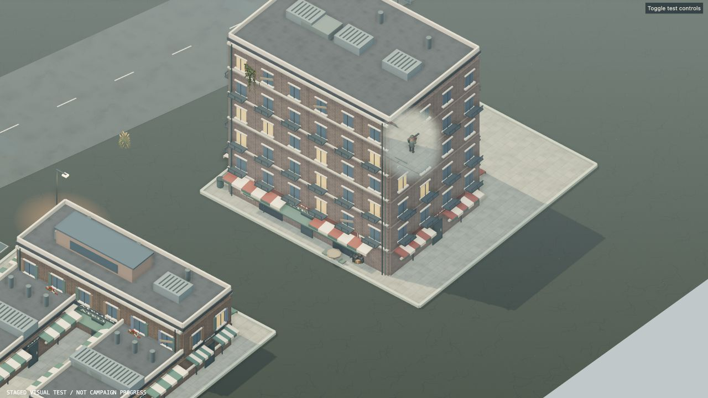

# 4.48.2 — Reliable edge landings and lighter building visibility

Descending onto the edge of a platform could put the hero inside its solid
body. Landing now uses the same collision footprint as the sides and ceiling.
The hero lands on the top, retains the correct firing height, and falls normally
when moving off the edge or when the support is destroyed.

The reproduction starts 10 cm outside a 4 m platform's centre footprint, with
40 cm body radius and downward velocity. Previously, steering inward left the
hero at ground height inside the platform. Regression tests now cover four
edges/corners, a fall outside physical reach, a fast descent, destroyed support,
paused movement and elevated shots through the actual campaign simulation.

## Rendering allocation cleanup

The high-quality building visibility pass previously created temporary arrays
for every visible mesh. Reusable scratch storage now preserves material identity
and renderer state, including nested passes and interrupted draws. References
clear after each pass; disposal clears the scratch pool.

An instrumented CPU-only reproduction with 2,400 visible meshes over 100 passes
counted **445,800 bookkeeping arrays and 200 Colors before**, versus **zero of
these allocations after warm-up**. This counts the changed bookkeeping sites,
not all engine allocations. [Recorded counts](qa/cutaway-allocations-4.48.2.jsonl).
The isolated median routine time was 0.0524 ms before and 0.0444 ms after across
nine batches of 1,500 passes. This is a modest CPU saving, not a measured FPS gain.

Actual WebGL inspection with High + AO showed the survivor through the local
facade aperture while the building remained present. No browser errors were
reported in this check.

## Validation

- 563 automated tests pass; production build passes with the existing large-chunk warning.
- All four automated campaign routes reached wave 32 victory: relaxed (1,204.7 s), standard (1,336.8 s), nightmare (1,315.1 s), and standard Open City (980.8 s). These are simulation runs, not a human playthrough.
- The exact packaged Apple Silicon app passed isolated startup with GPU enabled: offline world, shaders, menu and desktop bridge initialized. Archive SHA-256: `bcbf7a155ca854d1435d6744d71a631ac9b2c3b536d678e6934fd4e42ffd7339`.
- The new Edge landing action in `/dev/campaign-traversal-qa.html` reproduces the
  boundary case. [Captured landing state](qa/edge-landing-4.48.2.json).
- This patch does not complete roof-accessory collisions, the full ordinary
  playthrough, detailed character production integration or physical phone/controller QA.
- macOS remains an ad-hoc signed, unnotarized Apple Silicon test edition.
  Apple Developer ID and Steam Deck work remain deferred.

## Release artifact

Runtime commit `3247ee9fbcc227f2265b88d2a484851b32aea3ef`. The public
[v4.48.2 Mac test download](https://github.com/iamknow0ne/zombibagarre/releases/tag/v4.48.2)
is 141,686,637 bytes. GitHub reports the same SHA-256 as the exact archive
that passed the local hardware startup check. The automatically triggered
Steam Deck build was cancelled to respect the deferred platform scope.

Pages run `38613075915` completed successfully. The public game loaded to its
menu and displayed **BUILD 4.48.2**. [Public menu capture](screenshots/traversal/public-4.48.2.png).
