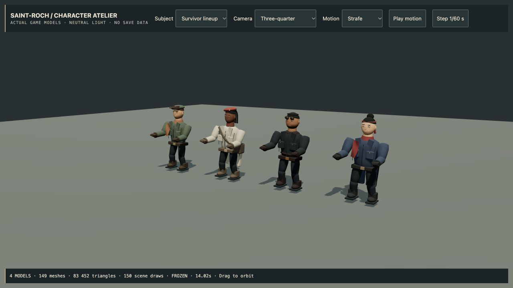
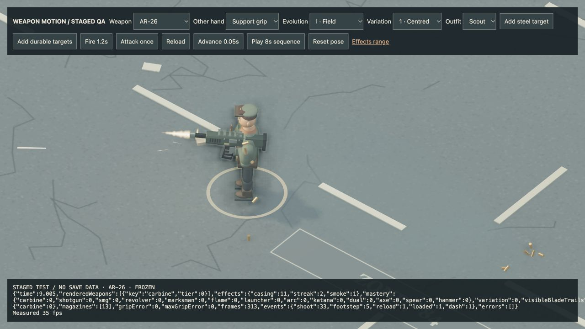
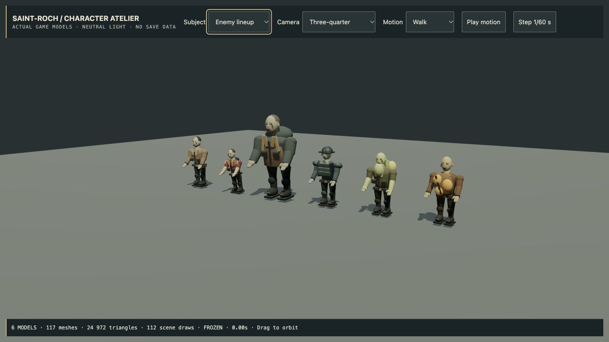

# 4.48 — Survivor and infected visual pass

The live game now uses refined survivor proportions and clothing, plus six
rebuilt ordinary enemy archetypes. This is an incremental improvement to the
procedural cast, not the final portrait-quality character replacement.

Survivors have smaller heads, softer facial shading, visible mouths, pigment
stubble instead of a jagged beard shell, folded scarf panels, thinner lapels,
subtle fabric weave, and less reflective leather and seams. Tapered trousers,
articulated ankles and a stance/flight leg solve replace the old sine-only
knee motion. Head counter-motion and restrained torso movement keep aiming
more stable. Movement speed, collision bodies and attack timing are unchanged.

Walkers, runners, brutes, armored enemies, spitters and volatile enemies now
have differentiated silhouettes, layered clothing, facial damage, irregular
mouths and asymmetric posture. The existing instancing, headshots, crawling,
limb removal and corpse ownership remain covered by regression tests. Enemy
detail uses shared matte materials and vertex colour, without extra textures
or lights.

## Evidence

- All **553 automated tests** pass; production build passes. The existing
  large-bundle warning remains.
- New tests cover 36 enemy variants, geometry budgets, visible facial planes,
  instancing with hidden limbs, actual corpse creation, resource disposal,
  planted ankle paths, gait continuity and preserved weapon anchors.
- Actual browser review covered survivor/enemy lineups, close facial views,
  walking and strafing, plus rifle and paired-blade sequences in the live World
  renderer. Rifle sequence: 313 frames, 33 shots, reload, dash, maximum grip
  error 0, no fixture errors. Paired blades: 339 frames, 18 swings, dash,
  maximum grip error 0, no fixture errors. Browser warning/error log was empty.
- Rook's production model is 20,860 triangles / 36 rigid meshes, down from
  22,792 / 37 before this pass. This is geometry accounting, not a measured FPS
  improvement. Each ordinary enemy variant stays under 4,600 triangles and
  at most 23 rigid meshes before instancing.
- The packaged Apple Silicon app passed isolated startup with GPU enabled:
  offline world, shaders, menu and desktop bridge initialized. Ad-hoc signed;
  Apple Developer ID signing and notarization remain deferred.

Exact tested Mac ZIP SHA-256:
`371a8f6c6682ddd5711354005d434e7121fc81524344777c8bef020777e9fc98`.

The new `/dev/actors-qa.html` inspection scene uses actual production models;
its neutral floor is not a gameplay location. The old before-image includes a
fixture-only white contact-shadow quad that was removed from the inspection
scene; that artifact was not a production world fix. Internal UI review:
compact 44px controls, coal/bone/brass, no decorative motion; slop 1/10,
distinctiveness 6/10. Character art quality is a separate, still-open gate.

## Detailed Rook study — development only

The independent v3 GLB study has better stubble/hair and cloth material maps,
10 skinned meshes and 46,546 triangles (32% fewer triangles than v2). Its larger
19.6 MB payload, fixed-outfit geometry and two A-pose deformation studies are
not ready for production/mobile. See [validation and real browser captures](art-direction/ROOK-VALIDATION.md).
It is not loaded by the main game. The next substantial art step is authored
combat locomotion, stronger portrait likeness, an optimized material/LOD set,
and a rest-pose-aware gameplay adapter before replacing the live survivor.

Physical phone/controller tests, a new full human expedition, target-device
FPS comparisons and final art/animation parity are not claimed by this release.

## Published checkpoint

Runtime commit `c538ec1`; Pages run `38601520008` passed. The public game was
opened and reached its menu showing **BUILD 4.48.0**. The uploaded Mac archive
is 141,685,639 bytes and its GitHub digest matches the exact locally tested ZIP
above. Independent macOS CI run `38601576344` subsequently passed, including
Metal hardware startup and archive verification. The tag-triggered Steam Deck job was cancelled
because that platform remains deferred.
