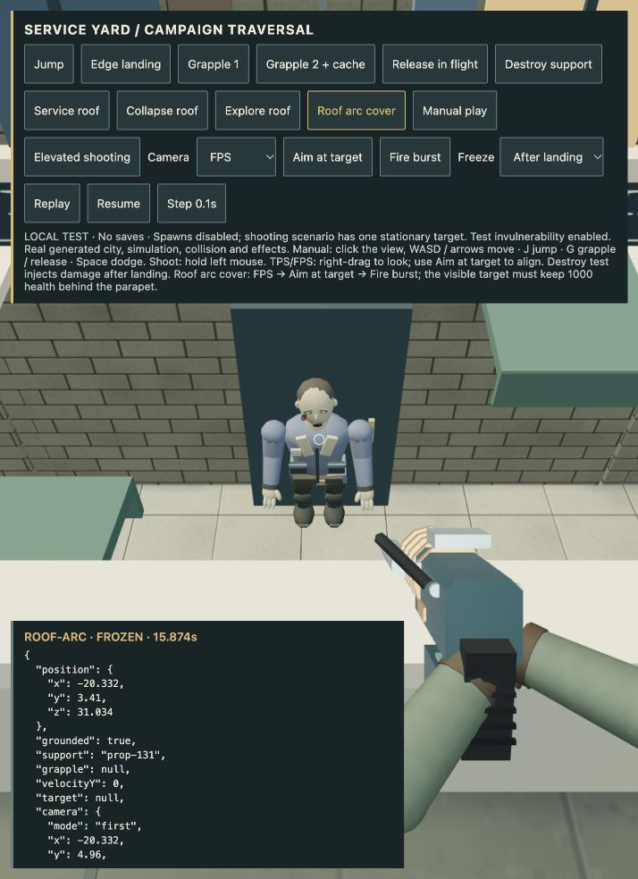
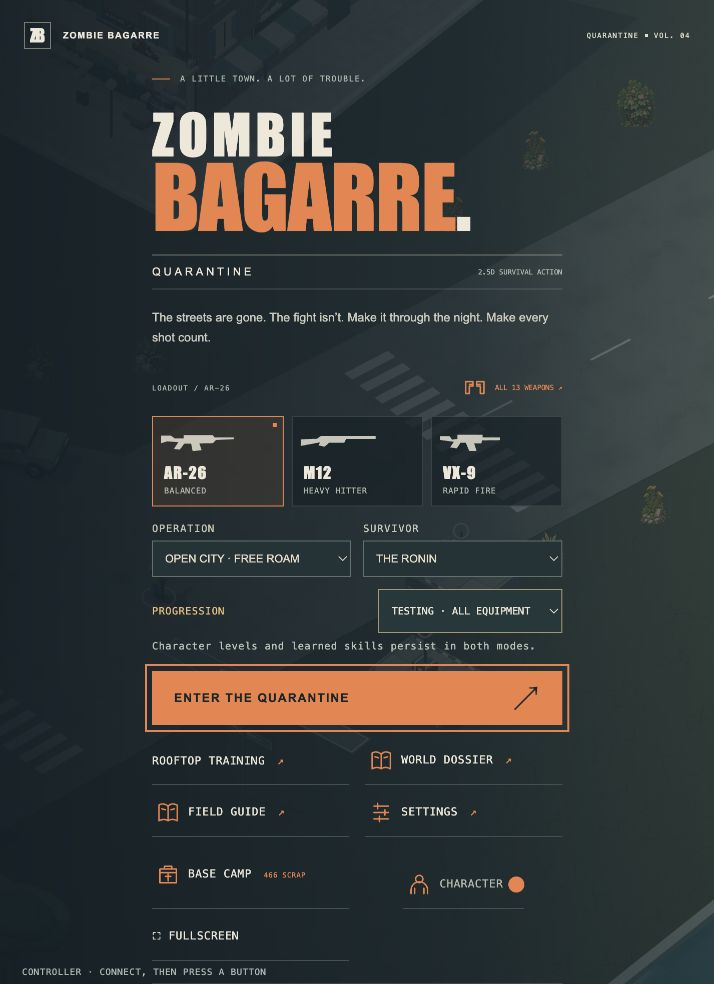

# 4.49.1 — electric weapons respect close rooftop cover

An FPS camera can see over a parapet while the gun muzzle remains behind it.
Previously the electric weapon advanced its shot origin by 85 cm before checking
cover, sometimes placing it outside that wall. The shot now starts at the same
physical muzzle as projectile weapons. Nearby cover blocks the first arc; valid
clear shots and enemy-to-enemy chaining retain their existing damage/falloff.

The actual seed-73 service roof reproduction is available in the local campaign
traversal fixture as **Roof arc cover**. Select FPS, aim at the target and fire.
Browser QA fired two shots (magazine 16 → 14), kept the target selected in the
crosshair, and left its health at 1,000. The hero remained grounded on the roof.
[Captured state](qa/roof-arc-cover-4.49.1.json).

Validation: **578 gameplay tests pass**, including the real roof reproduction,
clear elevated arc damage and blocked secondary chains. Production build passes
with the existing large-chunk advisory. Browser verification captured no errors.
The exact packaged Apple Silicon app passed offline hardware startup with GPU
enabled (world, shaders, menu and desktop bridge). Archive size: 141,688,120 bytes.
SHA-256: `16c56bcc473df2f9f1f7037bc8bfa524825c06d9de94761ea38666d1ec61898c`.
This is startup evidence, not a full native expedition or thermal soak.

The separate detailed-character study was saved in `c1557c4`: v5 materials,
three-strike sword sequence and two-direction dodge, with 43 art checks plus
28 motion checks on v5. It remains development-only; the production hero is
unchanged. See [character evidence](art-direction/ROOK-MOTION-CHECKPOINT.md).

This patch does not close the broader perspective/playthrough/character-art
milestones. Physical phone/controller tests, Apple signing/notarization and
Steam Deck work remain deferred or unverified as recorded in NEXT-PASS.

## Publication verified

Runtime commit `f40048496ceb2ee74ae01094e59f4e8fda25eaba` is published.
Pages run `38620125402` passed; the actual public menu shows BUILD 4.49.1
and captured no browser errors. GitHub's Mac asset digest and size match the
exact hardware-tested archive. [Mac test download](https://github.com/iamknow0ne/zombibagarre/releases/tag/v4.49.1).
The automatically triggered Steam Deck run was cancelled to preserve deferral.

