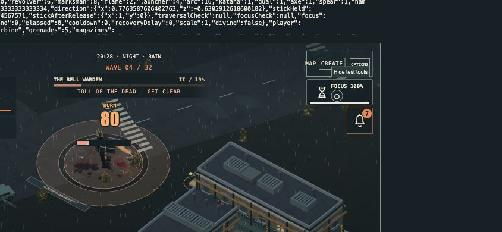
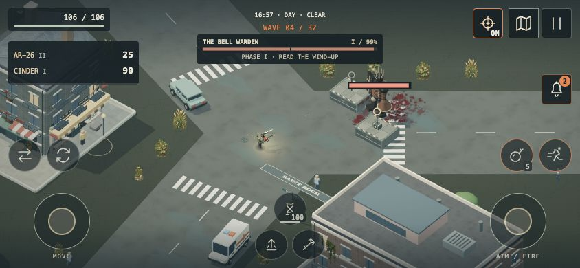

# 4.49.2 — More room to play on phones

Connecting a controller used to turn off the mobile layout, bringing back large desktop panels. Compact HUD density now follows the viewport independently of the active input device.

- Smaller health, ammo, quest, weather, boss and Focus panels at the screen edges.
- Jump and grapple sit along the bottom in landscape; controller glyphs remain visible.
- Hide the redundant score, connection banner, free-roam text, large minimap and unavailable melee action. The full map, pause readout and character notices remain accessible.
- Touch targets remain at least 44px. Short field messages retain their full text in the pause history and accessible labels.
- Stop drawing the hidden minimap; reserve HUD space for floating damage numbers with either input method.

## Actual browser captures

Simulated DualSense, 844×390:

Touch layout, 844×390:

## Validation

579 automated tests passed. Production build passed (existing large-chunk advisory remains). Browser layout inspected at 844×390, 1280×550, 390×844 and desktop 1280×720. Verified input source transitions, boss combat, short evolution notices, map opening and directional touch dodge. DOM checks at 844×390 found no overlapping visible HUD buttons and no button targets below 44×44 for either input mode. No browser console errors were reported in this preview.

The touch and controller inputs were simulated through the development fixture. This does not claim physical phone or controller testing. macOS remains at the previously tested 4.49.1 download; this release publishes the browser HUD fix.
