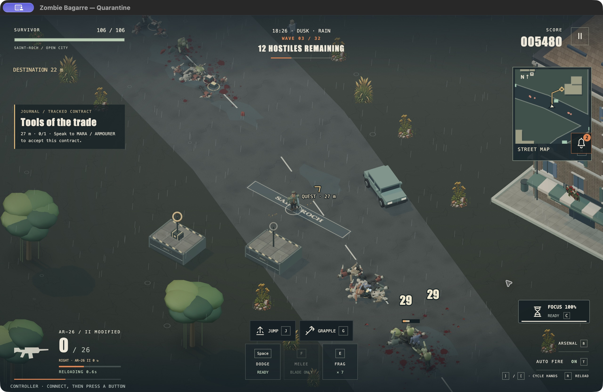

# 4.49.3 — Cover, safe exits and refreshed Mac edition

Electric shots in first- and third-person views now use the actual crosshair contact. An exposed head above cover can be hit when the muzzle has a clear line; a blocked muzzle still stops the shot. Chain lightning draws the same segments used by its collision checks. This does not add a new electric headshot damage multiplier.

Leaving a shelter now checks the shared regional arrival rules, including incoming bullets, rockets and burning building surfaces. Outdoor threats freeze while indoors; the exit searches for a safe nearby arrival before resuming them. Harmless player bullets and completed hazards do not displace the hero unnecessarily. If there is no safe arrival, the existing blocked-exit behavior retains the indoor session.

The macOS package also includes the compact phone/controller HUD from [4.49.2](RELEASE-4.49.2.md).

## Verification

- **583 automated tests passed**, including new regressions that reproduced the original defects. Independent cross-review found no actionable regression.
- Four automated full campaigns completed: relaxed, standard and nightmare campaign, plus standard Open City. These are simulated campaigns, not ordinary human playthroughs.
- Actual browser electric-shot fixture: exposed target health **10000 → 9957**, one beam; blocked muzzle **10000 → 10000**, zero beams. Both still had the target under the crosshair. [Exposed result](qa/4.49.3/arc-exposed.json), [blocked result](qa/4.49.3/arc-blocked.json).
- Actual workshop exit checked in two generated cities. The hero arrived beside the threatened doorway and kept **106/106 health**, with test invulnerability removed. [First capture](qa/4.49.3/safe-exit.json), [clean-page repeat](qa/4.49.3/safe-exit-clean.json).
- Production build passed with the existing large-chunk advisory. The first development iframe emitted one source-unattributed MutationObserver error around a hot reload; no matching observer exists in game source, and a fresh-page repeat reported no errors. This is recorded rather than described as a fully clean initial session.
- Exact Apple Silicon package passed signature verification and offline hardware startup, reporting WebGL graphics **enabled**. In a separate temporary-profile native session, ordinary UI input cleared waves 1 and 2, reached wave 3 with 33 kills, selected upgrades, evolved the carbine, used Focus/dodge, opened the atlas and tracked a contract, then paused and quit through the confirmation dialog. The pause readout recorded **48 seconds of simulation time**; this is a short native gameplay check, not a sustained soak or full expedition. [Native pause record](qa/4.49.3/mac-session.txt).

## Mac download

[Apple Silicon test edition](https://github.com/iamknow0ne/zombibagarre/releases/tag/v4.49.3), macOS 13+. Ad-hoc signed, not Developer ID signed or notarized. The native run logged an Electron sandbox-extension resource warning but no game renderer error or crash; the default sandbox and hardware backend remained enabled.

Archive SHA-256: `4b4eec5eb7e917dbfd5d3663ac4ce560f5f15d87b066907518bc5c080d245567`.

Physical phone/controller verification, sustained native performance/memory soak, broader perspective QA, ordinary 32-wave playthrough and character-art production integration remain open. No overall FPS improvement or whole-game completion is claimed. Hangar/orbit/moon remain downstream; Steam Deck and Apple signing are deferred.
