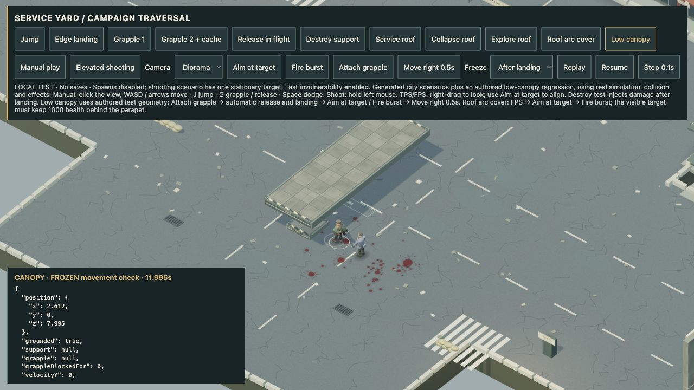

# 4.49.4 — Grapple recovery and lighter effect selection

A grapple cable can fit beneath an overhang that blocks the hero's body. That edge case previously left the pull active indefinitely and prevented firing. After 350 ms of blocked movement, the hero now releases the cable, lands normally and regains movement and weapon control. Brief collisions that clear still let the pull finish. This was reproduced in authored low-headroom geometry; a sampled generated-city sweep did not reproduce it, so it is not presented as a frequent city failure.

Building impacts and degradation now calculate each visible piece's world distance once per event. Health bars sort only eligible, recently wounded enemies, retain their existing lifetime and display limits, and skip unnecessary selection when no bars exist. The selected pieces and bar order match the previous algorithms; there is no reduction in visual detail.

## Verification

- **591 automated tests passed**, including three grapple regressions and five render-selection regressions. Independent review found no actionable traversal regression.
- Standard Open City automated campaign completed all **32 waves**, with 1,623 kills. This is simulated campaign coverage, not an ordinary full human playthrough.
- Actual browser low-canopy fixture attached the grapple, released it after obstruction, landed on the support, fired four shots (**10000 → 9835** target health), and moved **2.612 m** sideways. No captured browser errors. [Release state](qa/4.49.4/canopy-release.json) · [recovered movement and firing](qa/4.49.4/canopy-recovered.json).
- CPU-only local benchmark: ordering 200 building pieces fell from **0.51515 to 0.06668 ms**; selecting 12 active health bars among 60 enemies fell from **0.02310 to 0.00282 ms**. Reproduce with `node scripts/render-candidates-check.mjs`. [Raw result](qa/4.49.4/cpu-selection.json).
- Actual browser, fixed seed 20261012, balanced graphics, 1280×720, 240-frame samples: combat **60.2 → 59.7 FPS**; collapse **97.3 → 93.5 FPS**. These short samples **do not establish an overall FPS improvement**. Draw calls, triangle counts and peak effect counts matched exactly before/after. [Before](qa/4.49.4/performance-before.json) · [after](qa/4.49.4/performance-after.json).
- A separate 6,000-frame combat check covered **100 seconds of simulation**. Effects peaked at 394; texture count settled at 36. Geometry count rose from 627 to 720; this does not establish a memory plateau. This resource check overlapped automated tests and a second browser fixture, so its timing is not a controlled FPS comparison. No captured browser errors.
- Two isolated diagnostic repeats reproduced the resource counts. In the final run, frame 1800 → 6000 GPU geometry rose **645 → 720**: **54** additional registrations belonged to existing prop geometry, and **21** to active lightning. Prop ownership, actor batches and building counts remained flat. GPU count minus scene-registered geometry stayed at **17** throughout that interval. This is consistent with first-use prop residency as sunlight/shadows move, not growing scene ownership. The diagnostic uses a clearly labelled Three r169 listener heuristic; it is not proof of an indefinite memory plateau or an exact breakdown of the retained 17 resources. [Ownership inventory](qa/4.49.4/resource-inventory.json) · [residency diagnostic](qa/4.49.4/resource-residency.json).
- Production build passed with the existing large-chunk advisory. The exact Apple Silicon package passed signature verification and offline hardware startup: version 4.49.4, WebGL GPU enabled. This pass verified startup, not a new ordinary native playthrough.
- Mac archive SHA-256: `08c63e4d1d89e90cec5a848b58eeb74960fc410e7d412fafbd54af2441e1ef56`.

## Release scope

The [Apple Silicon macOS test edition](https://github.com/iamknow0ne/zombibagarre/releases/tag/v4.49.4) remains ad-hoc signed, not Developer ID signed or notarized. Signing and Steam Deck work remain deferred.

Physical phone/controller verification, sustained native soak, wider perspective checks, ordinary 32-wave playthrough, production character-art integration, and hangar/orbit/moon progression remain open. This is a narrow reliability checkpoint, not whole-game completion.
