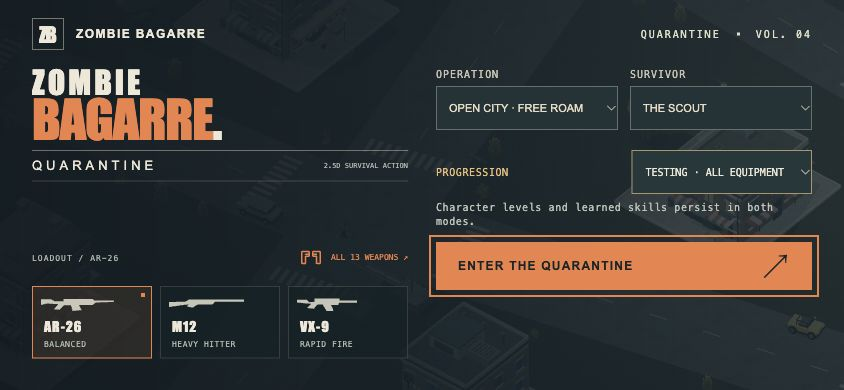

# 4.49.5 — Accessible field console and reliable weapon selection

The main menu now scrolls safely on short screens, uses consistent navigation targets and places expedition setup beside the loadout in phone landscape. The launch action stays visible at 844×390. Controller guidance has its own desktop strip; compact layouts omit it. Notification counts now retain contrast against their orange badges.

In Hero progression, choosing an unlocked gun before learning dual wield now replaces the main-hand gun. Previously it could silently retain the old weapon. Locked weapon requests leave the current weapon and melee attack intact. Learned dual wield and testing mode retain paired weapons.

## Verification

- **593 automated tests passed**, including single-hand selection, repeated selection, ammo/reload preservation, melee switching, locked requests and dual-wield regression checks.
- Actual browser menu checks at **320×568, 390×844, 844×390, 1280×720, 1280×857 and 1440×900** found no horizontal overflow, overlapping interactive controls or targets smaller than 44×44. Lower options remain scrollable; keyboard focus scrolls navigation into view. [Layout measurements](qa/4.49.5/menu-metrics.json).
- Actual no-save browser fixture: learned Breach training in Hero mode, selected the shotgun through Arsenal, and verified shotgun equipped, off-hand disabled and repeated selection stable. [Selection evidence](qa/4.49.5/arsenal.json).
- Actual 844×390 busy combat fixture retained the compact HUD with a simulated PlayStation controller. No captured browser errors. This is browser simulation, not physical controller or phone testing.
- Production build passed with the existing large-chunk advisory.
- Exact Apple Silicon package passed signature verification and offline GPU-enabled startup. Its actual native menu was visually checked with an isolated test profile and quit cleanly. This is menu/startup coverage, not a new native playthrough. [Mac menu](qa/4.49.5/mac-menu.png).
- Mac archive SHA-256: `94e4cea1f67b5b365e15c818b1087d731c2f932dfecebe9b99071b239ab45a30`.

[Portrait menu](qa/4.49.5/menu-portrait.png) · [Desktop menu](qa/4.49.5/menu-desktop.png) · [Compact controller gameplay](qa/4.49.5/hud-controller.png)

## Scope and remaining work

The Apple Silicon test app remains ad-hoc signed, without Developer ID signing or notarization. Steam Deck work remains deferred. Production character-art integration, wider perspective/traversal checks, ordinary full expedition, sustained native soak and hangar/orbit/moon progression remain open. This release does not establish whole-game completion or physical device compatibility.

## Publication

Runtime `5de4869a60abd6f0d25762f2dfcc11a13726aa71` is published. Pages run `38641595937` passed; the actual public menu reports BUILD 4.49.5 with no captured startup errors. [Published landscape capture](qa/4.49.5/published-landscape.png). The [Mac release](https://github.com/iamknow0ne/zombibagarre/releases/tag/v4.49.5) contains the exact tested archive: 141,689,709 bytes, GitHub asset `641744684`, matching SHA-256 above. Cancellation of the deferred automatic Steam Deck workflow `38641720509` was requested.
