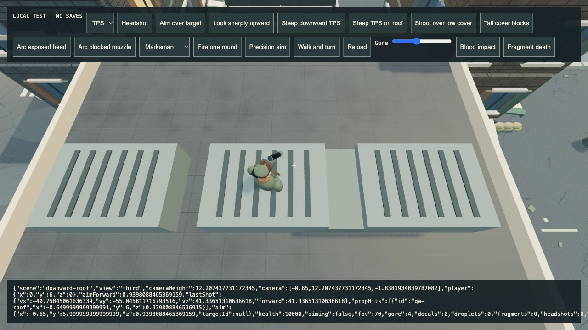

# 4.49.8 — Downward aim and safe boss-lane arrivals

Steep downward TPS aim now keeps the crosshair and bullets ahead of the hero. The chase camera used the full boom length horizontally while adding its pitched vertical offset, stretching the boom and moving the ground target behind the player. The boom now follows a spherical arc. At maximum downward pitch, the flat-ground target changes from 1.758 m behind to 0.904 m ahead. Shoulder choice, precision aiming, vehicles, cover retraction and elevated support are covered by regressions.

Shelter exits and regional arrivals now check the full footprint of boss attack lanes. Previously they treated a 19 m harpoon lane as a small circle around its center, so an apparently safe arrival could be hit as the frozen attack resumed. The arrival check uses the same lane predicate as combat, with a body margin. Circular hazards retain their existing behavior.

## Verification

- **605 tests passed**, including real projectile direction, both shoulders, precision aim, cardinal headings, vehicle boom length, roof contact, cover retraction, regional arrivals and shelter exits. The independent 54-test region/interior/boss suite also passed.
- Production build passed with the existing large-chunk advisory.
- Actual browser: downward street shot travels forward at 41.35 m/s; roof shot travels forward at 41.34 m/s and impacts the support at y=6. Neither points back toward the camera. [Street result](qa/4.49.8/downward-street.json) · [Roof result](qa/4.49.8/downward-roof.json).
- Actual browser shelter fixture: the doorway is inside a real boss harpoon lane; the selected side arrival is outside. On attack resolution at simulation time 0.933 s, health remains **106** and the player is outside the lane. Later unrelated boss attacks reduce health; this check does not claim immunity after arrival. [Before](qa/4.49.8/shelter-lane-before.json) · [Resolved attack and later state](qa/4.49.8/shelter-lane-after.json). Placement is explicit fixture setup, not normal gameplay navigation.
- No captured browser errors in these fixtures.
- Exact Apple Silicon package passed signature verification and automated offline startup with WebGL GPU enabled. This is startup coverage, not a new native playthrough or sustained hardware soak.
- Mac archive SHA-256: `42a67b9647c6f0cfaec9425584f2beb3ffddce57fb649739289d78d0269db2b8`.

## Longer resource sample

The frozen local combat fixture completed **18,000 fixed steps / 300 seconds of simulation**, including 60 warm-up frames, with 60 enemies, flame + arc weapons, balanced graphics and a 1280×720 browser viewport. It was built before this patch was finalized and tests the unchanged diorama rendering path; it is not an exact final-package soak. [Raw result](qa/4.49.8/combat-soak.json).

From frame 6,000 onward, sampled GPU geometries fluctuate between **689 and 719**, ending at 691; textures remain **34**. Character batches, building and prop geometry ownership remain constant. Peak live effects are **415**. No captured browser errors. This bounded sample does not establish an indefinite memory plateau, CPU heap stability, phone thermals or a whole-game FPS improvement. The early part overlaps automated tests and a second QA view; the recorded 66.8 FPS is not a controlled performance comparison.

The raw result's listener-name residency heuristic is **invalid in the minified fixture** (zero values do not mean zero GPU registrations). Only renderer counters and scene ownership counts are used above. The fixture now reports that heuristic as unavailable in production builds and offers the longer run through an explicit button.

## Remaining gates

Wider perspective/visibility coverage, production character likeness/animation/armour/LOD integration, an ordinary full expedition and sustained native gameplay remain open. Hangar/orbit/moon are downstream. Developer ID signing/notarization, Steam Deck and other ports remain deferred. No physical phone/controller test is claimed.

## Publication

Runtime `7b6548ffd9997aa237b2140df97e244defb35af3`; Pages workflow `38693865678` passed. The actual public menu displays BUILD 4.49.8 with no captured startup errors. [Published menu](qa/4.49.8/public-menu.png).

[Mac release](https://github.com/iamknow0ne/zombibagarre/releases/tag/v4.49.8) asset `642948916` is 141,689,918 bytes and its GitHub digest matches the tested archive above. A separate isolated-profile native session reached ready, but hands-on UI access was blocked by the locked Mac; that process was stopped cleanly. No new native gameplay result is claimed.

Deferred Steam Deck workflow `38694020429` was cancelled.
