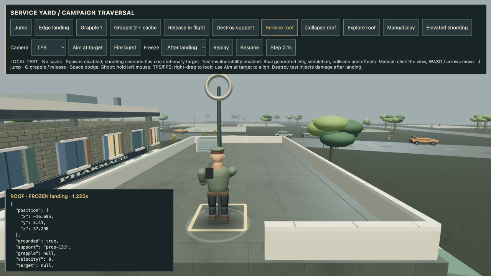
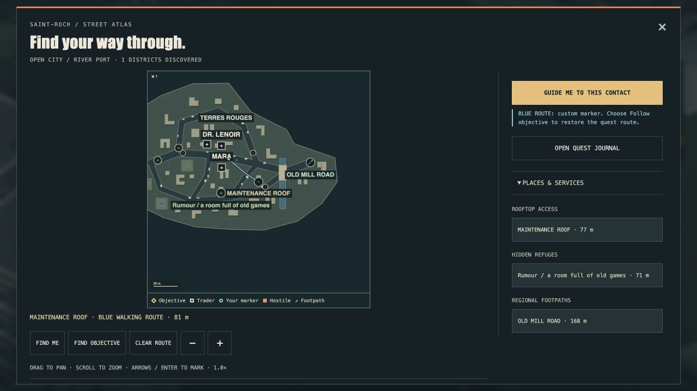
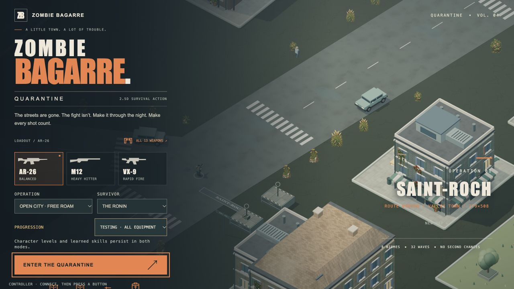

# 4.49 — Reachable maintenance roofs

Open City now selects a low, accessible building for a maintenance roof route.
The map's **Rooftop access → Maintenance roof** destination guides you to its
street approach. From there, grapple onto the marked landing area; use the
opening in the parapet to return to the street.

The roof slab, five parapet segments and ventilation unit share one authored
geometry plan with their collision boxes. Decorative details stay inside those
solids. Existing random roof fittings are suppressed on this building. These
parts share the building's health: attacking a parapet damages the structure,
and collapse removes all roof support and its anchor. Explosions and melee
sweeps cannot multiply damage by hitting several parts of that same building.
Nearby melee enemies can batter the supporting building, so rooftops are not
permanent immunity. Partial facade damage leaves this roof intact until collapse.

## Validation

- Deterministic roof selection, pedestrian approach, real grapple ascent and
  return to the street checked across ten seeds.
- Tests cover parapet/HVAC collision, projectiles, structural damage, collapse,
  enemy pressure, paused movement and nearby/distant anchor prompts.
- Actual browser seed 73 landed on the roof at y=3.41 m. Destroying its host
  released the hero and returned it to y=0. [Landing](qa/service-roof-4.49.json)
  and [collapse](qa/roof-collapse-4.49.json) captures use the production simulation.
- Normal game map controls created an 81 m walking route to the maintenance
  approach in a separately generated city. Browser error logs were empty.
- **575 gameplay tests and 29 art tests pass**; production build passes with the existing large-chunk advisory.
- Four automated full campaigns reached wave 32 victory: relaxed 1,204.7 s, standard 1,336.8 s, nightmare 1,315.1 s and standard Open City 980.8 s. This is simulation evidence, not a human full playthrough.
- The exact packaged Apple Silicon app passed isolated hardware startup with GPU enabled. Archive: 141,688,108 bytes; SHA-256 `f75225b08e4002578f300b5e90beb413c8e5e8f73e0da8a619a0e23c4b7c2ef8`.

## Character development checkpoint

The detailed Rook study now has travel-speed locomotion, starts, stops and
strafing with planted-foot anchors and measured boot clearance. **29 art tests
pass** and actual browser motion was reviewed. [Evidence and remaining art
gates](art-direction/ROOK-MOTION-CHECKPOINT.md). This remains a development
viewer asset, not the production hero replacement.

## Limits

This is one curated roof per suitable city, not collision-complete access to
all procedural buildings. It introduces no extra roof reward or elevated enemy
archetype. More roof layouts, elevated threats, perspective QA, the ordinary
full playthrough, character likeness/production integration and downstream
hangar/space chapters remain open. Physical phone/controller verification is
not claimed. macOS remains ad-hoc signed and unnotarized; Apple Developer ID
and Steam Deck work remain deferred.

## Published artifact

Runtime commit `da2f11ab554d2229df4691103e106ffba19eb2f6`. The
[v4.49.0 Mac test download](https://github.com/iamknow0ne/zombibagarre/releases/tag/v4.49.0)
was uploaded with the same size and SHA-256 as the hardware-tested local archive.
The automatic Steam Deck tag build was cancelled because that platform is deferred.

Pages run `38616849197` passed. The public game loaded to its menu with
BUILD 4.49.0 and no captured browser errors on 14 October 2026.

