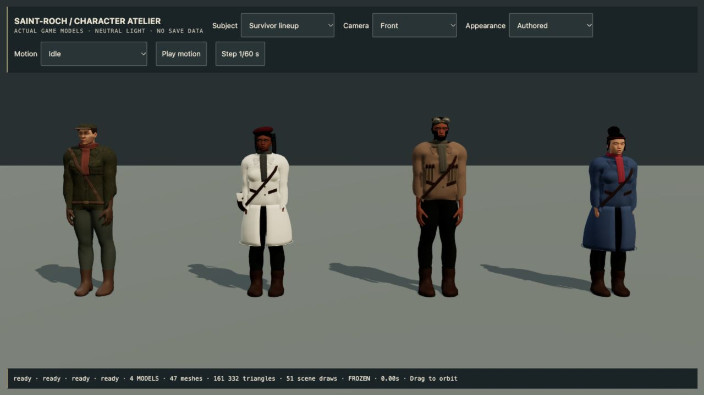
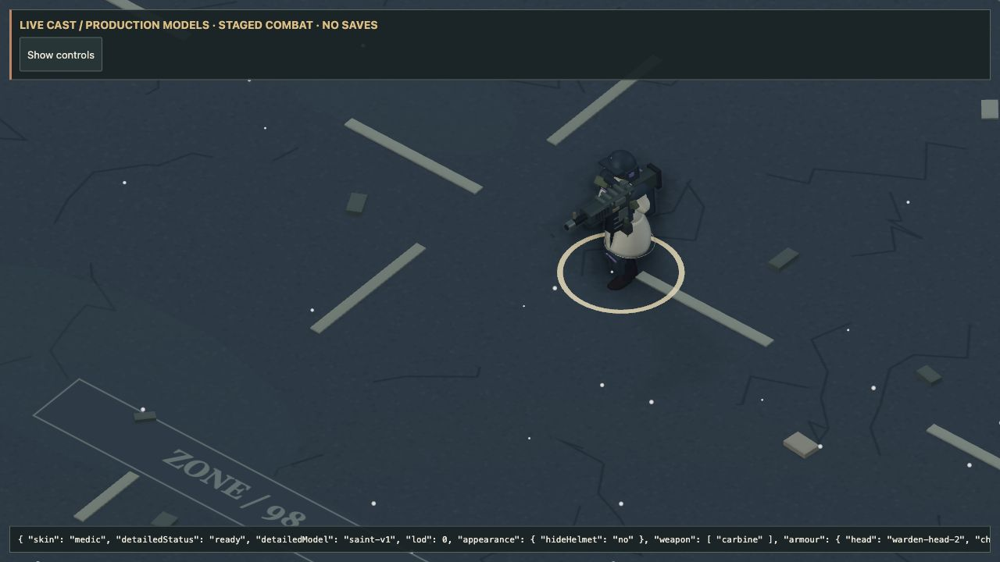
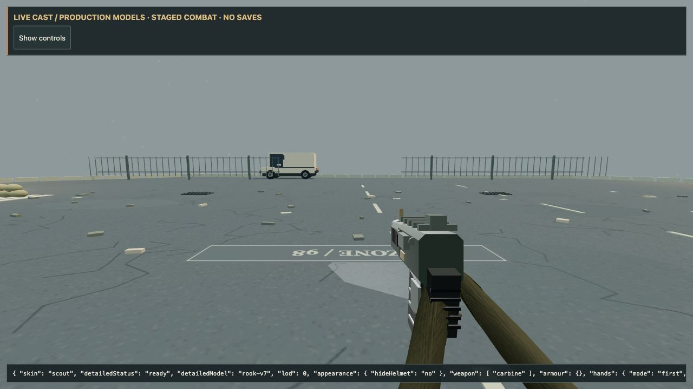
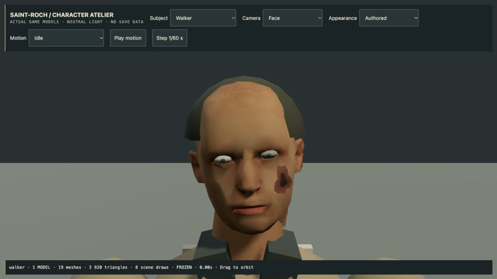
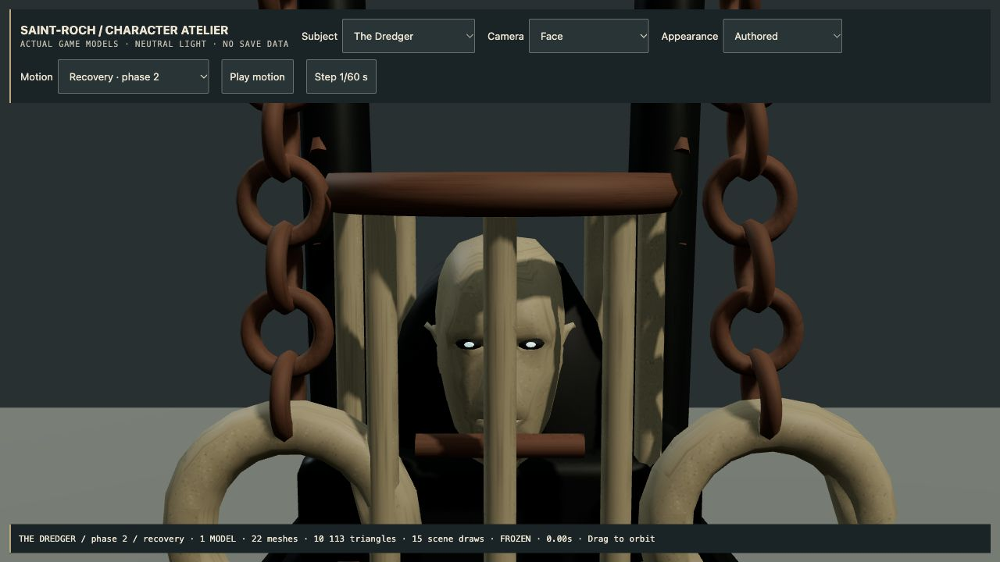

# 4.51.0 — The production cast

15 October 2026. The four survivor identities now use distinct authored bodies in
the actual game, with anatomical faces and hands, tailored clothing, shared rigs,
and reduced geometry at street distance. This replaces the Rook-only integration.

## Survivors and their equipment

- **Saint:** distinct face and body, braided hair, beret, ivory medical coat and satchel.
- **Torque:** broader proportions, beard, mechanic's leather clothing and goggles.
- **Vesper:** distinct face and body, tied hair, red band and split navy coat.
- **Rook:** retains the reviewed detailed model, now with a skinned distance version.
- Rifle, paired firearms and melee retain their existing weapon grips. Detailed
  first-person fingers and sleeves follow those grips without torso intrusion.
- Armour and helmet visibility, saved skin/hair/clothing dyes, custom hair and
  headwear remain usable. Custom face, coat and accessory combinations use the
  modular body with new anatomical heads, also used by the traders. They do not
  silently discard the player's choices.
- Interior foot placement now uses the same leg solve as the outdoor world.
  Character portraits update when a newly selected survivor finishes loading.

## Infected and bosses

All six ordinary infected archetypes use an anatomical head surface and shared
skin texture, projected cheek wounds, improved eye placement and continuous
organic forms. Crawl poses, dismemberment and corpse batching remain supported.
The head texture is shared rather than loaded once per monster.

Dredger and Reaper expose gaunt captive faces inside their cages. Bloom and Root
Cathedral gain cupped petals, veins, ribbed cores and more deliberate crowns.
Existing sealed-mask boss identities remain intact. This is a surface refinement
of the eight existing encounters, not a new set of boss mechanics.

## Rendering and asset ownership

Each detailed survivor has two geometry levels sharing the same textures and rig.
Screen-space size chooses the level, with hysteresis; portraits and first-person
hands retain their detailed geometry. Skeletons are consolidated within an actor,
never shared between independently animated characters. Lazy loading and cancelled
appearance changes are covered by regression tests.

| Identity | Runtime size | Detailed / distance triangles | Visible mesh draws |
| --- | ---: | ---: | ---: |
| Saint | 8.06 MB | 44,822 / 19,263 | 13 |
| Torque | 7.76 MB | 37,862 / 16,266 | 12 |
| Vesper | 7.40 MB | 32,194 / 13,832 | 12 |

These are model budgets, not whole-scene FPS measurements. Original embedded
texture payloads are preserved. Reproducible builders, Blender sources, morph
inputs, hashes and CC0 attribution accompany the assets in `assets/source/cast`.

## Validation

**622 gameplay regressions and 89 actual-model art checks pass.** The production
build passes with the existing JavaScript chunk-size warning. The exact Mac package also passed ad-hoc signature validation and hardware
startup: offline world, shaders, menu and desktop bridge initialized. This is
startup evidence, not a sustained native gameplay benchmark.

Live-browser review includes all four loaded identities; rifle, paired SMG/flame
and katana first-person poses; armoured Saint walking and helmet hiding; Torque's
custom hair and corrected clothing dye; custom Saint/Vesper faces; the workshop,
trader and asynchronous dossier portraits; Dredger's visible captive and Cathedral
phase-two pose; all six crawlers, their corpses and the street-distance LOD. The
final reviewed pages emitted no console errors. See the [capture index](qa/cast-revamp/README.md).

## Honest limits

This is a complete integration of the four default survivor identities and a
cast-wide anatomy/surface pass. It does not establish photorealistic parity with
the painted lore portraits. Custom coats, hair and accessories retain stylized
modular construction; faces do not yet have expression or dialogue animation.
Physical phone/controller validation, sustained target-device performance and a
normal full expedition remain separate QA gates. Apple notarization and Steam Deck
work are still deferred.

## macOS package

`Zombie-Bagarre-4.51.0-macOS-arm64.zip`

SHA-256: `cfc4aab0b19e91b5ca89f6cc8c73c0d85b9fb71993e2015112330aa25f774fbb`

Apple Silicon, ad-hoc signed, not Developer ID notarized. The locally built app
is available in `release/4.51.0/Zombie Bagarre-darwin-arm64/`. Downloaded copies
may be blocked by Gatekeeper; see [the Mac guide](MACOS.md).

Runtime commit: `5af6fef10ad59937c0e02ac89fe89afea1e66137`.

## Publication

GitHub Pages workflow **38723532216** passed, including both test suites and the
production build. The public title screen reports BUILD 4.51.0 and emitted no
console errors during the check; [capture](qa/cast-revamp/public-menu.png).

[macOS release v4.51.0](https://github.com/iamknow0ne/zombibagarre/releases/tag/v4.51.0)
is published. GitHub reports the exact ZIP digest above, matching the locally
hardware-startup-tested artifact. The tag-triggered Steam Deck job was cancelled
because that platform remains deferred.
