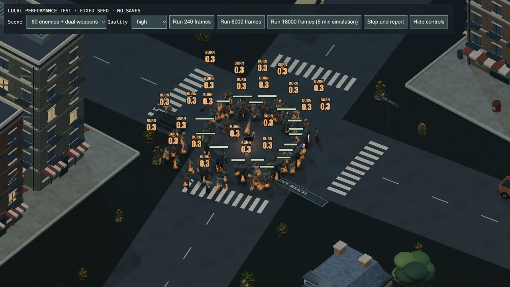

# 4.51.1 — Safer returns and Android audio recovery

15 October 2026.

Returning from a shelter or another region now avoids structural debris about to
hit the arrival point. Previously, a collapsing slab frozen during the visit
could strike the hero on the first resumed frame. The safety check covers moving
fragments, delayed falls and fragments whose supporting building disappeared;
spent and safely resting fragments do not unnecessarily block travel.

The Android adapter now retries audio recovery on the next player gesture if the
system rejects a resume request. An old failed request cannot override a newer
successful recovery. Browser and desktop audio handling are unchanged.

Android pull-request builds now cover shared game code, assets, dependencies and
tests, and run Android lint in addition to packaging and byte-for-byte bundled
asset verification. The Android edition remains a debug-signed test APK; it is
not a Play Store release.

## Validation

- All 635 gameplay regression tests pass, including five new audio and return-safety checks.
- The related region/interior/quest suite passes (54 tests); the Android/save/input suite passes (43 tests).
- A real WebGL combat scene completed 6,000 fixed simulation frames (5,940 measured after warmup), with 60 enemies and paired flame/electric weapons at high quality, 1280×720. No browser console errors were reported. Enemy geometry remained constant and textures settled at 46 after lazy loading. Live environmental/effect geometry varied, so this is not a proof of zero resource growth in every scene.
- [Raw rendering evidence](qa/4.51.1/combat-resources.json) records the scene, frame timings and ownership checkpoints. Builds and tests ran concurrently on the Mac; timings are not an isolated benchmark or phone FPS.

The packaged Apple Silicon app passed ad-hoc signature verification and hardware
startup with GPU enabled (offline world, shaders, menu and desktop bridge). This
is not a native gameplay endurance test. The ZIP includes the updated installation
guide; the tested app bundle is unchanged.

The Android APK passed byte-for-byte verification for all 48 assets, v2 signature
verification and lint (0 errors; warnings for landscape orientation and legacy
backup configuration with backups disabled). The same-key update returned
`Success` on the connected OnePlus 7 Pro without clearing game data. Its display
still reports keyguard locked. Android test APK publication remains pending
visible device QA.
The physical Android device remains locked; visible rendering, touch, audio,
backup pickers and phone performance are not verified. Apple Developer ID signing
and notarization remain deferred. Expedition persistence, new interiors, hangar,
orbit and planetary travel are still future milestones.

## Artifacts

- `Zombie-Bagarre-4.51.1-macOS-arm64.zip`
  SHA-256: `6643d8c7b7760999ae15082f3714da2950c60f92e14b2a3adf483d672eb2602a`
- `Zombie-Bagarre-4.51.1-Android-test.apk`
  SHA-256: `f624c17fa61f5aec9c4d1617c6118921361f78f3ef69052c28e5a0875e58343b`
