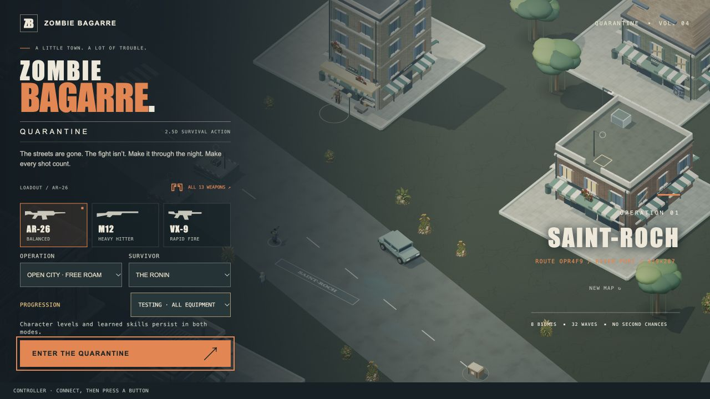

# 4.51.2 — Consistent build identity

15 October 2026. This supersedes 4.51.1, whose gameplay fixes were present but
whose hard-coded title/loading labels still said 4.51.0.

The loading screen, title and development diagnostics now derive their version
from the same package metadata used by the Mac and Android builds. A post-build
check rejects missing or stale visible version labels before packaging. This
prevents future patches from looking like an old cached copy.

The [4.51.1 gameplay fixes and QA](RELEASE-4.51.1.md) remain included: safe returns
around falling structural debris and retryable Android audio recovery. Those
changes passed 635 regressions and a 6,000-frame real-browser combat resource
check. The Android build pipeline also passed independently on GitHub (run
38728019789), including packaging, lint and all asset comparisons. That CI APK
has a different debug key and must not be installed over the local phone build.

This follow-up changes release identification, not combat or rendering logic.
The fresh web build verifies both visible labels as 4.51.2. A separate temporary
fixture confirmed the gate rejects stale labels and accepts generated future
version labels. The fresh Mac bundle passed ad-hoc signature verification and
hardware startup with GPU enabled. The Android APK passed comparison of all
48 bundled assets, v2 signature verification and a same-key, data-preserving
update on the OnePlus 7 Pro.

The phone is still locked. Android rendering, touch, audio, file pickers and FPS
remain unverified despite successful APK installation. The Mac edition remains
ad-hoc signed and not notarized; hardware startup is not an endurance test.

## Artifacts

- `Zombie-Bagarre-4.51.2-macOS-arm64.zip`
  SHA-256: `1b21e2f5dd025e70a882a5537d4d91839d29cc1bf5c08d4c896551bea83629d7`
- `Zombie-Bagarre-4.51.2-Android-test.apk`
  SHA-256: `1c7c30e9d013670fb79f13b82a04633e939490d294a7ebc6de48831fd0652441`

## Publication evidence

Runtime source `ff53c5478d26ad48c638a40e7197fd96058a7e2b`. Pages run
`38728843853` passed (including the gameplay suite, model checks and version gate).
The public title reports **BUILD 4.51.2**, and the inspected page has no captured
console errors. GitHub's digest for the uploaded Mac ZIP matches the local hash
above. The tag-triggered Steam Deck build was cancelled because that work remains
deferred. The Android APK remains a local installed test build, not a published
or hardware-gameplay-approved release.

