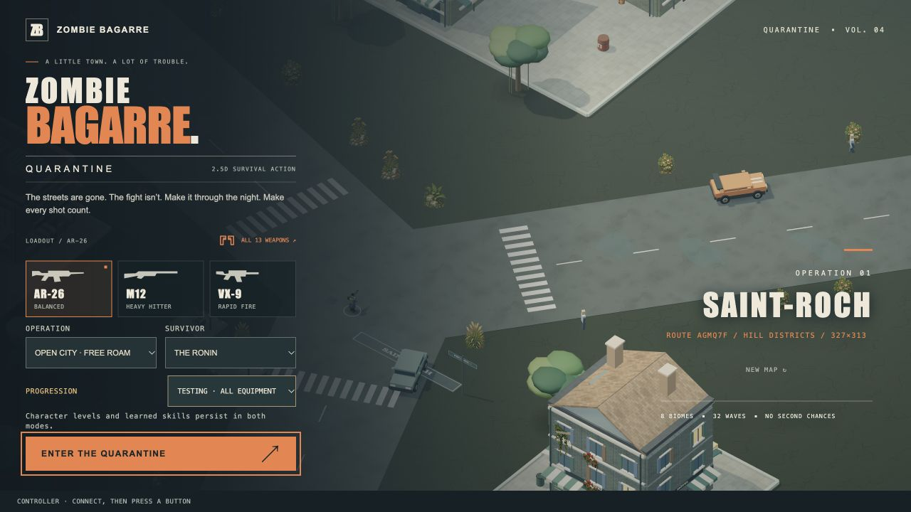

# 4.52.0 — Leave the city, keep your expedition

15 October 2026. This release adds the persistence needed for longer regional
adventures. In a safe outdoor position, pause and choose **Save expedition &
exit**. The title screen offers **Resume expedition**, returning to a paused
world with the same route, supplies, quests, upgrades, enemies and damage.
Current and previously visited regions are retained together.

The checkpoint is device-local and one-use: save again before leaving. It is
separate from permanent character backups, bounded to 2 MB and checked for
corruption and incompatible data. Restore prepares the world before consuming
the record. Shared browser locks prevent competing tabs from both resuming it.
A changed permanent hero is detected rather than silently overwritten. There
is no automatic crash recovery, cloud sync or expedition export.

Short landscape pause menus now put Resume and Save in view immediately. On
Android, losing window focus sends the same pause/input-clear signal used by
backgrounding, covering system dialogs that do not pause the Activity. Native
packaging and art-source trees are excluded from development file watching.

## Validation

The full 655-test suite passed, followed by 21 final checkpoint/UI regressions
including one additional removal/readback failure case. Browser interaction
verified save → reload → resume, a full first combat wave, an earned upgrade,
a second save/restore preserving wave-two score/mastery, and cancellation of
replacement. Landscape 844×390 and portrait 390×844 were visually reviewed.
Production version verification passed. See [QA evidence](qa/4.52.0/README.md).

The unlocked OnePlus 7 Pro renders the game using Adreno 640/WebGL 2 and reached
combat and upgrade selection. Recurring Dolby Atmos system crash dialogs still
block reliable controls, clean performance measurements and remaining acceptance
tests. Android remains a local test APK, not an approved public mobile release.
No changes to that unrelated system app were made.

The Mac edition is ad-hoc signed, not Developer ID signed or notarized.
Spaceflight, additional regional destinations, indoor combat and full-expedition
endurance remain future milestones.

## Publication and artifact evidence

Source `f82eed4707ee8ade06fd7adf91cb1e6bf0b7e57b`. Pages run
`38734267560` passed the final **656 gameplay tests**, **89 model checks**,
production build and deployment. Public title reports BUILD 4.52.0 with no
captured console errors.

- [Mac download](https://github.com/iamknow0ne/zombibagarre/releases/tag/v4.52.0):
  `Zombie-Bagarre-4.52.0-macOS-arm64.zip`, SHA-256
  `6e2847a707b3395a820cec18a63746982ec20435bb3beaefe4c17e13a5112d25`.
  Exact packaged app passed ad-hoc verification and hardware GPU startup;
  GitHub uploaded digest matches. This is not native endurance evidence.
- Local Android `Zombie-Bagarre-4.52.0-Android-test.apk`, SHA-256
  `d27909c8aa369118e5ef49099957768b4ec44399b9fa3a21875e222291c2148f`.
  All 48 bundled assets compared successfully (59,206,432 bytes), v2 signature
  verified, same-key update returned Success. Cold activity launch 701 ms;
  menu rendered. Recurring Dolby dialog still owns focus. No public Android
  artifact was promoted.
- Tag-triggered Steam Deck workflow 38734523454 cancelled because that port is deferred.

