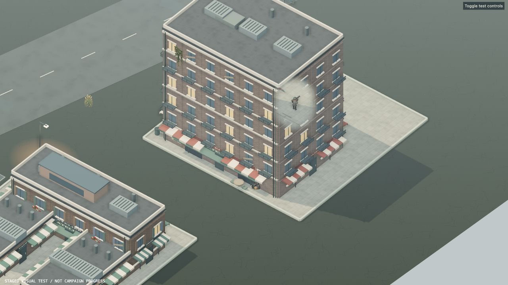
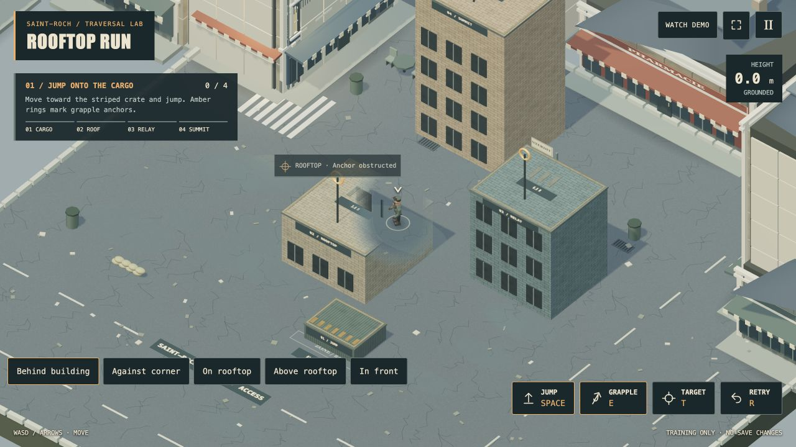

# Building visibility · 4.39.1

The survivor stays readable behind architecture in the city and Rooftop Training. The course's custom meshes previously bypassed the building cutaway shader altogether.

## What changed

- A capsule-shaped opening follows the feet and head, with a clear central area for the body and weapons and a broader transparency feather around it.
- The colour pass uses the existing multisample anti-aliasing for smooth coverage rather than a coarse, speckled edge. Devices without it retain a screen-aligned dithering fallback.
- Roofs and surfaces under the survivor's feet stay intact. The effect follows elevation during jumps and grappling, and starts correctly even on a paused first frame.
- Grapple labels move above the survivor when they would cover the character, and stay within the phone screen.
- Course walls, windows, rooftop markings and building labels use the same visibility treatment as the city's architecture.
- Shadows and collision geometry remain unchanged. Materials retain their opaque depth behaviour; there is no additional scene pass or duplicate building geometry.

## Verification

308 automated tests pass, including camera transforms, elevated support preservation, zoom scaling, effect transitions, material reuse, texture changes, and AO restoration. Production build passes; the existing large Three.js bundle warning remains.

Browser checks cover rear walls, corners, standing on rooftops, Classic and Pixel Diorama, high graphics with AO, the lighter render path, and a 390 × 844 phone viewport. No shader errors appeared during these checks. Screenshots above are staged regression scenes using the real renderer, not campaign progress. Phone viewport checks do not substitute for testing physical mobile hardware.

Local fixtures:

- `/dev/visual-qa.html?scene=occlusion`: behind/in front/alongside, walk behind the facade, graphics and texture controls.
- `/traversal.html?visibilityQA=1`: behind a course building, corner, rooftop, airborne and in-front positions. These position buttons exist only in development and are removed from the public build.

TPS/FPS retain their separate camera-collision and avatar-visibility system. This fix targets the diorama view used in the city and training course. The downloadable desktop archive remains version 4.37.0; this patch ships to the browser build.
