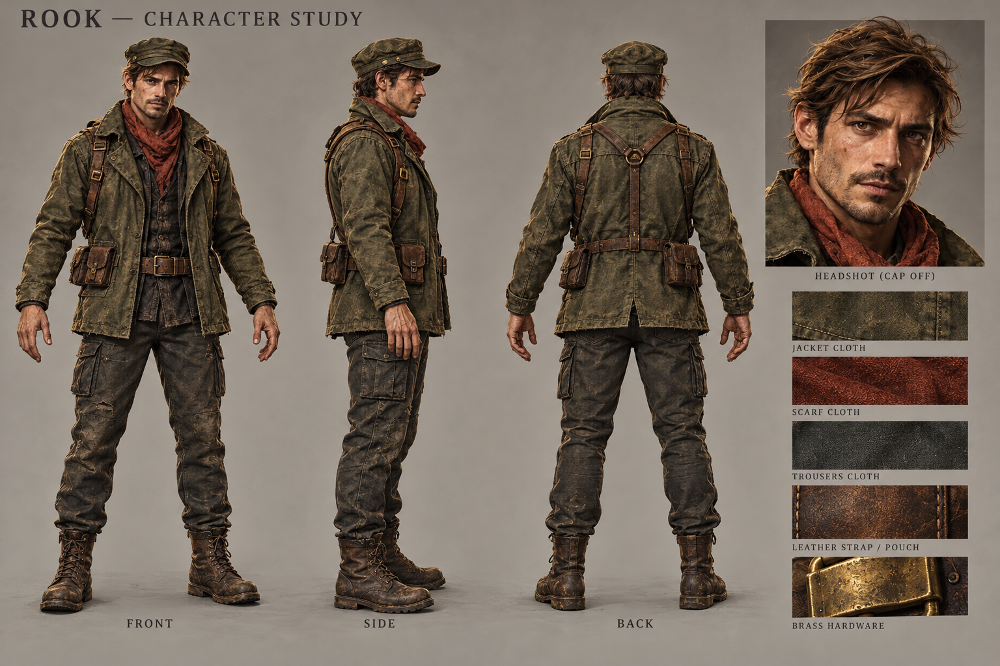

# Character art direction — from portraits to playable heroes

14 October 2026. Production proposal following the 4.44 source and artwork review. The generated sheet is concept reference, not an implemented model or an in-engine screenshot. No runtime visuals changed in this pass.

## Diagnosis

The existing portraits and Quarantine key art promise believable adult anatomy, recognizable faces, layered clothing, worn materials and atmospheric lighting. The current hero uses rigid procedural pieces in `SurvivorVisuals.js`: rounded boxes, reshaped spheres, cylinders and lathed clothing. Its cloth/leather detail is a small repeated procedural texture. Adding more pieces cannot economically produce the same quality of anatomy, garment construction and deformation as an authored character.

`CharacterMotion.js` supplies useful continuous motion signals, but `World.animateCharacter` primarily rotates separate limb groups with periodic functions. The issue is pose, contact, weight and transitions, rather than a lack of animation frames. Preserve its movement/turn/impact signals as inputs to a richer animation controller.

The existing renderer can support imported animated characters. A whole engine rewrite is not the first step. There are currently no GLB/GLTF/FBX/Blend character assets under `public`.

## Direction

Aim for grounded painterly realism: adult proportions, identifiable faces and silhouettes, readable cloth folds, matte skin, worn leather and restrained metallic highlights. Maintain the portraits' character identities. Do not claim that an illustration's pore-level detail will survive the normal distant gameplay camera.

Prioritize silhouette, proportions, large color blocks and pose at gameplay distance; facial likeness and material detail at inventory/TPS distance. Reserve fine grain for close views to avoid shimmer. Keep the optional pixel presentation as a rendering choice rather than designing the primary hero as a billboard, because TPS and FPS remain requirements.

| Hero | Identity anchors | Motion character |
| --- | --- | --- |
| Rook | Angular face, brown swept hair, olive patrol cap and field jacket, rust scarf, leather straps and aged brass | Alert, practical, quick directional changes with grounded recoveries |
| Saint | Black woman, braids, red beret, ivory trench, medical satchel | Composed, balanced stance, controlled handling |
| Torque | Muscular build, beard, forehead goggles, mechanic's layers and equipment | Heavier acceleration, deliberate recoil recovery, strong stance |
| Vesper | East Asian woman, topknot, red band, navy split coat, burgundy scarf | Precise footwork, deliberate anticipation and clean blade follow-through |

Identity must remain recognizable with armor equipped. Preserve existing saved appearance choices; unsupported pieces need explicit fallback behavior rather than silently resetting the player's selection.

## First asset: Rook

Generated with the built-in image generation tool using the top-left survivor portrait as identity reference. Exact prompt: [rook-character-study-v1.prompt.txt](rook-character-study-v1.prompt.txt). Original source: `public/art/survivors-portraits-v1.webp`.

The sheet establishes front/side/back clothing construction, face and material direction. It is not dimensionally exact orthographic reference: arm poses vary, small strap/pouch details need reconciliation, and the face reads somewhat more weathered than the original portrait. Use the original portrait as the likeness authority. Refine trouser bulk and retain a readable rust scarf before final modeling. Swatches contain illustrative lighting and are not ready-to-use PBR maps.

## Asset production required

1. Build or adapt a properly licensed humanoid base to the reference: face, body proportions, sculpted clothing, hands and hair. Record source/license for every imported mesh, texture and animation.
2. Prepare deformation-friendly topology, UVs and skin weights; create separate customizable clothing/armor modules sharing the skeleton. Avoid visible body intersections through extreme poses.
3. Author base color, normal and roughness maps. Separate material response for skin, cloth, leather and metal; do not bake directional lighting into base color. Keep material slots and transparency modest.
4. Export a skinned GLB with named attachment sockets and animation clips. Test exports against the project's installed Three.js version, not just current documentation.
5. Create lower-detail mesh/texture variants for distant views and mobile. Set final budgets from a measured Rook prototype; high resolution everywhere is not an acceptance criterion.

Image generation can provide reference sheets and texture source imagery. It does not by itself deliver retopology, a consistent UV material set, a skeleton, validated weights or production animation. Those assets still require a 3D creation/cleanup workflow. A generated 3D candidate, if evaluated later, must pass the same checks; do not present a raw conversion as finished.

## Runtime integration boundaries

- Introduce a character-visual adapter rather than letting simulation depend on the model's bone names. Preserve position, facing, gameplay dimensions and collision behavior independently of the artwork.
- Replace `buildSurvivor` through a selectable development path first. Keep the existing model as a loading/error fallback while the proof is unfinished.
- Map head, shoulders, elbows, wrists, hips and knees to the current equipment/effects consumers. Audit `WeaponRig`, armor attachments, hit effects, customization previews and disposal before switching the default.
- Replace the rigid-mesh cloning in `ViewRig.syncHands` with a properly skinned first-person arm rig or authored first-person variant. Maintain weapon timing across world and view models.
- Preserve simulation-owned attack timing and projectile origins. Animation may drive visual markers, but must not fire duplicate bullets or apply a second melee hit.
- Avoid per-frame scene allocation; share textures and geometry where safe, clone skeleton state per actor, and dispose loaded resources correctly on restart and customization changes.

## Animation set and behavior

First proof: idle/breathing, walk/run with starts/stops and directional blending, pistol and two-handed weapon stance, fire/reload, dodge and a three-strike melee sequence. Validate these before commissioning the entire library.

Then add dual-hand handling, heavy weapon weight, throw wind-up/release/recovery, jump/takeoff/air/landing, grappling transitions, stagger/death and vehicle entry/exit. Variation should reflect intent and weight, not random timing that changes gameplay unpredictably.

Use authored clips for primary poses and motion, with additive aiming/recoil, foot placement and hand grip corrections. Blend speed to actual movement; keep planted feet from skating. Give melee attacks anticipation, acceleration, contact and recovery. Use restrained secondary movement on scarf/coat rather than uniform sine motion. Pause and bullet time must affect animation clocks consistently with the relevant gameplay state.

## Art approval and QA gate

Do not roll out all heroes until Rook passes this gate in actual rendered gameplay:

- Compare portrait, reference sheet, neutral turntable and actual city camera. Judge face and anatomy without bloom, fog or exaggerated rim light masking defects.
- Show the same hero at gameplay size and close TPS/inventory size in daylight, dusk, rain and a simple interior. Keep skin readable and preserve material distinctions.
- Capture idle, start/stop, strafe/turn, fire, reload, dual-hand weapon switch, dodge and melee. Inspect foot sliding, hand placement, muzzle alignment, cloth clipping and pose snapping.
- Check armor, hat/hair hiding, saved appearance, camera occlusion, FPS arms and death/restart. Test keyboard, controller and touch transitions without changing established controls.
- Compare a fixed-seed scene against the existing character at the same resolution/settings: frame-time percentiles, draw calls, triangles, texture memory, load time and repeated character rebuilds. Browser desktop results do not prove physical phone or Steam Deck performance.
- Produce an honest before/after recording from the engine. Concept art never counts as this acceptance evidence.

After Rook: apply the proven pipeline to Saint, Torque and Vesper; then prioritize enemies and bosses by screen prominence. Coordinate streets/buildings/props with the same material scale, restrained saturation and warm/cool light hierarchy. Avoid raising character detail while leaving nearby surfaces visibly inconsistent.

## Verified technical references

- [Three.js GLTFLoader](https://threejs.org/docs/pages/GLTFLoader.html): imports glTF scenes and animation clips. Use the installed package's supported feature set.
- [Three.js AnimationMixer](https://threejs.org/docs/pages/AnimationMixer.html): animation playback, timing and lifecycle management.

These establish a feasible import/animation route. They do not establish that the required character assets have been produced.
