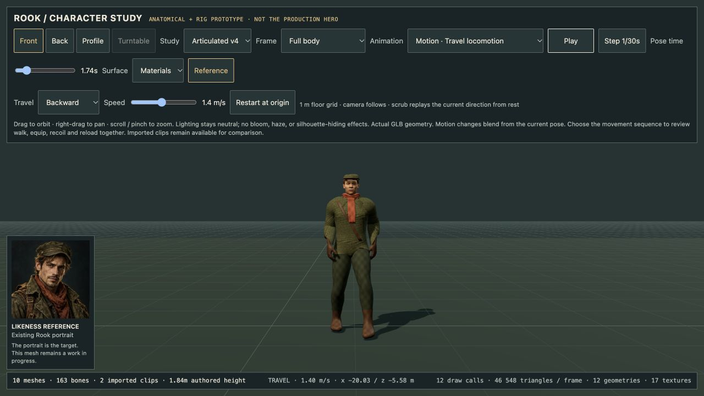
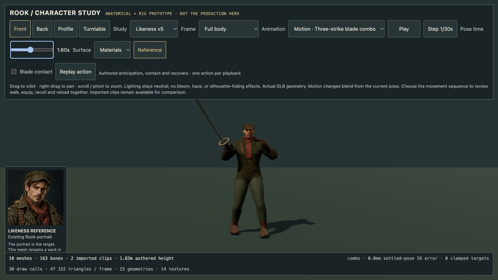
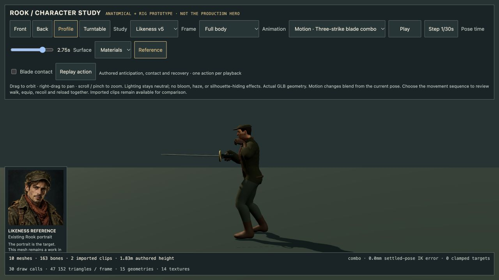
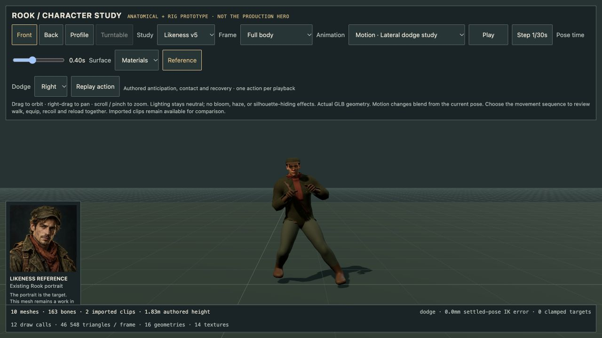

# Rook motion and contact checkpoint

14 October 2026. Development viewer only; public game and Mac remain 4.48.1.
The v4 GLB is unchanged. This checkpoint improves its runtime motion studies,
not its face, textures or production integration.

## Contact and gait

The rifle now uses actual mesh landmarks for pistol grip, fore-end underside
and butt plate, replacing coarse wrist targets. Palm frames come from the
loaded hand skeleton; thumb joints oppose toward the grip. The butt seats
at the inside-front shoulder pocket. Reload carries its magazine using the
measured palm point. Tests independently check palm/thumb/stock landmarks;
this is not general finger/weapon collision detection.

Walking has heel strike, toe-off and toe-bone flexion. Two bounded IK corrections
use the minimum height of the actual deformed boot vertices, instead of an
ankle-only plane. Tests check heel/toe behavior and sole support/clearance to
within 1 mm for sampled settled poses. The skin sampling also refreshes Three.js
inverse bind transforms when the model is moved. All six motion modes retain
local pose under translated/yaw-rotated placement.

## Transitions and review tools

`dev/RookMotionController.js` blends positions/scales and bone quaternions over
0.32 seconds. Interruptions start from the displayed pose and weapon state.
The weapon follows the blended firing wrist; equip visibility fades near the
settled grip instead of showing the gun floating through the transition.
Review-owned material clones prevent fades from changing shared game materials.

The 9.84-second combat sequence covers walk, rifle, recoil, reload and ready.
Playback splits exactly at sequence boundaries, clamps at its endpoint and
can be replayed. The viewer exposes upper-body/grip framing, settled-pose
scrubbing and actual frame stepping (including the transition). Paused
turntable/root placement refreshes attachments without advancing animation.
Imported GLB clips and bind-pose inspection remain available.

## Evidence

**24 art tests pass**: 7 structural validator, 4 seam-regression, 6 motion/contact
and 7 controller tests. The controller tests cover interruption continuity,
30/120 Hz equivalence, real skinned vertices through equip/reload/unequip,
paused placement, deterministic seek, complete bind restoration/disposal,
endpoint clamping and invalid input. Node image decoding remains stubbed;
actual textures are reviewed separately in the browser.

Browser checks: close oblique and profile rifle views, walk heel/toe pose,
reload magazine support, automatic sequence completion at 9.84 seconds,
replay, pause and transition frame stepping. Console warnings/errors were
empty. Production build passed with its existing large-chunk advisory; no
production character path or downloaded game content changes in this pass.
The 559-gameplay-test result belongs to the preceding checkpoint and is not
presented as a fresh hardware or playthrough result here.


Reproduce:

```sh
node --test scripts/art/validate-rook.test.mjs scripts/art/rook-rig-audit.test.mjs scripts/art/rook-motion-study.test.mjs scripts/art/rook-motion-controller.test.mjs
npm run build
npm run dev
```

Open `/dev/character-art-qa.html`, select **Combat motion sequence** and press
Play. Use **Upper body / grip** for hand and weapon review. Scrubbing chooses
a settled sample; Step advances the actual transition by 1/30 second.

## Remaining gates

The face still reads as a generic anatomical base; cap/hair, jacket construction,
cloth material scale and weathering do not yet match the portrait. The gun is
the current procedural game asset. Fingers are landmark-constrained, without
full surface collision. Motion remains in place: actual travel speed, starts,
stops, strafing, turn-in-place, terrain and crossfade foot locking are unfinished.
Equip fading is a review aid, not an authored holster/draw animation. Melee
attacks, dodges, aim layers, LOD, equipment/customization, FPS hands and the
production adapter remain open. No physical controller/phone or new Mac
hardware test is claimed.

## Travel-space locomotion follow-up

The development viewer now moves the model through space at 0–3 m/s, rather
than showing only an in-place walk. It exposes forward/backward/left/right
commands, acceleration, stopping and a metre grid with a following camera.
Planted feet retain travel-space anchors; swing feet anticipate the requested
velocity. Actual deformed boot vertices correct sole clearance. Stop settles
the feet while idle breathing continues. The external placement is applied
once; a regression checks world-space feet after moving the viewer parent.

**29 art tests pass** across the structural, rig, motion, controller and new
locomotion checks. The five new checks cover acceleration, stop, directions,
0–3 m/s, frame-rate equivalence, actual v4 boot support and placement. Sampled
settled foot support is within 1 mm and planted ankle targets within 2 mm in
these tests; this is not a claim of perfect animation in every situation.

Browser review exercised all four directions, stopping, following-camera travel
and model rendering. Backward gait and settled stop were inspected; console
errors were empty. The viewer preserves the coal/bone/rust inspection palette,
44 px controls and a conditional travel row, with no decorative motion. Internal
UI review: slop 1/10, distinctiveness 6/10; useful future improvements are a
foot-contact overlay, compact timeline event marks and a collapsible control
strip for larger close-ups.



Seeking reconstructs the currently selected velocity from rest, not a recording
of previous direction changes. This remains flat-ground development motion:
fast strafing uses crossing steps, with no finished sprint, terrain adaptation,
turn-in-place, melee/dodge animation or gameplay adapter. Likeness and garments
remain unfinished. The production game still uses its existing stylized hero.

## V5 material and three-strike study — 14 October 2026

The development viewer now loads the separately preserved v5 candidate by default
and can still compare v1–v4. See [the candidate review](ROOK-V5-CANDIDATE.md):
cloth scale, cap silhouette and material colour improved, but the face and garment
construction are still visibly short of the portrait. This is not a production
hero replacement.

New authored studies include a diagonal slash, rising reverse cut, finishing
thrust, a 3.5-second three-strike sequence and a lateral dodge in either direction.
Each attack has anticipation, contact and recovery; an optional contact reaction
adds bounded recoil. Rifle/blade switches fade completely out before the mesh and
scale change. One-shot playback stops, scrubs and replays without automatic loops.
The viewer shows only the controls relevant to the selected action.

Validation: **43 art tests pass** (including v4 motion and v5 asset preservation);
all **28 motion tests also pass against the actual v5 geometry**. These inspect
real skinned positions, bind matrices, grip targets, forearm clearance and planted
feet; image decoding is replaced in Node, so this does not substitute for visual
review. Production build passes. Browser review checked the face, reverse cut,
thrust profile and both dodge directions. A transient hot-reload syntax error
during implementation was corrected before the final pose review and tests.





These are authored flat-ground review motions. Runtime attack timing, collision,
aiming layers, terrain adaptation, production equipment, LODs and a full animation
library remain open. The dodge travel resets when leaving its development study;
it is not yet connected to the production character's world movement.
