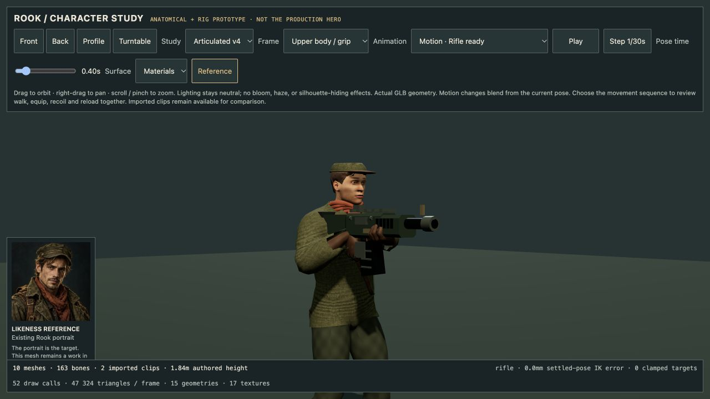
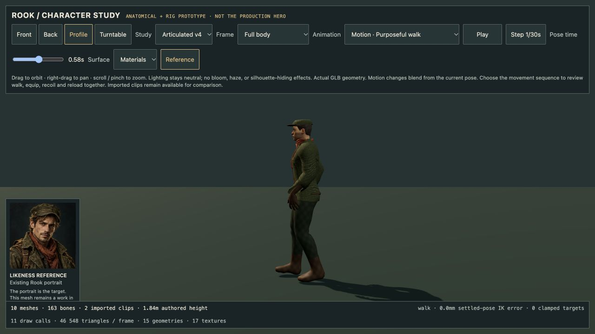

# Rook motion and contact checkpoint

14 October 2026. Development viewer only; public game and Mac remain 4.48.1.
The v4 GLB is unchanged. This checkpoint improves its runtime motion studies,
not its face, textures or production integration.

## Contact and gait

The rifle now uses actual mesh landmarks for pistol grip, fore-end underside
and butt plate, replacing coarse wrist targets. Palm frames come from the
loaded hand skeleton; thumb joints oppose toward the grip. The butt seats
at the inside-front shoulder pocket. Reload carries its magazine using the
measured palm point. Tests independently check palm/thumb/stock landmarks;
this is not general finger/weapon collision detection.

Walking has heel strike, toe-off and toe-bone flexion. Two bounded IK corrections
use the minimum height of the actual deformed boot vertices, instead of an
ankle-only plane. Tests check heel/toe behavior and sole support/clearance to
within 1 mm for sampled settled poses. The skin sampling also refreshes Three.js
inverse bind transforms when the model is moved. All six motion modes retain
local pose under translated/yaw-rotated placement.

## Transitions and review tools

`dev/RookMotionController.js` blends positions/scales and bone quaternions over
0.32 seconds. Interruptions start from the displayed pose and weapon state.
The weapon follows the blended firing wrist; equip visibility fades near the
settled grip instead of showing the gun floating through the transition.
Review-owned material clones prevent fades from changing shared game materials.

The 9.84-second combat sequence covers walk, rifle, recoil, reload and ready.
Playback splits exactly at sequence boundaries, clamps at its endpoint and
can be replayed. The viewer exposes upper-body/grip framing, settled-pose
scrubbing and actual frame stepping (including the transition). Paused
turntable/root placement refreshes attachments without advancing animation.
Imported GLB clips and bind-pose inspection remain available.

## Evidence

**24 art tests pass**: 7 structural validator, 4 seam-regression, 6 motion/contact
and 7 controller tests. The controller tests cover interruption continuity,
30/120 Hz equivalence, real skinned vertices through equip/reload/unequip,
paused placement, deterministic seek, complete bind restoration/disposal,
endpoint clamping and invalid input. Node image decoding remains stubbed;
actual textures are reviewed separately in the browser.

Browser checks: close oblique and profile rifle views, walk heel/toe pose,
reload magazine support, automatic sequence completion at 9.84 seconds,
replay, pause and transition frame stepping. Console warnings/errors were
empty. Production build passed with its existing large-chunk advisory; no
production character path or downloaded game content changes in this pass.
The 559-gameplay-test result belongs to the preceding checkpoint and is not
presented as a fresh hardware or playthrough result here.




Reproduce:

```sh
node --test scripts/art/validate-rook.test.mjs scripts/art/rook-rig-audit.test.mjs scripts/art/rook-motion-study.test.mjs scripts/art/rook-motion-controller.test.mjs
npm run build
npm run dev
```

Open `/dev/character-art-qa.html`, select **Combat motion sequence** and press
Play. Use **Upper body / grip** for hand and weapon review. Scrubbing chooses
a settled sample; Step advances the actual transition by 1/30 second.

## Remaining gates

The face still reads as a generic anatomical base; cap/hair, jacket construction,
cloth material scale and weathering do not yet match the portrait. The gun is
the current procedural game asset. Fingers are landmark-constrained, without
full surface collision. Motion remains in place: actual travel speed, starts,
stops, strafing, turn-in-place, terrain and crossfade foot locking are unfinished.
Equip fading is a review aid, not an authored holster/draw animation. Melee
attacks, dodges, aim layers, LOD, equipment/customization, FPS hands and the
production adapter remain open. No physical controller/phone or new Mac
hardware test is claimed.
