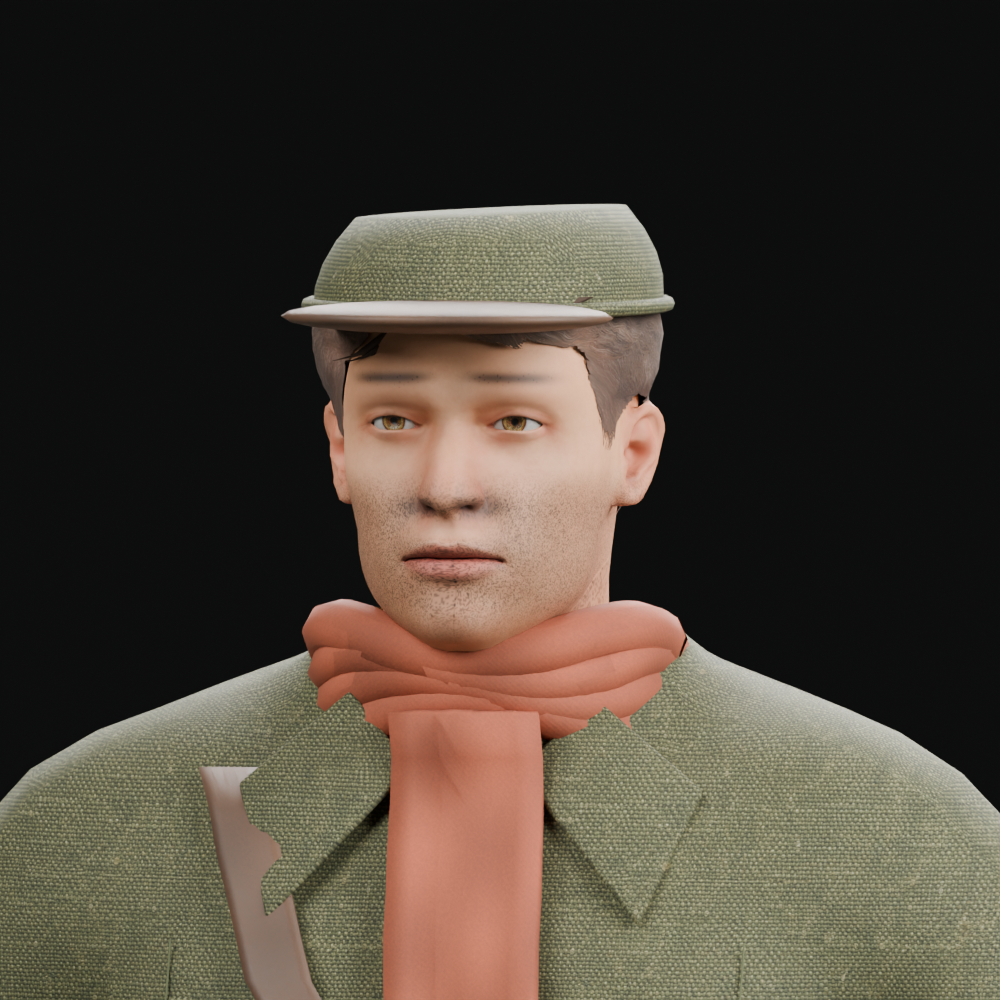
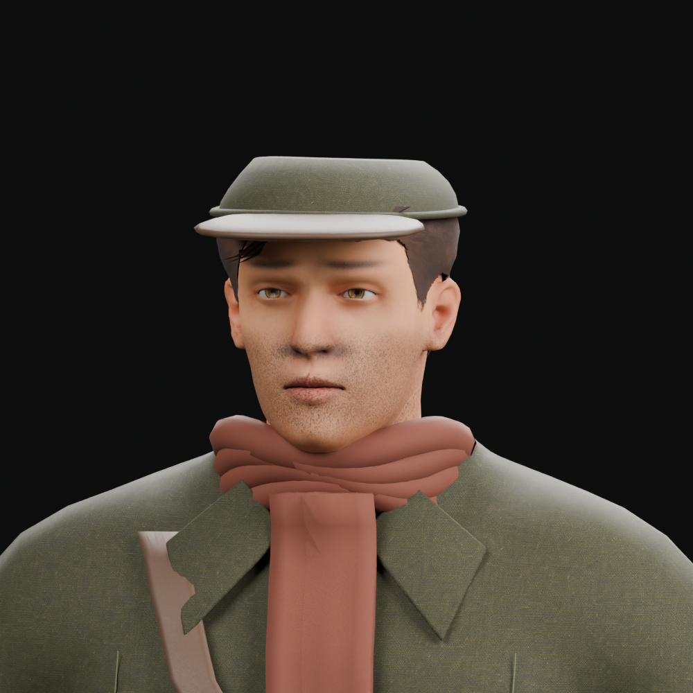
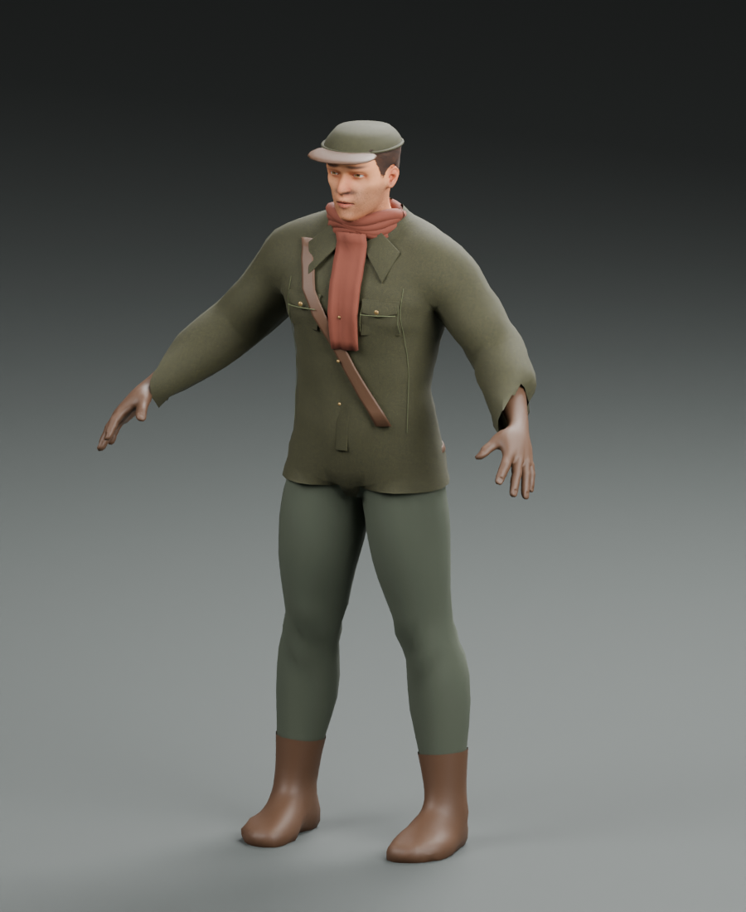

# Rook v5 — bounded material and silhouette candidate

14 October 2026. Development-only candidate derived from the preserved v4
Blender source. This remains visibly short of the portrait-likeness and final
garment-construction gate. It does not replace the production hero.

## Retained changes

- Narrower lower-face planes, more defined cheek/nose/brow geometry and a small
  chin adjustment. The eye registration, facial skeleton and existing UVs remain.
- A lower, tapered patrol-cap crown, a tipped brim and slightly longer swept
  locks. The silhouette remains simplified compared with the portrait.
- Finer canvas weave through metric UV scale, lower normal-map intensity and
  portable olive/skin/hair tint factors.
- Removed the visibly repeating checker-like albedo on trousers, scarf and
  leather; retained their existing normal/roughness maps and distinct pigments.
  This avoids patterned noise but leaves these surfaces in need of authored
  wear and garment-specific maps.
- Original v4 scarf geometry, skeleton, skin weights, material batches and
  exported clips are preserved. No extra mesh detail or raster assets were added.

The original portrait is still the likeness authority. Neutral renders below
are actual Blender outputs using the candidate geometry/materials; they do not
prove browser rendering, production integration or final art approval.

| v4 reference | v5 candidate |
| --- | --- |
|  |  |



## Source, reproducibility and preservation

The standalone [refinement script](../../scripts/art/refine_rook_v5.py) loads
`assets/source/rook/rook-prototype-v4.blend` and writes separate v5 GLB/source
and render paths. It reuses only the existing CC0 source imagery and original
project canvas texture documented in the [source license record](../../assets/source/rook/README.md).
No new texture pixels are generated or edited. Material tint uses scalar glTF
PBR factors. Blender 5.1 drops its corresponding MixRGB tint during export, so
the script explicitly retains the equivalent factors in the exported JSON;
the mesh/image binary chunk is preserved.

```sh
/Applications/Blender.app/Contents/MacOS/Blender --background --python scripts/art/refine_rook_v5.py
node scripts/art/validate-rook.mjs assets/characters/rook-prototype-v5.glb
node scripts/art/rook-rig-audit.mjs assets/characters/rook-prototype-v5.glb
node --test scripts/art/rook-v5.test.mjs
```

The retained v5 export has **29,518 vertices, 46,546 triangles, 10 meshes and
163 joints**, unchanged from v4. Texture count falls from 15 to 12. File size
is **18,476,536 bytes**, down from 19,597,208 bytes; this is a download change,
not a measured frame-rate improvement.

SHA-256:

- v5 GLB: `abf92e6a9e25b3667e00eb01ad2e279dc2f51429c4786c1e92596a75d4c7b575`
- preserved v4 GLB: `8c704e461e9fa8591bc2e7ff25a3ce8916f6959df88a09ff416f4419fd8e53ef`
- preserved v4 Blender source: `baca07c417dfd8510d71cbb6695b34fa088fa77456d948f2960b5e91324888d9`

## Evidence and remaining limits

Four actual-asset regression tests pass: unchanged v4 hash and topology budget;
unchanged rest bones/inverse bind matrices and every existing skin influence;
unchanged exported animation channels/keys; retained PBR factors and reuse of
the existing raster data. The [structural/deformation report](rook-validation-v5.json)
and [rig report](rook-rig-audit-v5.json) are also retained. Seam attachment drift
is unchanged from corrected v4. Node image decoding is stubbed in these tests;
they cannot judge surface appearance or likeness.

The face remains a generic anatomical base. Brows/hair need a proper character
pass, the cap needs tailored panel construction, and jacket/cuffs/pockets/boots
need stronger garment shapes. The neutral render still shows smooth, simplified
clothing. Inventory/TPS likeness, consistent production lighting, LOD, saved
equipment/customization and the runtime adapter remain open. Root-owned browser
inspection and current combat/locomotion regression runs are separate evidence.
