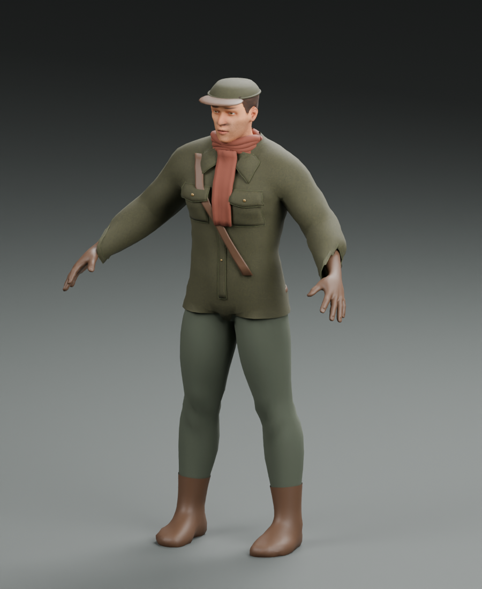
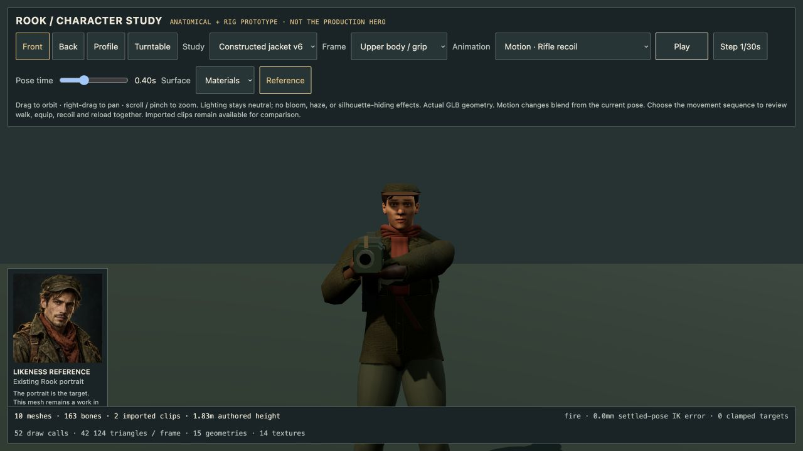
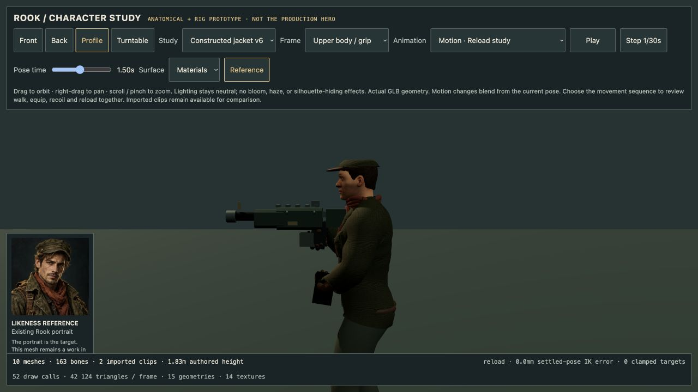
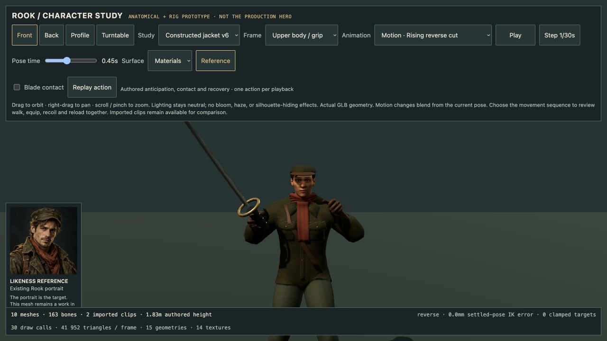

# Rook v6: constructed field-jacket candidate

Development-only candidate, 14 October 2026. This preserves v5 and does not replace the game character or establish portrait likeness.

## Visible change

Seven thin jacket panels were replaced with closed cloth shells: two shaped pocket bodies, lifted pocket flaps, rolled collars and a centre opening/placket. Narrow cuffs follow the source sleeve cut loops. Perimeter stitching follows the new garment surfaces. Existing brass studs were reseated on their panels. The base coat, face, scarf, hair and cap remain the v5 design, apart from a shallow centre-facing recess on the coat.

The heavy eight seam tubes were replaced with smaller four-sided seams, funding the new construction without adding draw calls. This is garment structure rather than added random wear.

## Source and reproduction

- Input: preserved `assets/source/rook/rook-prototype-v5.blend`.
- Construction/export: `scripts/art/refine_rook_v6.py`.
- Optional binding fit: `scripts/art/fit-rook-v6-weights.mjs`.
- Output source/model: `assets/source/rook/rook-prototype-v6.blend` and `assets/characters/rook-prototype-v6.glb`.
- New geometry uses the existing material batches. All embedded raster bytes are reused from v5; existing asset licenses/provenance remain in the source README. No newly generated image is claimed.

The construction script uses only the original coat triangles for its surface projection. Each added vertex records its source triangle and barycentric location in `rook-v6-surface-bindings.json`. Initial skin weights interpolate those source vertices. A nonnegative four-bone fit then minimizes movement away from those same coat supports across nine samples of each of seven existing combat studies. It only changes new garment vertices; it does not modify original coat weights, bones, bind transforms or clips. Fitted weights are stored in `rook-v6-fitted-weights.json` and consumed during the final Blender build.

Normal rebuilds use the committed fitted-weight file. To regenerate the fit after changing geometry: temporarily move that file aside, build the initial GLB, run the fit script, then run the Blender build again. The fit script derives support from the actual exported coat, never from a separate imagined rig.

A browser check exposed inward panel winding that the double-sided Blender preview masked. The final exporter explicitly orients the closed shells outward. The actual GLB normal regression checks all seven outer shell groups against their original coat normals; mean outward dot products are 0.775–0.864, minimum +0.244. Viewer shadow tuning is a separate decision.

## Measured evidence

| Property | v5 | v6 |
| --- | ---: | ---: |
| Exported vertices | 29,518 | 26,350 |
| Triangles | 46,546 | 41,346 |
| Skinned meshes / material batches | 10 / 10 | 10 / 10 |
| Skeleton joints | 163 | 163 |
| GLB bytes | 18,476,536 | 18,280,604 |

Final GLB SHA-256: `9dbab4210b52f36f0d20e37ee13d318160dda42e910ce473b0bbfe17789792e8`.

The attachment audit samples 2,492 new vertices through 120 actual posed frames: rifle, firing, reload, three blade strikes and dodge, plus independent shoulder elevation. It checks the change in distance to the original barycentric coat support, not proximity to an arbitrary nearest vertex. Intermediate samples between fitting keys and the shoulder-elevation sample are not fitting inputs. The independent raise brings both wrists above 1.54 m and measures a worst attachment-distance change of 3.279 mm.

- Overall mean attachment-distance change: 0.171 mm.
- Maximum pocket-body change: 1.202 mm; flap change: 3.023 mm.
- Maximum collar change: 3.465 mm, reduced from 20.114 mm before fitting.
- Centre placket maximum: 0.390 mm.
- Cuff maximum: 7.452 mm; mean per cuff below 0.75 mm. This remains the largest local deformation limitation.
- Rest rig, inverse bind matrices, retained non-garment weights, animation channels/keys and embedded image data pass preservation checks.
- Deliberately replacing seams with the old rigid spine binding exceeds 30 mm and is rejected by the regression.

Commands/evidence: `scripts/art/rook-v6.test.mjs`, `rook-v6-garment-audit.mjs`, `docs/art-direction/rook-garment-audit-v6.json` and `rook-validation-v6.json`. Node geometry tests use placeholder images and make no raster-decoding claim. Blender renders and browser material review supply separate visual evidence.

## Remaining art gates

- This improves the coat's construction, but the face is still generic compared with the portrait; likeness is not complete.
- The existing diagonal leather strap still ends without convincing shoulder/waist attachments. It was outside this bounded garment pass and remains an explicit issue.
- The existing scarf remains bulky, and the silhouette/cloth folds still need authored art review.
- Binding is fitted skinning, not cloth physics. Measured distance changes do not establish collision-free fabric, prevent self-intersection or validate arbitrary future motions. New poses must be checked again.
- Cuff extremes need further review if visible at gameplay camera distance. No production character swap or art-quality approval is implied by passing numeric tests.

## Browser acceptance of this bounded candidate

Root reviewed the corrected export in the actual Three.js viewer: neutral/front,
rifle recoil, reload profile and rising blade cut. Pockets/collars now render as
outward cloth surfaces, without the black-panel regression. Rifle and magazine
grips remain aligned during these sampled poses. This accepts the incremental
jacket construction only; it does not close the remaining art gates above.

The neutral viewer uses a 2048-pixel shadow map with a 2 mm normal offset rather
than the earlier 15 mm offset, so nearby garment layers are not obscured by an
oversized shadow displacement. This is development-viewer tuning, not a claimed
production performance or lighting change. The mesh winding correction remains
necessary independently of the shadow settings.

Final model: 28 motion tests and 5 v6 preservation/attachment tests pass after
re-export. These supplement the previously passed v4/v5 validation suites.
