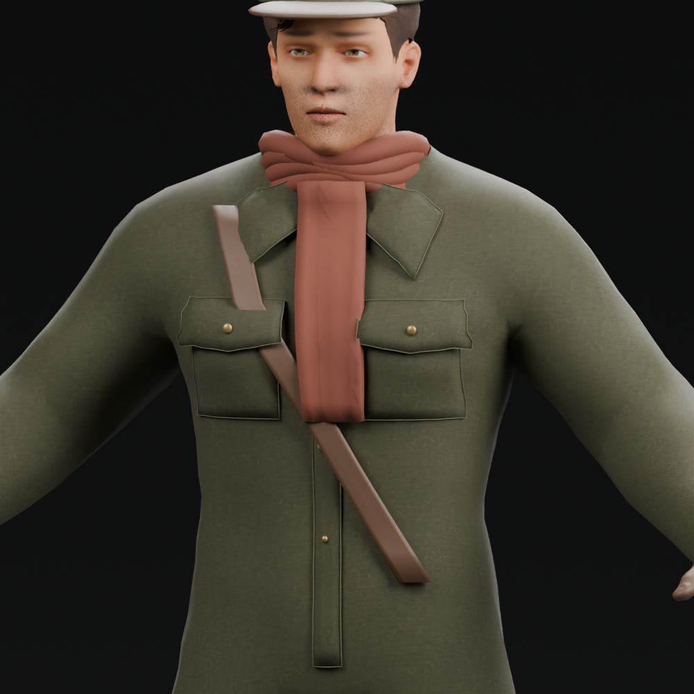
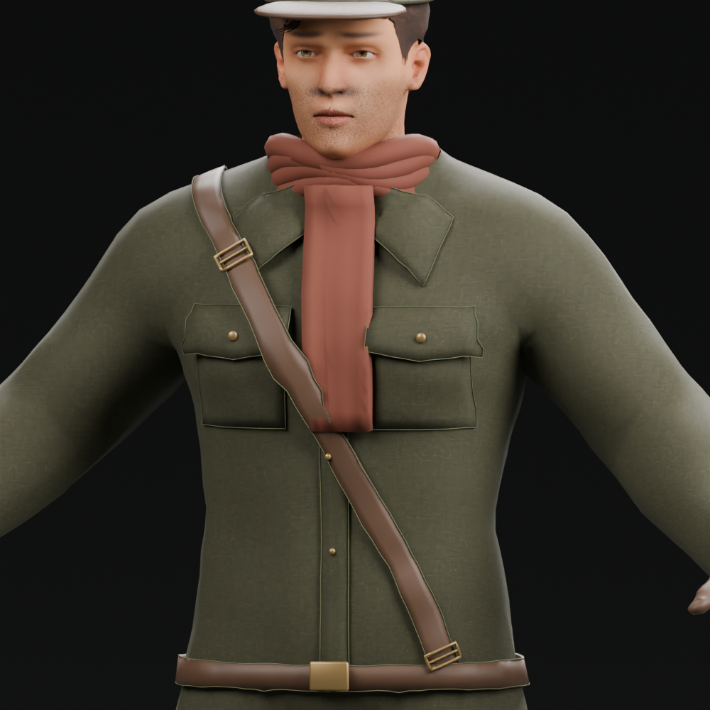
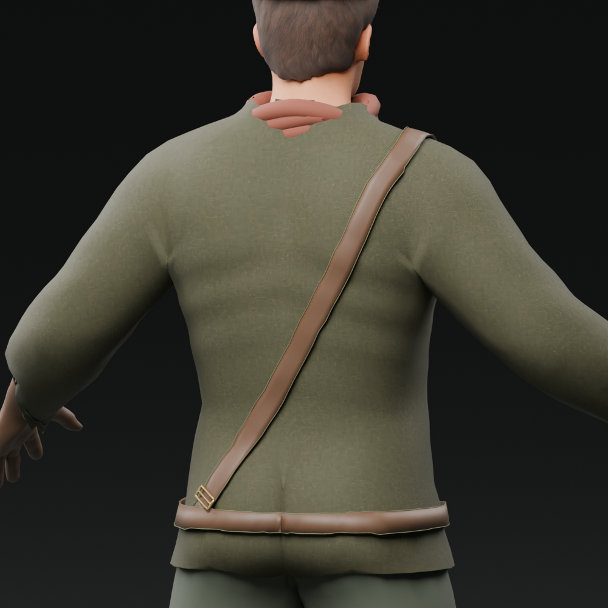
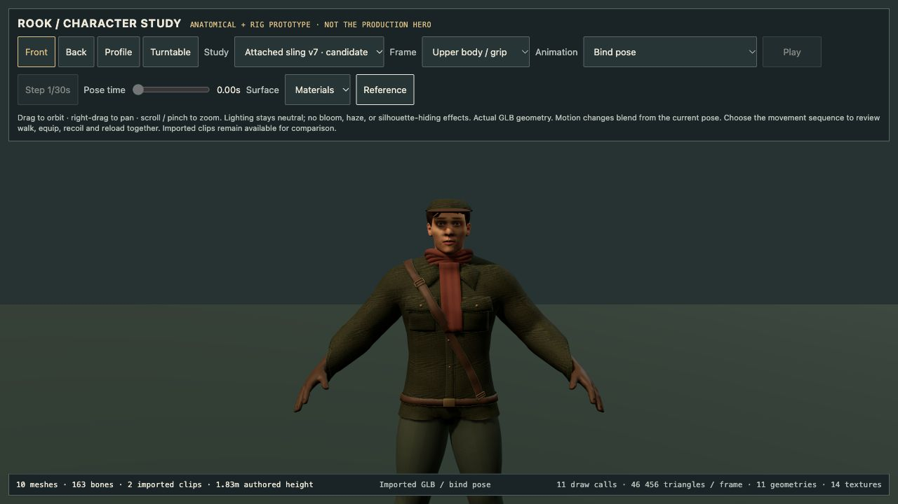
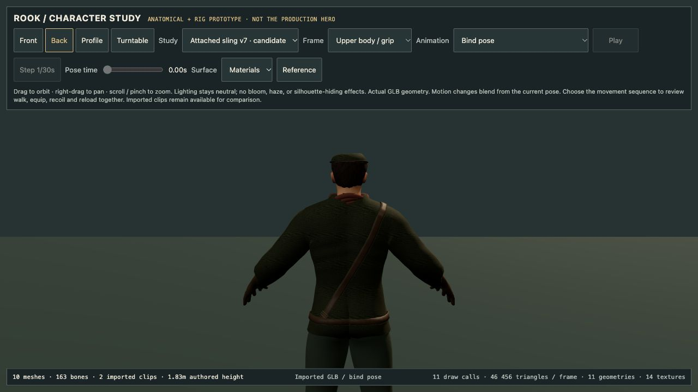
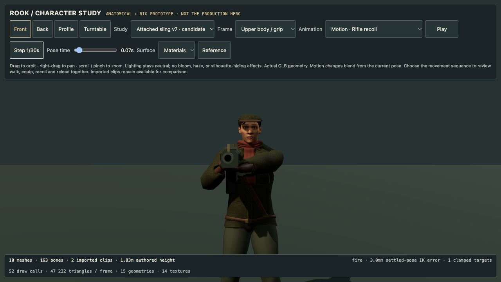
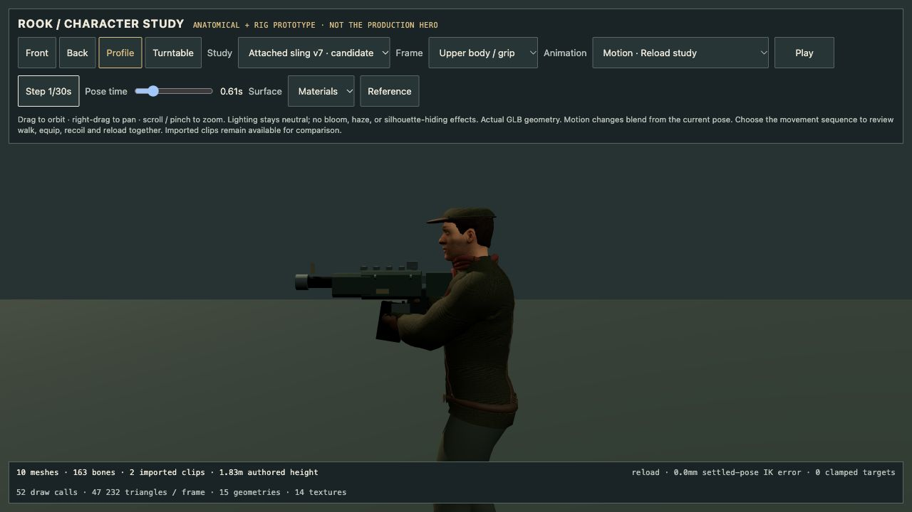
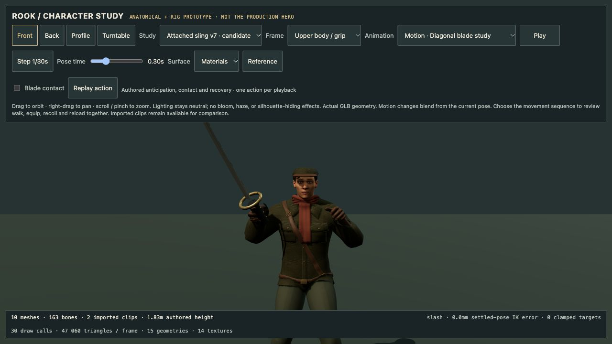

# Rook v7: continuous leather sling candidate

Development-only candidate, 15 October 2026. V6 is preserved, remains the default development viewer model, and this does not replace the production hero or establish portrait likeness.

## Bounded visual change

The earlier diagonal strap ended on the chest and above a largely buried belt. V7 replaces it with one 33 mm leather sling that continues over the shoulder and down the back to front/rear belt keepers. A brass adjustment frame, two keeper frames and thin edge stitches give the construction visible attachment details. A thin fitted waist band replaces the two old round belt halves, and the original buckle sits on that band.

The front sling smoothly bridges the pocket flap. Directed front/back surface rays keep the authored path from wobbling as nearest-point projection did in the first iteration. Above the chest, projection rays rotate continuously around the shoulder; an earlier abrupt ray/nearest-point switch produced a visible kink and was rejected. Radial rays fit the belt around the actual coat. These remain skinned mesh surfaces, not simulated cloth.

## Reproduce and verify

- Input: `assets/source/rook/rook-prototype-v6.blend`.
- Builder: `scripts/art/refine_rook_v7.py`.
- Candidate: `assets/source/rook/rook-prototype-v7.blend` and `assets/characters/rook-prototype-v7.glb`.
- Source coat support: `assets/source/rook/rook-v7-surface-bindings.json`.
- Optional skin fit: `scripts/art/fit-rook-v7-weights.mjs`; stored in `rook-v7-fitted-weights.json`.
- Deformation audit: `scripts/art/rook-v7-sling-audit.mjs`.
- Preservation/regression tests: `node --test scripts/art/rook-v7.test.mjs`.

The builder keeps the existing ten material batches and reuses all raster bytes and material factors. No new generated raster is claimed. It stores each new vertex's original coat triangle and barycentric support. The fit minimizes attachment drift in the same seven existing motion studies as v6. The separate audit includes intermediate times and an independent shoulder elevation not used for fitting. Negative-control rigid seam weights must fail the regression.

Normal builds consume the committed fit. After altering geometry, build once, regenerate the fit, then rebuild. `-- --no-render` skips previews. The Blender source is saved with the preserved rig, original animation data and new geometry; all front/back preview images use the same lighting as v6.

## Measured evidence

| Property | v6 | v7 |
| --- | ---: | ---: |
| Exported vertices | 26,350 | 28,492 |
| Triangles | 41,346 | 46,454 |
| Skinned meshes / material batches | 10 / 10 | 10 / 10 |
| Skeleton joints | 163 | 163 |
| GLB bytes | 18,280,604 | 18,422,648 |

Final candidate SHA-256: `18526face762ce7f5b534ecca39291cbfad76a4f06d4f98faed222707e5181e5`.

The 120-frame audit covers 3,566 new vertices across rifle, fire, reload, three blade strikes, dodge and an independent shoulder raise. Maximum attachment-distance change is **5.172 mm**, at the front belt keeper; overall mean is **0.204 mm**. The continuous leather sling itself stays within **3.776 mm**. Full results are in `rook-sling-audit-v7.json`; structure/deformation validation is in `rook-validation-v7.json`.

The five candidate tests check the byte-identical v6 source GLB; unchanged rig, bind matrices and retained garment/body attributes; identical exported animation channels/keys; reused embedded raster bytes/material factors; and measured attachment drift, with a deliberately rigid-binding negative control. Node validation uses placeholder textures and does not claim raster decoding. Blender previews and separate actual-browser review cover appearance.

## Remaining gates

- This is an attachment/construction candidate, not character-art completion. Face likeness, scarf bulk, silhouette, fold design and production integration remain open.
- Distance-to-support measurements do not establish collision-free cloth or validate future animations. Surface layers can still intersect during untested combinations, and the large scarf needs its own review.
- Leather material response is inherited from v6; texture fidelity and wear are not newly authored here.
- No physical hardware, production performance or in-game character replacement is claimed.

The final candidate also passes all **28 existing motion tests** with
`ROOK_TEST_MODEL=assets/characters/rook-prototype-v7.glb`, covering motion study,
controller, locomotion and combat tests. These are real-skeleton/geometry tests
with placeholder raster loading, independent of the five v7-specific tests.
Front and rear Blender renders were inspected after the continuous-shoulder
correction; the earlier projection kink is absent in both final views.

## Actual browser review

The final checksum above was reviewed in the local Three.js viewer, with reference art hidden. Front/back bind poses show a continuous shoulder return and visible waist attachment. Sampled rifle recoil (0.07 s), reload (0.61 s, profile) and diagonal blade (0.30 s) show the sling following the torso without the rejected shoulder kink or a detached belt end. No browser errors were reported. This bounded review does not certify every pose or garment collision.

Bind pose reports 11 draw calls / 46,456 triangles including the floor; the character itself remains 10 batches / 46,454 triangles. Weapon-study props add calls and geometry, so these viewer counts are not production performance measurements.

Accepted for continued development review only. V6 remains the viewer default. Face likeness, scarf/fold art, equipment variants, LODs and production animation adapters remain open.
