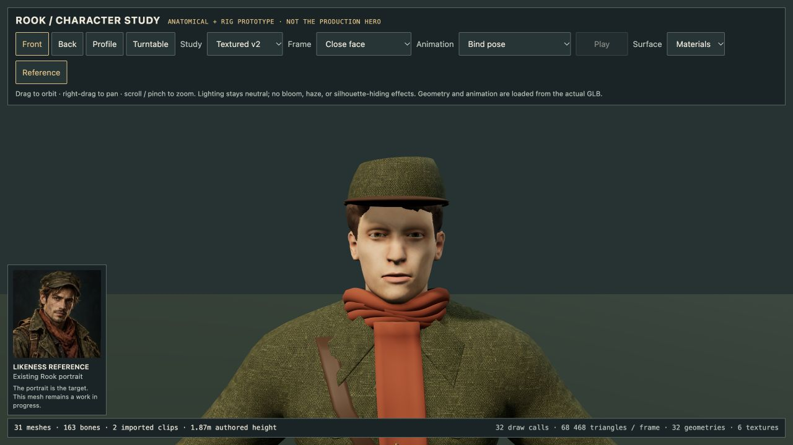
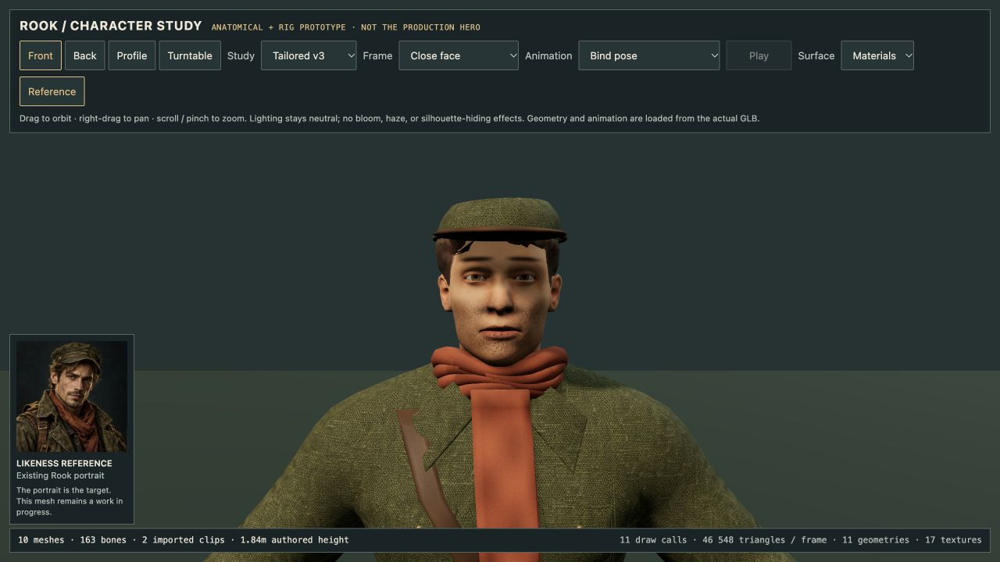

# Rook prototype validator evidence

Checked 2026-10-14T14:36:17+00:00. Development art checks only; no production character replacement or hardware performance claim.

## Results

| Asset | Meshes / all skinned | Vertices | Triangles | Joints | Embedded textures | Result |
| --- | ---: | ---: | ---: | ---: | ---: | --- |
| v1 | 50 | 38842 | 69242 | 163 | 0 | Passed |
| v2 | 31 | 39599 | 68466 | 163 | 4 | Passed |

v2 SHA-256: `3ddd62b57f190b264ca841da0c6a434503ea86e7d4dc7c52e4d07c4feb3dada4`. Its 13 textured primitives have complete UV accessor coverage (24618 vertices). Embedded images are PNG at 1254×1254, 1024×1024 and two at 2048×2048. Full machine-readable reports: [v1](rook-validation-v1.json), [v2](rook-validation-v2.json).

## What the check establishes

The validator checks binary bounds, typed accessors, indexed triangles, node hierarchy, all-skinned meshes, skin joint references and normalized weights. Mesh counts can change within an explicit 1–256 bound; the art budget caps 300,000 vertices and 500,000 triangles. Texture/material/image references, embedded image containers, PNG chunk CRCs, image dimensions and per-material UV accessor coverage are checked. UVs must have nonzero extent; this does not prove good unwrap packing or lack of seams.

Actual Three.js GLTFLoader builds the scene, materials, bones and animation clips. AnimationMixer samples both clips at nine points; CPU-skinned bounds and vertex movement must remain finite, human-scale and bounded. Both clips must deform sampled vertices, so static clips cannot pass by merely existing. v2 breathing moves sampled vertices by up to 0.004915 m; its walk study by 0.300984 m. These measurements establish deformation, not animation quality.

**Node image loading is deliberately stubbed with 1×1 placeholders. Raster decoding, texture appearance, UV seams, lighting quality, facial likeness and GPU rendering are not validated by this script.** Material texture slots are still checked after actual GLTFLoader material construction. Root's real browser texture review is separate evidence. JSON reports explicitly record `rasterDecodeValidated: false` and the image-loading mode.

## Regression tests

`node --test scripts/art/validate-rook.test.mjs`: **7/7 passed**. The developer suite remains outside production gameplay tests. It covers original v1 deformation; a textured embedded GLB and real loader with disclosed placeholders; invalid image signature/view/external URI/CRC; missing image/texture/material references; missing/collapsed UVs; invalid triangle indices/types; absent/invalid skins and joint indices; and valid changed mesh counts. Test fixture files are temporary and removed after use.

Commands to reproduce:

```sh
node scripts/art/validate-rook.mjs assets/characters/rook-prototype-v1.glb
node scripts/art/validate-rook.mjs assets/characters/rook-prototype-v2.glb
node --test scripts/art/validate-rook.test.mjs
```

The validator deliberately rejects unsupported compressed image extensions and unsupported material texture slots rather than silently claiming coverage. Any subsequent model rebuild requires a fresh report and browser review.

## Actual browser review

The development viewer loaded the retained v2 GLB through browser GLTFLoader.
Close face, full front/back and both imported clips were inspected. Four model
textures rendered (six renderer textures including shadow resources); the scene
reported 32 draw calls and 68,468 triangles including the floor. Browser console
errors/warnings were empty. This is not an FPS benchmark or production gameplay
integration check. The eye opacity and scarf intersections found in the first
render were corrected before retaining this asset.



Facial likeness, detailed tailoring, complete material maps and natural combat
animation still fail the production art gate. The preview deliberately makes
that gap visible rather than using cinematic lighting to conceal it.

## Development v3 — 14 October 2026

V3 passes the same structural, UV/material and actual Three.js deformation
validator: **10 skinned meshes, 29,518 vertices, 46,546
triangles, 163 joints, 15 embedded textures, two deformation studies**. Report:
[rook-validation-v3.json](rook-validation-v3.json). SHA-256:
`f695e7e9cdea6f936e70357c88e180f297fafc55646c79dc10ec91fba6fd8ad1`. The validator regression suite remains **7/7 passing**.

V2 remains intact. V3 reduces triangle count by 32% and batches matching
materials from 31 meshes to 10. More material maps increase the self-contained
GLB from approximately 14 MB to 19.6 MB (decimal); this is not a mobile-optimized
asset or a measured frame-time improvement.

Browser GLTFLoader review confirmed the actual mapped v3 export, front/face,
full body, rear and profile views, and both breathing/walk clip playback. The
viewer reports **11 draw calls / 46,548 triangles** including the floor and
**17 renderer textures** including shadow resources. Console warnings/errors
were empty. This is the neutral development viewer, not main-game QA.



The retained build corrects scalp-through-cap clipping found in the first
render and dark exported albedo found in browser review. Pigment stubble,
stronger brows, tapered swept locks, a lower cap and fine normal/roughness maps
are visible changes. Likeness is still approximate: the face and hair require
further artistic work, garment construction remains basic, and the existing
A-pose walk is not a production locomotion clip. The new maps are generated
tileable surface studies, **not sculpt-baked garment atlases**. Hidden body
and scalp geometry were removed for this fixed outfit; do not reuse it as an
undressed customization base. No gameplay replacement or hardware-performance
claim is made.

Reproduce: `node scripts/art/validate-rook.mjs assets/characters/rook-prototype-v3.glb`.
