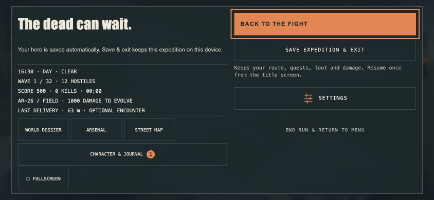

# 4.52.0 QA — resumable expeditions

15 October 2026.

## Browser and simulation

- Full gameplay suite: 655/655 passed before the final deletion/readback regression.
- Final checkpoint/UI subset: 21/21 passed, including the additional deletion/readback edge (656 total tests now present).
- Real browser, isolated origin `127.0.0.1:3015`, ordinary persistent storage (no ephemeral QA flag): start → pause → save/exit → page reload → title Resume → paused restore → resume combat → clear wave one → choose upgrade → save wave two → cancel replacement → restore wave two. Score 1,825, kills 12, elapsed 00:23 and weapon mastery 280 damage remaining matched after restoration. No captured console errors.
- Restored city rendered and combat progressed normally. Codec tests additionally cover both current and parked regional state, exact RNG continuation, unsafe-save rejection, corrupt/oversized data, storage failures, stale heroes and competing tabs.
- 844×390 landscape review caught pause actions below the fold; compact two-column pause now exposes Resume and Save immediately. This is desktop viewport evidence, not physical multitouch evidence.
- Production build passed, visible version gate reports 4.52.0.

## Android physical device

OnePlus 7 Pro GM1913, Android 11, WebView 150.0.7871.46. User unlocked it for this test. Installed local 4.51.2 debug build first, then a separately named native focus-guard QA variant using the same bundled 4.51.2 web assets and signing key.

- Actual menu, rendered city, enemies, automatic combat, wave-one upgrade cards and street atlas observed. GPU log reports Qualcomm Adreno 640 and WebGL 2.0.
- Repeated **Dolby Atmos keeps stopping** system dialogs own input focus (`Application Error: com.oneplus.sound.tuner`). These are not game crash reports. No Dolby settings, disabling or uninstall performed. A permission request to temporarily stop that app is pending.
- Found that a system overlay can take focus without Activity pause. Added native window-focus events to pause combat/audio and clear input. Native variant builds and installs; an interrupted run remains paused at health 106, one enemy and unchanged position. However this was also opened in the atlas, so it does not by itself isolate the focus guard. A clean overlay-only acceptance test remains open.
- App background/foreground returns to the paused atlas, but recurring dialogs prevent reliable input follow-through.
- Interrupted baseline playing samples: 23 one-second samples, median 16 FPS, range 9–43, at most seven enemies. This is a warning to investigate, **not a clean benchmark**. Menu/paused caps must not be mistaken for combat FPS. No performance improvement is claimed.
- Manual multitouch, audio audibility, native file pickers, sustained thermals and clean graphics comparisons remain unverified.

## Limits

Explicit safe-point saving only, one device-local checkpoint, no automatic crash recovery or expedition export/cloud sync. Character backup format unchanged. New destinations, indoor combat, hangar/space and full-run/endurance acceptance remain outstanding.
