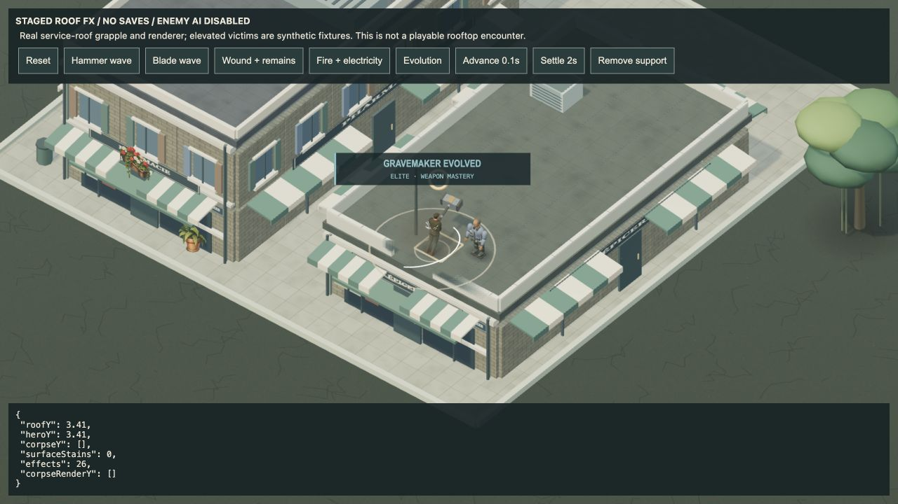
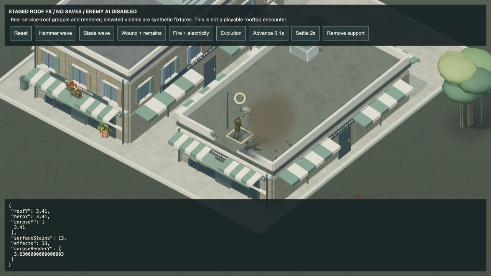
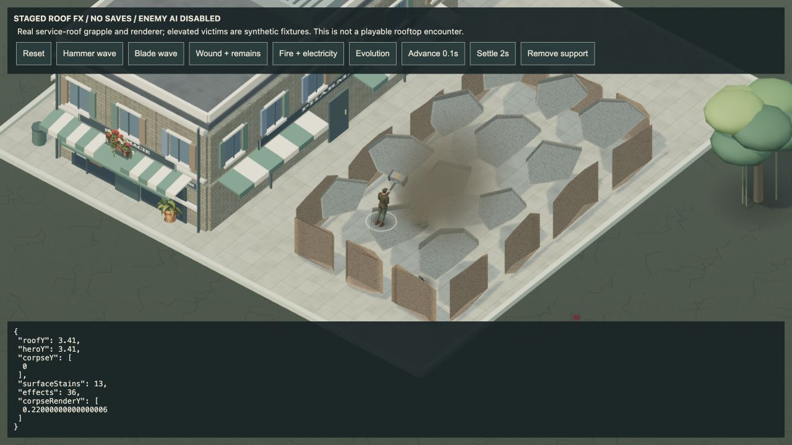
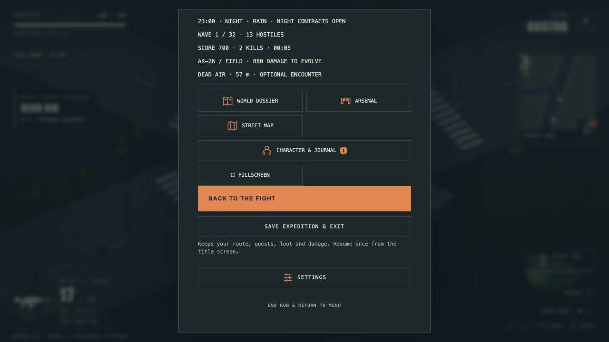

# 4.52.1 QA — elevated combat effects and weather resume

15 October 2026.

## Automated checks

- Final full suite: **679/679** passed locally.
- Checkpoint audit: **64/64** city/campaign continuations (waves 1–32, real upgrade selection, resumed-state continuation) passed.
- Build and visible release-version check passed for **4.52.1**.
- Height regression coverage includes real campaign service-roof grapple, actor event contracts, nova/thermal blast floor separation, molotov ignition, signature fire suppression above street level, roof fragment landing/edge exit, remains losing support, real triangle-projected stains and distant-root culling.

## Browser evidence

Local isolated origin `127.0.0.1:3015`; no player production saves touched.

- `dev/elevation-qa.html`: real service-roof approach and grapple reach y=3.41. Deliberately staged stationary elevated victim, with enemy AI disabled. Actual World renderer: hammer/sword waves and evolution at roof height; fire/electricity at the victim; blood and remains rest on roof. Settled corpse base=3.41, mesh=3.63. On injected support destruction, base falls to 0 and mesh to 0.22. The frozen fixture hero does not simulate a fall; actual player support-loss behavior is covered by service-roof regression tests.
- Pausing during a burning death and rendering another two seconds kept **38 effects**, one surface stain and corpse mesh y=3.435207991998567 unchanged. No accumulated corpse smoke or paused drift observed.
- No captured console errors in the staged page.
- Real menu/game flow: Always night + Rain → enter city → ordinary combat → pause → Save expedition & exit → title settings Always day + Clear skies → Resume expedition → settings show Always night + Rain → change volume → pause ledger remains **23:00 NIGHT RAIN**, score 700, 2 kills, 13 hostiles and weapon mastery 880 damage remaining. No captured console errors.
- Development server retained its earlier 4.52.0 label while code hot-reloaded. Production build version gate separately passed 4.52.1; local screenshots are runtime behavior evidence, not proof of deployed release identity.

## Limits

No sustained FPS comparison, full-expedition endurance or new physical phone/controller acceptance this pass. Cosmetic fragments use bounded existing pools and the live collision index; performance claims require actual device measurement. These checks do not establish finished rooftop enemy AI or a completed game.
